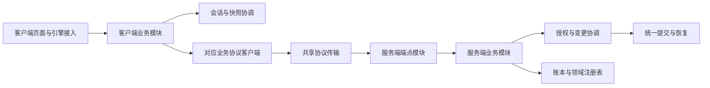

# partial 使用审计与模块拆分计划

目标是让 1.7 的业务模块拥有自己的状态和明确的依赖，逐步解除 `ClashOfRimMod` 与 `ClashOfRimNetworkServer` 的跨文件私有成员耦合。当前 `partial` 拆分主要改善了文件浏览，没有建立模块边界。优先迁移会话、快照变更边界和事件流程，再按业务域完成迁移；保留已经统一的提交、恢复、状态转换和游戏对象流转算法。

审计基线为 `ee55d0b0` 加当时工作区，包括此前未提交的改动。初次审计只增加计划；后续实施状态见文末记录。以下 P2/P3 表示结构改造优先级，不代表新复现的功能故障。1.6 冻结内容不参与改造。

## 使用范围

扫描 `Source/`、`Tools/`、`ThirdPartyCompat/Source/` 的 946 个 C# 文件，排除 `bin/`、`obj/`、冻结版本和独立的 RimTest 子仓库。发现 30 个 partial 类型：生产代码 16 个类型、102 处分片声明、100 个文件；项目测试工具 14 个类型、52 处分片声明、42 个文件。第三方兼容包自身未发现 partial 声明，但依赖主客户端兼容 API。

统计使用 Roslyn 语法树，按命名空间和外层类型识别同名嵌套类型。行数是类型声明范围，包含空行和嵌套类型；嵌套 Fixture 与外层测试类的行数不能相加。字段数包含常量和 readonly 字段，不含属性；readonly 集合的内容仍可变。跨分片引用按可解析的符号统计，是已确认的依赖，不是完整运行时调用图。[完整类型和文件清单](partial-module-inventory-2026-10-17.json)保存本次基线。

| 生产类型 | 分片 | 类型行数 | 字段 | 已确认跨分片访问的字段 | 处理方向 |
| --- | ---: | ---: | ---: | ---: | --- |
| `ClashOfRimMod` | 23 | 21,159 | 122 | 101 | 按会话、快照和业务域分配状态所有权 |
| `ClashOfRimNetworkServer` | 43 | 17,352 | 12 | 4 | 宿主装配、HTTP 端点与业务服务分离 |
| `ClashOfRimMultiplayerWindow` | 2 | 3,994 | 132 | 68 | 按页面拆视图及编辑状态 |
| `ClashOfRimModNetworkClient` | 2 | 3,043 | 86 | 3 | 共享传输层加各域协议客户端 |
| `ClashOfRimCompatibilityApi` | 6 | 2,474 | 52 | 44 | 保留公开门面，注册生命周期与各能力存储分离 |
| `BiotechCompatibility` | 10 | 1,808 | 38 | 17 | 按物品元数据、pawn、远程地图等能力组合 |
| `BankLoanRegistry` | 2 | 983 | 15 | 5 | 保留单一账务写入边界，收回同一类型文件 |
| `ServerShopRegistry` | 2 | 717 | 9 | 5 | 保留库存与幂等记录的共同发布边界 |
| `SnapshotCommitService` | 3 | 683 | 5 | 4 | 日志存储、提交编排和业务应用分离 |
| `MercenaryContractRegistry` | 2 | 579 | 10 | 4 | 保留合同写入边界，收回同一类型文件 |
| `RemoteIdeoMaterializer` | 2 | 574 | 0 | 0 | 文化包加载与目录物化分离 |
| `ItemDeliveryItemSummary` | 1 | 81 | 0 | 0 | 删除无实际分片的 partial 修饰符 |
| `ModThingReferenceDto` | 1 | 78 | 0 | 0 | 同上，保持序列化契约 |
| `ModPawnExchangeAppearanceDto` | 1 | 25 | 0 | 0 | 同上 |
| `ModCrossMapPawnReferenceDto` | 1 | 21 | 0 | 0 | 同上 |
| `ModPawnExchangeIdentityDto` | 1 | 15 | 0 | 0 | 同上 |

服务端主类的字段全部是常量或 readonly 字段，不能据此认为它低耦合：它通过 `ClashOfRimNetworkState` 获取依赖。该状态类有 39 个构造参数、40 个直接声明的属性。网络客户端的 86 个字段中有 79 个 readonly 字段，包含大量路由定义，不能将它们全部视为可变业务状态。

## 主要发现

### A1 P2 客户端会话生命周期拥有各业务模块的内部状态

`ClashOfRimMod` 有 564 个直接声明的方法。`settings` 被 22 个分片访问，`manualSyncInProgress` 被 12 个分片访问，`eventStateLock` 被 11 个分片访问。退出逻辑逐一清除银行、雇佣、商店、世界、事件和聊天字段；其中事件锁还保护玩家列表、地图标记、交易订单和商店列表。新增一个业务状态，往往必须同步修改另一个文件中的退出流程。

依据：[字段集中声明](../Source/Client/Core/ClashOfRimMod.cs#L50)、[退出与跨域清理](../Source/Client/ClientNetwork/Runtime/ClashOfRimMod.SessionRuntime.cs#L330)。这使状态所有权难以检查，也让之前修复的迟到响应和切换会话隔离容易在新增路径中遗漏。

目标：`ClientSessionRuntime` 管理身份、会话代次和连接生命周期；`ClientSnapshotCoordinator` 管理上传事务和未确认本地变更。事件、银行、交易、商店等模块各自持有状态和只读快照。模块只接收会话视图、所需命令及调度入口；不接收整个 Mod、可随意改写的 settings 或全量 ClientRuntime。

复用 `ClientSessionWork` 的取消、发布锁和主线程动作所有权。第一阶段由新会话模块托管这些能力，不为每个业务创建独立会话代次。退出仍先使旧工作失效，再清理模块状态；账户、殖民地和 Game 对象的生命周期分别处理。

### A2 P2 服务端宿主和业务服务合并在一个静态类型

43 个分片共同组成 589 个方法的静态类。`MapEndpoints` 注册路由，`Bootstrap` 装配存储和宿主，其他分片直接执行授权、恢复、业务规则、快照提交、通知及成就登记。新提取的事件读取和银行上下文也仍依赖同一类型中的私有恢复及授权方法。

依据：[路由注册](../Source/Server/ClashOfRim.Network/Server/Core/ClashOfRimNetworkServer.cs#L88)、[宿主装配](../Source/Server/ClashOfRim.Network/Server/Core/ClashOfRimNetworkServer.Bootstrap.cs#L17)、[全量状态依赖](../Source/Server/ClashOfRim.Network/Client/ClashOfRimNetworkState.cs#L9)、[事件读取上下文](../Source/Server/ClashOfRim.Network/Server/Core/ClashOfRimNetworkServer.EventReadContext.cs#L8)。

目标：宿主只装配服务；各域 `Map…Endpoints` 负责 HTTP 绑定和协议响应；业务服务使用构造参数声明所需账本、注册表、授权、提交和通知能力。`ClashOfRimNetworkState` 可暂时保留为宿主与旧测试的装配容器，但新业务模块不得把它作为全量依赖入口。

不能把当前私有方法统一改成 public static 后互相调用。每迁移一个域，旧入口只能单向转发给新服务，新服务不能直接调用旧主类完成业务。基础设施迁移所需的临时适配器单独列名并限定退役阶段，不能成为长期模块接口。

### A3 P2 恢复边界和提交流程的所有权仍跨主类与服务

`EnterRecoveredSnapshotMutation` 掌握准备前授权、锁外恢复准备、重新加锁、授权复验和嵌套锁规则，但它是服务器主类的私有方法。它随后以多项注册表和回调调用 `SnapshotCommitService.Recover`，回调又回到主类中的上传后处理和确认计划。`SnapshotCommitService` 虽然只有 683 行类型代码，却承担日志读写、待办缓存、回执、恢复准备和多种业务提交。

依据：[统一恢复边界](../Source/Server/ClashOfRim.Network/Server/Core/ClashOfRimNetworkServer.SnapshotCommits.cs#L15)、[恢复回调装配](../Source/Server/ClashOfRim.Network/Server/Core/ClashOfRimNetworkServer.SnapshotCommits.cs#L80)、[提交与恢复入口](../Source/Server/ClashOfRim.Network/Server/Services/SnapshotCommitService.cs#L103)。

先把现有变更边界提取为 `SnapshotMutationCoordinator`，保留原控制流程，再逐步让日志存储和业务应用拥有独立职责。提交协调器继续唯一持有 pending/applying 状态；日志存储不另建第二份待办缓存。业务变更优先复用现有 `TradeSnapshotMutation`、`SupportSnapshotMutation`、`PendingSnapshotOperations` 等类型。

当前日志版本 1–12、磁盘目录、恢复顺序、回执优先重放及原子提交必须保持兼容。模块迁移阶段不同时更换日志格式、不拆分全服变更锁、不新增第二套提交模板。已统一的 `PersistNewIntent` 和 `LedgerBatch` 应继续共用。

### A4 P2 网络传输与临时登录生命周期混在协议客户端中

`ClashOfRimModNetworkClient` 的 105 个方法覆盖几乎所有业务。`SetupAuthentication` 分片可直接访问 HTTP 客户端和凭据上下文，并负责创建临时会话及 finally 登出。这种行为属于会话租约的生命周期，不应由各业务客户端分别复制。

依据：[客户端主体](../Source/Client/ClientNetwork/Runtime/ClashOfRimModNetworkClient.cs#L18)、[临时认证生命周期](../Source/Client/ClientNetwork/Runtime/ClashOfRimModNetworkClient.SetupAuthentication.cs#L9)。

目标：共享 `ProtocolTransport` 继续负责实际序列化、请求头、取消、错误映射及 multipart；各域客户端只构造对应请求；`SetupAuthenticationLease` 管理临时登录和所属会话释放。现有客户端可暂时作为转发门面。只读和写入请求都要保留原先的身份、快照绑定及 `ClientSessionWork` 约束。

### A5 P2 多人窗口拥有跨页编辑状态并直接调用整个 Mod

多人窗口合计 132 个字段，管理员分片可访问其中的大量字段，并通过整个 Mod 读取配置、修改业务和控制刷新。窗口关闭、切页、会话切换及异步刷新缺少页面级的状态所有者。

依据：[窗口主体](../Source/Client/Multiplayer/Windows/ClashOfRimMultiplayerWindow.cs#L19)、[管理员页入口](../Source/Client/Multiplayer/Windows/ClashOfRimMultiplayerWindow.Admin.cs#L17)。

目标：窗口保留布局、页签选择和页面对象的生命周期；玩家、事件、交易、银行、商店、管理等页面分别持有自己的筛选、分页和编辑草稿。页面读取业务模块发布的只读状态，调用明确的业务命令。先建立业务模块，再移动页面，避免页面对象只是换个位置继续接收整个 Mod。

### A6 P2 兼容 API 的注册生命周期与各能力集合纠缠

六个分片共享 52 个字段，44 个存在跨分片访问。核心文件维护各类能力集合、优先级、顺序、注册令牌和清理动作，`ClearCompatibilityRegistrations` 明确列出所有能力集合。第三方兼容包直接调用这一公开静态 API。

依据：[注册状态和代次](../Source/Client/ThirdPartyCompatibility/Api/ClashOfRimCompatibilityApi.cs#L16)、[跨能力清理](../Source/Client/ThirdPartyCompatibility/Api/ClashOfRimCompatibilityApi.cs#L444)。

目标：保留公开 API 签名作为兼容门面；一个 `CompatibilityRegistrationScope` 拥有 generation/token/priority/order 和注销生命周期，物品、pawn、远程地图和世界能力注册表分别拥有其集合及缓存。排序和注册去重继续复用现有统一逻辑。能力注册表不能各自创建不同的全局注册代次，也不能把公开 API 改为第三方必须访问的新实现类型。

### A7 P3 DLC 分片应按能力拆分而非按 DLC 名称继续聚集

`BiotechCompatibility` 的十个分片覆盖基因物品、繁殖来源、pawn、编辑器展示、远程地图和防御点。38 个字段中 28 个是常量，另外 10 个是 readonly，主要耦合在元数据键、辅助函数和反射缓存；它与客户端主类的可变状态问题不同。

目标：物品元数据编解码与匹配、繁殖来源、pawn 交换、地图清理分别成为具体能力组件；共享元数据契约保持唯一来源。UI 编辑和展示共同使用同一个编解码器。现有独立的 Biotech 世界配置和物品流转类继续复用，不回收进新“大 DLC 服务”。文化目录物化使用独立的 `IdeoPackageLoader` 加现有物化服务，加载器继续遵守 Scribe 与 Game 线程边界。

依据：[Biotech 元数据契约](../Source/Client/DlcCompatibility/Biotech/Trading/BiotechThingReferenceCompatibility.cs#L12)、[文化包加载](../Source/Client/DlcCompatibility/Ideology/Ideos/RemoteIdeoMaterializer.PackageLoading.cs#L12)。

### A8 P3 测试本身依赖私有成员名字和跨场景状态

`GameSuite` 有 15 个分片，`DomainCommands` 有 8 个分片；测试套件和桥接共享客户端、场景结果和反射辅助函数。部分客户端回归通过字符串定位 Mod 私有方法。直接重命名迁移会使这些测试失效，即使业务行为保持一致；若只更新名字，测试也未必能约束新模块边界。

依据：[场景调度及共享状态](../Tools/ClashOfRim.GameTests/GameSuite.cs#L15)、[桥接模块注册](../Tools/ClashOfRim.RimTestBridge/DomainCommands.cs#L23)、[私有调度方法定位](../Tools/ClashOfRim.Client.Tests/MainThreadDispatchTests.cs#L13)。

目标：桥接按账户、银行、商店、远程地图等注册独立命令处理器；命令名和行为保持稳定。Mod 私有业务反射逐步替换为显式命令和只读观察入口，仍走正式产品流程。保留游戏内部反射所需的集中适配器。`GameSuite` 拆成场景对象与有明确先决条件的 fixture；共享服务器和客户端生命周期，场景产物由明确的返回值或领域 fixture 传递。

### A9 P3 部分 partial 没有对应的模块拆分需要

五个 DTO/载荷类型只有一处声明，可直接删除 partial 修饰符。银行、雇佣和商店注册表的第二分片使用同一个 gate、缓存和持久化提交，是同一聚合的操作，不宜拆成可独立改写同一数据的服务。先把同一类放回一个文件；只有可独立验证的纯计算才提取为策略。

依据：[银行待确认批次操作](../Source/Server/ClashOfRim.Network/Server/Registries/Economy/BankLoanRegistry.PendingOperations.cs#L7)。减少 partial 数量本身不能替代状态和事务边界的改进。

## 目标边界

第一轮在现有程序集内建立具体类、私有状态和显式依赖，保持当前加载及打包方式。稳定后再评估是否需要独立项目；不把每个目录都变成 DLL。新名字表示职责方向，实施时优先复用现有服务及策略。

图中是调用方向；两端宿主负责创建和连接这些对象，不参与具体业务决策。

| 模块 | 唯一负责的状态或职责 | 可依赖的能力 | 不应取得的能力 |
| --- | --- | --- | --- |
| 客户端会话 | 身份、代次、连接、退出和重新登录 | 认证客户端、设置持久化、现有会话工作机制 | 直接清空所有业务模块的私有列表 |
| 客户端快照 | 上传事务、捕获、确认失败与重试、lineage 更新 | 会话视图、上传服务、主线程调度 | 银行或商店的界面状态 |
| 客户端业务模块 | 本域运行状态、命令及只读状态发布 | 会话视图、对应协议客户端、快照协调、具体游戏适配器 | 整个 Mod、全量 settings、其他域的可变集合 |
| UI 页面 | 当前页面的显示、选择和编辑草稿 | 本域状态和命令 | 直接管理网络会话或快照提交 |
| HTTP 端点模块 | 请求绑定、响应映射、路由和恢复元数据 | 本域业务服务 | 直接改写注册表或重新实现恢复流程 |
| 服务端业务模块 | 本域业务规则和调用顺序 | 明确的授权、变更协调、账本或注册表、通知能力 | 整个 NetworkState、静态主类私有助手 |
| 服务端提交协调 | 全局变更顺序、恢复、日志与回执发布 | 日志存储、快照存储、现有业务变更对象 | HTTP 对象和客户端 UI 状态 |
| 兼容能力注册表 | 本能力集合和缓存 | 统一注册生命周期和公共契约 | 其他能力注册表的内部集合 |

跨模块调用优先使用已有数据类型和少量明确端口。只有需要替换实现、隔离引擎或跨生命周期时引入接口；纯计算保留普通函数。跨域流程由用例或协调器发起，避免领域模块双向引用。禁止通过 `IServiceProvider`、`Func<ClashOfRimMod>` 或“包含所有服务的 Context”重新引入隐式依赖。

## 分阶段实施顺序

每个表项是一个阶段，可包含多个小提交。多业务阶段必须按列出的业务逐个完成，不能合成一次大搬迁。每个提交迁移实际实现和状态，补齐受影响的边界测试，测试通过后提交；新旧实现不并存执行。

| 阶段 | 拆分内容 | 依赖和完成条件 | 主要验证 |
| --- | --- | --- | --- |
| M0 | 固定协议、存档、路由、锁顺序及测试入口；建立迁移清单和边界约束 | 本次清单已完成；实施前加入只约束已迁移目录的依赖检查 | 实际 JSON 契约、注册路由和恢复元数据、冻结校验 |
| M1 | 服务端授权服务与 `SnapshotMutationCoordinator`，分别提交 | 直接迁移现有实现；协调器依赖明确的恢复端口，旧恢复逻辑仅允许由指定临时适配器接入 | MutationAuthentication、SnapshotJournalRecoveryPreparation、HttpSnapshotRecovery、SessionConnection |
| M2 | 服务端 `EventDeliveryService` 与事件读取端点模块 | 依赖 M1；登录复用队列读取端口，长轮询等待在锁外；投递继续单一 LedgerBatch | EventReadHttp、EventDeliveryBatch、DeferredEventDelivery、完整 NetworkSmoke |
| M3 | 客户端会话、快照事务、协议传输和临时认证租约，分别提交 | 统一所有权先于业务迁移；原 Mod/网络客户端只转发已迁移入口；保留一个会话代次与上传协调机制 | SessionPublication、MainThreadDispatch、重连测试、WorldSetupTransport、AdministratorSetupTransport |
| M4 | 客户端事件收取、事件状态和信件执行模块 | 依赖 M3；复用 ClientEventLetterPolicy、载荷读取器和确认流程；不再访问 Mod 的事件字段 | EventLetterPolicy、RaidSettlementPayload、延后选择、重复投递和会话替换 |
| M5 | 银行业务服务与客户端银行模块，服务端/客户端分开提交 | 依赖 M1/M3；银行读取、借款、偿还与债务边界明确，继续调用统一提交协调 | 银行上下文恢复、借款条款变化、经济幂等、快照中断、RimTest 银行矩阵 |
| M6 | 礼物、交易、商店，按域分别迁移两端 | 依赖事件/快照基础；快照、物品流转和拒收退回不复制算法 | GiftRejectionAtomicity、交易恢复/退款、复杂物品、商店全物品及压力场景 |
| M7 | 雇佣、支援、袭击、远程地图，逐域迁移 | 保留统一 pawn 流转和游戏地图加载器；领域模块不得相互持有可变状态 | 提交/证据/结算恢复、超时、支援死亡与归还、远程地图和飞船场景 |
| M8 | 账户、世界准备/同步、殖民地生命周期、管理、聊天、成就，逐域迁移 | 复用会话能力；世界生成、上传和进入游戏的主线程边界独立；路由装配从服务器主类退出 | 账户重建、世界覆盖率/难度/文化、权限、排行榜和成就实机场景 |
| M9 | 拆分 SnapshotCommitService 内的日志存储、回执及业务应用职责 | 业务模块已通过稳定提交入口接入；保留 pending/applying 的唯一所有者、日志 1–12 和现有 Apply 顺序 | 完整 Save 故障矩阵、历史日志恢复、重复恢复、回执优先、持久化重启 |
| M10 | 兼容 API 内部能力注册表、Biotech 组件、文化包加载器 | 外部 API 签名、令牌和顺序不变；旧门面仅转发 | 注册/注销/优先级、DLC 开关、复杂物品与 pawn、多语言文化、第三方兼容包构建 |
| M11 | 多人窗口拆页面；清理 Mod、网络客户端和服务器过渡门面 | 所需业务模块已就位；UI 不再接收整个 Mod，宿主只负责装配和引擎接入 | 页面刷新、编辑状态、切页、退出、重连及代表性 RimTest 功能流程 |
| M12 | 按域拆桥接和场景 fixture；合并内聚注册表；移除单声明 partial | 桥接适配随 M1–M11 同步更新，此步收尾清理；不另造一套业务实现给测试使用 | 全套回归、测试命令清单、第三方构建、1.6 冻结和模块依赖检查 |

M1 不一次迁移全部恢复业务。协调器只提取加锁、锁外准备、重入和复验控制流程；世界通知、管理员基线、殖民地删除和快照后处理暂由一个 `LegacySnapshotRecoveryAdapter` 实现明确的恢复端口。只有该具名适配器可转接旧主类恢复逻辑，业务模块不得依赖它或传入任意恢复回调。M5–M8 随对应业务迁移替换其协作对象，M9 结束前删除适配器及旧恢复入口。这样可以逐步迁移现有恢复链，避免把 M1 扩成全服业务重写。M3 不允许把原 Mod 作为 RuntimeContext 传给新模块。

## 每步验收标准

1. 新模块能在不构造完整 Mod/NetworkState 的情况下测试主要用例；构造参数只声明实际依赖。已有领域注册表继续拥有其缓存、锁和持久化。
2. 迁移的方法、字段和算法从旧 partial 中删除。必要的兼容门面仅转发，保留原因和删除条件，不再包含分支、重试、状态写入或领域规则。临时恢复适配器只保留尚未迁移的恢复职责，并在清单中逐项减少；不能将其算作完成了相应业务拆分。
3. 已迁移客户端目录不引用 `ClashOfRimMod.Instance`，服务端业务目录不引用 `ClashOfRimNetworkServer` 或全量 `ClashOfRimNetworkState`。装配、兼容门面和引擎补丁采用显式限定的例外，逐步缩减；不依靠通用服务定位器绕过约束。
4. 保持会话发布锁与缓存锁的顺序、全服变更锁及领域锁的顺序、恢复前后授权复验、重放优先、通知与成就的幂等，以及等待前释放变更锁。跨模块不传递可任意释放的锁对象。
5. 保持 HTTP 路由、JSON 字段与枚举值、存档字段、日志格式、第三方公开 API、Harmony 接入点和 RimTest 命令语义。测试从私有实现名字转向业务结果；引擎专属反射仍集中在适配层。
6. 执行本步定向测试及受影响的集成测试后提交；阶段收尾执行完整回归、第三方兼容包构建及冻结校验。涉及引擎生命周期的步骤追加 RimTest，不用编译成功代替游戏行为验证。

总体目标是生产业务类型不再使用 partial；职责内聚的单一类型归并到一个文件。测试中的 partial 逐步以场景和 fixture 组合替代，确有必要的生成代码才允许保留例外。完成度以状态归属、依赖方向和回归结果衡量，不以文件数或类名变化衡量。

## 验证基线与执行入口

最近一次运行时验证来自[事件协议修复](event-protocol-audit-2026-10-17.md)：Events 52 项、Save 136 组、Client.Core 8 组、客户端 42 项、完整 NetworkSmoke 和 77 个冻结文件通过。本轮是静态结构审计，没有将该结果作为模块迁移已验证的证据。

后续实施使用 `Tools/Test-Regression.ps1 -IncludeClient -RimWorldManagedDir E:/SteamLibrary/steamapps/common/RimWorld` 作为完整回归入口；客户端测试需要真实 1.7 游戏程序集。定向组沿用现有控制台测试程序，不能以 `dotnet test` 的空执行替代。RimTest 使用项目维护的 GameTests/Bridge 场景，保持主仓库之外的 RimTest 子仓库边界。

本计划承接[架构修复记录](architecture-remediation.md)第 5 项和[事件协议审计](event-protocol-audit-2026-10-17.md)的统一逻辑成果。实施从 M0 的剩余约束与 M1 开始；不重新实现已经修复的恢复、提交和账本算法。

## 实施记录

### M0 迁移契约与依赖检查

已固定 81 个实际 HTTP 协议端点的路径、方法和恢复所有权，其中 51 个端点显式拥有恢复。`ServerNotification` 是下行通知契约，不当作入站 HTTP 端点注册。`ModuleBoundaryTests` 从实际 ASP.NET 端点读取元数据，与迁移前契约比较；随完整 NetworkSmoke 自动执行，也支持 `--module-boundaries-only`。

`ModuleDependencyGuard` 检查新服务端 `Network.Modules.*` 类型的编译后成员、泛型参数、方法体调用和异步状态机，禁止依赖旧服务器主类、全量 NetworkState 或 IServiceProvider。签名、泛型和方法体违规样本验证检查器确实能拒绝越界依赖。当前尚无迁移模块，零类型结果仅表示约束已经接入；客户端模块加入时接入同一检查器。

验证：新约束及 81 个端点契约通过，Client.Core 8 组通过，1.6 冻结 77 个文件通过。日志：`LocalOnly/module-migration/m0.log`。尚未改动产品逻辑，下一步 M1 提取殖民地访问授权。
