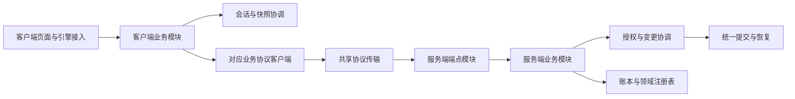

# partial 使用审计与模块拆分计划

目标是让 1.7 的业务模块拥有自己的状态和明确的依赖，逐步解除 `ClashOfRimMod` 与 `ClashOfRimNetworkServer` 的跨文件私有成员耦合。当前 `partial` 拆分主要改善了文件浏览，没有建立模块边界。优先迁移会话、快照变更边界和事件流程，再按业务域完成迁移；保留已经统一的提交、恢复、状态转换和游戏对象流转算法。

审计基线为 `ee55d0b0` 加当时工作区，包括此前未提交的改动。初次审计只增加计划；后续实施状态见文末记录。以下 P2/P3 表示结构改造优先级，不代表新复现的功能故障。1.6 冻结内容不参与改造。

## 使用范围

扫描 `Source/`、`Tools/`、`ThirdPartyCompat/Source/` 的 946 个 C# 文件，排除 `bin/`、`obj/`、冻结版本和独立的 RimTest 子仓库。发现 30 个 partial 类型：生产代码 16 个类型、102 处分片声明、100 个文件；项目测试工具 14 个类型、52 处分片声明、42 个文件。第三方兼容包自身未发现 partial 声明，但依赖主客户端兼容 API。

统计使用 Roslyn 语法树，按命名空间和外层类型识别同名嵌套类型。行数是类型声明范围，包含空行和嵌套类型；嵌套 Fixture 与外层测试类的行数不能相加。字段数包含常量和 readonly 字段，不含属性；readonly 集合的内容仍可变。跨分片引用按可解析的符号统计，是已确认的依赖，不是完整运行时调用图。[完整类型和文件清单](partial-module-inventory-2026-10-17.json)保存本次基线。

| 生产类型 | 分片 | 类型行数 | 字段 | 已确认跨分片访问的字段 | 处理方向 |
| --- | ---: | ---: | ---: | ---: | --- |
| `ClashOfRimMod` | 23 | 21,159 | 122 | 101 | 按会话、快照和业务域分配状态所有权 |
| `ClashOfRimNetworkServer` | 43 | 17,352 | 12 | 4 | 宿主装配、HTTP 端点与业务服务分离 |
| `ClashOfRimMultiplayerWindow` | 2 | 3,994 | 132 | 68 | 按页面拆视图及编辑状态 |
| `ClashOfRimModNetworkClient` | 2 | 3,043 | 86 | 3 | 共享传输层加各域协议客户端 |
| `ClashOfRimCompatibilityApi` | 6 | 2,474 | 52 | 44 | 保留公开门面，注册生命周期与各能力存储分离 |
| `BiotechCompatibility` | 10 | 1,808 | 38 | 17 | 按物品元数据、pawn、远程地图等能力组合 |
| `BankLoanRegistry` | 2 | 983 | 15 | 5 | 保留单一账务写入边界，收回同一类型文件 |
| `ServerShopRegistry` | 2 | 717 | 9 | 5 | 保留库存与幂等记录的共同发布边界 |
| `SnapshotCommitService` | 3 | 683 | 5 | 4 | 日志存储、提交编排和业务应用分离 |
| `MercenaryContractRegistry` | 2 | 579 | 10 | 4 | 保留合同写入边界，收回同一类型文件 |
| `RemoteIdeoMaterializer` | 2 | 574 | 0 | 0 | 文化包加载与目录物化分离 |
| `ItemDeliveryItemSummary` | 1 | 81 | 0 | 0 | 删除无实际分片的 partial 修饰符 |
| `ModThingReferenceDto` | 1 | 78 | 0 | 0 | 同上，保持序列化契约 |
| `ModPawnExchangeAppearanceDto` | 1 | 25 | 0 | 0 | 同上 |
| `ModCrossMapPawnReferenceDto` | 1 | 21 | 0 | 0 | 同上 |
| `ModPawnExchangeIdentityDto` | 1 | 15 | 0 | 0 | 同上 |

服务端主类的字段全部是常量或 readonly 字段，不能据此认为它低耦合：它通过 `ClashOfRimNetworkState` 获取依赖。该状态类有 39 个构造参数、40 个直接声明的属性。网络客户端的 86 个字段中有 79 个 readonly 字段，包含大量路由定义，不能将它们全部视为可变业务状态。

## 主要发现

### A1 P2 客户端会话生命周期拥有各业务模块的内部状态

`ClashOfRimMod` 有 564 个直接声明的方法。`settings` 被 22 个分片访问，`manualSyncInProgress` 被 12 个分片访问，`eventStateLock` 被 11 个分片访问。退出逻辑逐一清除银行、雇佣、商店、世界、事件和聊天字段；其中事件锁还保护玩家列表、地图标记、交易订单和商店列表。新增一个业务状态，往往必须同步修改另一个文件中的退出流程。

依据：[字段集中声明](../Source/Client/Core/ClashOfRimMod.cs#L50)、[退出与跨域清理](../Source/Client/ClientNetwork/Runtime/ClashOfRimMod.SessionRuntime.cs#L330)。这使状态所有权难以检查，也让之前修复的迟到响应和切换会话隔离容易在新增路径中遗漏。

目标：`ClientSessionRuntime` 管理身份、会话代次和连接生命周期；`ClientSnapshotCoordinator` 管理上传事务和未确认本地变更。事件、银行、交易、商店等模块各自持有状态和只读快照。模块只接收会话视图、所需命令及调度入口；不接收整个 Mod、可随意改写的 settings 或全量 ClientRuntime。

复用 `ClientSessionWork` 的取消、发布锁和主线程动作所有权。第一阶段由新会话模块托管这些能力，不为每个业务创建独立会话代次。退出仍先使旧工作失效，再清理模块状态；账户、殖民地和 Game 对象的生命周期分别处理。

### A2 P2 服务端宿主和业务服务合并在一个静态类型

43 个分片共同组成 589 个方法的静态类。`MapEndpoints` 注册路由，`Bootstrap` 装配存储和宿主，其他分片直接执行授权、恢复、业务规则、快照提交、通知及成就登记。新提取的事件读取和银行上下文也仍依赖同一类型中的私有恢复及授权方法。

依据：[路由注册](../Source/Server/ClashOfRim.Network/Server/Core/ClashOfRimNetworkServer.cs#L88)、[宿主装配](../Source/Server/ClashOfRim.Network/Server/Core/ClashOfRimNetworkServer.Bootstrap.cs#L17)、[全量状态依赖](../Source/Server/ClashOfRim.Network/Client/ClashOfRimNetworkState.cs#L9)、[事件读取上下文](../Source/Server/ClashOfRim.Network/Server/Core/ClashOfRimNetworkServer.EventReadContext.cs#L8)。

目标：宿主只装配服务；各域 `Map…Endpoints` 负责 HTTP 绑定和协议响应；业务服务使用构造参数声明所需账本、注册表、授权、提交和通知能力。`ClashOfRimNetworkState` 可暂时保留为宿主与旧测试的装配容器，但新业务模块不得把它作为全量依赖入口。

不能把当前私有方法统一改成 public static 后互相调用。每迁移一个域，旧入口只能单向转发给新服务，新服务不能直接调用旧主类完成业务。基础设施迁移所需的临时适配器单独列名并限定退役阶段，不能成为长期模块接口。

### A3 P2 恢复边界和提交流程的所有权仍跨主类与服务

`EnterRecoveredSnapshotMutation` 掌握准备前授权、锁外恢复准备、重新加锁、授权复验和嵌套锁规则，但它是服务器主类的私有方法。它随后以多项注册表和回调调用 `SnapshotCommitService.Recover`，回调又回到主类中的上传后处理和确认计划。`SnapshotCommitService` 虽然只有 683 行类型代码，却承担日志读写、待办缓存、回执、恢复准备和多种业务提交。

依据：[统一恢复边界](../Source/Server/ClashOfRim.Network/Server/Core/ClashOfRimNetworkServer.SnapshotCommits.cs#L15)、[恢复回调装配](../Source/Server/ClashOfRim.Network/Server/Core/ClashOfRimNetworkServer.SnapshotCommits.cs#L80)、[提交与恢复入口](../Source/Server/ClashOfRim.Network/Server/Services/SnapshotCommitService.cs#L103)。

先把现有变更边界提取为 `SnapshotMutationCoordinator`，保留原控制流程，再逐步让日志存储和业务应用拥有独立职责。提交协调器继续唯一持有 pending/applying 状态；日志存储不另建第二份待办缓存。业务变更优先复用现有 `TradeSnapshotMutation`、`SupportSnapshotMutation`、`PendingSnapshotOperations` 等类型。

当前日志版本 1–12、磁盘目录、恢复顺序、回执优先重放及原子提交必须保持兼容。模块迁移阶段不同时更换日志格式、不拆分全服变更锁、不新增第二套提交模板。已统一的 `PersistNewIntent` 和 `LedgerBatch` 应继续共用。

### A4 P2 网络传输与临时登录生命周期混在协议客户端中

`ClashOfRimModNetworkClient` 的 105 个方法覆盖几乎所有业务。`SetupAuthentication` 分片可直接访问 HTTP 客户端和凭据上下文，并负责创建临时会话及 finally 登出。这种行为属于会话租约的生命周期，不应由各业务客户端分别复制。

依据：[客户端主体](../Source/Client/ClientNetwork/Runtime/ClashOfRimModNetworkClient.cs#L18)、[临时认证生命周期](../Source/Client/ClientNetwork/Runtime/ClashOfRimModNetworkClient.SetupAuthentication.cs#L9)。

目标：共享 `ProtocolTransport` 继续负责实际序列化、请求头、取消、错误映射及 multipart；各域客户端只构造对应请求；`SetupAuthenticationLease` 管理临时登录和所属会话释放。现有客户端可暂时作为转发门面。只读和写入请求都要保留原先的身份、快照绑定及 `ClientSessionWork` 约束。

### A5 P2 多人窗口拥有跨页编辑状态并直接调用整个 Mod

多人窗口合计 132 个字段，管理员分片可访问其中的大量字段，并通过整个 Mod 读取配置、修改业务和控制刷新。窗口关闭、切页、会话切换及异步刷新缺少页面级的状态所有者。

依据：[窗口主体](../Source/Client/Multiplayer/Windows/ClashOfRimMultiplayerWindow.cs#L19)、[管理员页入口](../Source/Client/Multiplayer/Windows/ClashOfRimMultiplayerWindow.Admin.cs#L17)。

目标：窗口保留布局、页签选择和页面对象的生命周期；玩家、事件、交易、银行、商店、管理等页面分别持有自己的筛选、分页和编辑草稿。页面读取业务模块发布的只读状态，调用明确的业务命令。先建立业务模块，再移动页面，避免页面对象只是换个位置继续接收整个 Mod。

### A6 P2 兼容 API 的注册生命周期与各能力集合纠缠

六个分片共享 52 个字段，44 个存在跨分片访问。核心文件维护各类能力集合、优先级、顺序、注册令牌和清理动作，`ClearCompatibilityRegistrations` 明确列出所有能力集合。第三方兼容包直接调用这一公开静态 API。

依据：[注册状态和代次](../Source/Client/ThirdPartyCompatibility/Api/ClashOfRimCompatibilityApi.cs#L16)、[跨能力清理](../Source/Client/ThirdPartyCompatibility/Api/ClashOfRimCompatibilityApi.cs#L444)。

目标：保留公开 API 签名作为兼容门面；一个 `CompatibilityRegistrationScope` 拥有 generation/token/priority/order 和注销生命周期，物品、pawn、远程地图和世界能力注册表分别拥有其集合及缓存。排序和注册去重继续复用现有统一逻辑。能力注册表不能各自创建不同的全局注册代次，也不能把公开 API 改为第三方必须访问的新实现类型。

### A7 P3 DLC 分片应按能力拆分而非按 DLC 名称继续聚集

`BiotechCompatibility` 的十个分片覆盖基因物品、繁殖来源、pawn、编辑器展示、远程地图和防御点。38 个字段中 28 个是常量，另外 10 个是 readonly，主要耦合在元数据键、辅助函数和反射缓存；它与客户端主类的可变状态问题不同。

目标：物品元数据编解码与匹配、繁殖来源、pawn 交换、地图清理分别成为具体能力组件；共享元数据契约保持唯一来源。UI 编辑和展示共同使用同一个编解码器。现有独立的 Biotech 世界配置和物品流转类继续复用，不回收进新“大 DLC 服务”。文化目录物化使用独立的 `IdeoPackageLoader` 加现有物化服务，加载器继续遵守 Scribe 与 Game 线程边界。

依据：[Biotech 元数据契约](../Source/Client/DlcCompatibility/Biotech/Trading/BiotechThingReferenceCompatibility.cs#L12)、[文化包加载](../Source/Client/DlcCompatibility/Ideology/Ideos/RemoteIdeoMaterializer.PackageLoading.cs#L12)。

### A8 P3 测试本身依赖私有成员名字和跨场景状态

`GameSuite` 有 15 个分片，`DomainCommands` 有 8 个分片；测试套件和桥接共享客户端、场景结果和反射辅助函数。部分客户端回归通过字符串定位 Mod 私有方法。直接重命名迁移会使这些测试失效，即使业务行为保持一致；若只更新名字，测试也未必能约束新模块边界。

依据：[场景调度及共享状态](../Tools/ClashOfRim.GameTests/GameSuite.cs#L15)、[桥接模块注册](../Tools/ClashOfRim.RimTestBridge/DomainCommands.cs#L23)、[私有调度方法定位](../Tools/ClashOfRim.Client.Tests/MainThreadDispatchTests.cs#L13)。

目标：桥接按账户、银行、商店、远程地图等注册独立命令处理器；命令名和行为保持稳定。Mod 私有业务反射逐步替换为显式命令和只读观察入口，仍走正式产品流程。保留游戏内部反射所需的集中适配器。`GameSuite` 拆成场景对象与有明确先决条件的 fixture；共享服务器和客户端生命周期，场景产物由明确的返回值或领域 fixture 传递。

### A9 P3 部分 partial 没有对应的模块拆分需要

五个 DTO/载荷类型只有一处声明，可直接删除 partial 修饰符。银行、雇佣和商店注册表的第二分片使用同一个 gate、缓存和持久化提交，是同一聚合的操作，不宜拆成可独立改写同一数据的服务。先把同一类放回一个文件；只有可独立验证的纯计算才提取为策略。

依据：[银行待确认批次操作](../Source/Server/ClashOfRim.Network/Server/Registries/Economy/BankLoanRegistry.PendingOperations.cs#L7)。减少 partial 数量本身不能替代状态和事务边界的改进。

## 目标边界

第一轮在现有程序集内建立具体类、私有状态和显式依赖，保持当前加载及打包方式。稳定后再评估是否需要独立项目；不把每个目录都变成 DLL。新名字表示职责方向，实施时优先复用现有服务及策略。

图中是调用方向；两端宿主负责创建和连接这些对象，不参与具体业务决策。

| 模块 | 唯一负责的状态或职责 | 可依赖的能力 | 不应取得的能力 |
| --- | --- | --- | --- |
| 客户端会话 | 身份、代次、连接、退出和重新登录 | 认证客户端、设置持久化、现有会话工作机制 | 直接清空所有业务模块的私有列表 |
| 客户端快照 | 上传事务、捕获、确认失败与重试、lineage 更新 | 会话视图、上传服务、主线程调度 | 银行或商店的界面状态 |
| 客户端业务模块 | 本域运行状态、命令及只读状态发布 | 会话视图、对应协议客户端、快照协调、具体游戏适配器 | 整个 Mod、全量 settings、其他域的可变集合 |
| UI 页面 | 当前页面的显示、选择和编辑草稿 | 本域状态和命令 | 直接管理网络会话或快照提交 |
| HTTP 端点模块 | 请求绑定、响应映射、路由和恢复元数据 | 本域业务服务 | 直接改写注册表或重新实现恢复流程 |
| 服务端业务模块 | 本域业务规则和调用顺序 | 明确的授权、变更协调、账本或注册表、通知能力 | 整个 NetworkState、静态主类私有助手 |
| 服务端提交协调 | 全局变更顺序、恢复、日志与回执发布 | 日志存储、快照存储、现有业务变更对象 | HTTP 对象和客户端 UI 状态 |
| 兼容能力注册表 | 本能力集合和缓存 | 统一注册生命周期和公共契约 | 其他能力注册表的内部集合 |

跨模块调用优先使用已有数据类型和少量明确端口。只有需要替换实现、隔离引擎或跨生命周期时引入接口；纯计算保留普通函数。跨域流程由用例或协调器发起，避免领域模块双向引用。禁止通过 `IServiceProvider`、`Func<ClashOfRimMod>` 或“包含所有服务的 Context”重新引入隐式依赖。

## 分阶段实施顺序

每个表项是一个阶段，可包含多个小提交。多业务阶段必须按列出的业务逐个完成，不能合成一次大搬迁。每个提交迁移实际实现和状态，补齐受影响的边界测试，测试通过后提交；新旧实现不并存执行。

| 阶段 | 拆分内容 | 依赖和完成条件 | 主要验证 |
| --- | --- | --- | --- |
| M0 | 固定协议、存档、路由、锁顺序及测试入口；建立迁移清单和边界约束 | 本次清单已完成；实施前加入只约束已迁移目录的依赖检查 | 实际 JSON 契约、注册路由和恢复元数据、冻结校验 |
| M1 | 服务端授权服务与 `SnapshotMutationCoordinator`，分别提交 | 直接迁移现有实现；协调器依赖明确的恢复端口，旧恢复逻辑仅允许由指定临时适配器接入 | MutationAuthentication、SnapshotJournalRecoveryPreparation、HttpSnapshotRecovery、SessionConnection |
| M2 | 服务端 `EventDeliveryService` 与事件读取端点模块 | 依赖 M1；登录复用队列读取端口，长轮询等待在锁外；投递继续单一 LedgerBatch | EventReadHttp、EventDeliveryBatch、DeferredEventDelivery、完整 NetworkSmoke |
| M3 | 客户端会话、快照事务、协议传输和临时认证租约，分别提交 | 统一所有权先于业务迁移；原 Mod/网络客户端只转发已迁移入口；保留一个会话代次与上传协调机制 | SessionPublication、MainThreadDispatch、重连测试、WorldSetupTransport、AdministratorSetupTransport |
| M4 | 客户端事件收取、事件状态和信件执行模块 | 依赖 M3；复用 ClientEventLetterPolicy、载荷读取器和确认流程；不再访问 Mod 的事件字段 | EventLetterPolicy、RaidSettlementPayload、延后选择、重复投递和会话替换 |
| M5 | 银行业务服务与客户端银行模块，服务端/客户端分开提交 | 依赖 M1/M3；银行读取、借款、偿还与债务边界明确，继续调用统一提交协调 | 银行上下文恢复、借款条款变化、经济幂等、快照中断、RimTest 银行矩阵 |
| M6 | 礼物、交易、商店，按域分别迁移两端 | 依赖事件/快照基础；快照、物品流转和拒收退回不复制算法 | GiftRejectionAtomicity、交易恢复/退款、复杂物品、商店全物品及压力场景 |
| M7 | 雇佣、支援、袭击、远程地图，逐域迁移 | 保留统一 pawn 流转和游戏地图加载器；领域模块不得相互持有可变状态 | 提交/证据/结算恢复、超时、支援死亡与归还、远程地图和飞船场景 |
| M8 | 账户、世界准备/同步、殖民地生命周期、管理、聊天、成就，逐域迁移 | 复用会话能力；世界生成、上传和进入游戏的主线程边界独立；路由装配从服务器主类退出 | 账户重建、世界覆盖率/难度/文化、权限、排行榜和成就实机场景 |
| M9 | 拆分 SnapshotCommitService 内的日志存储、回执及业务应用职责 | 业务模块已通过稳定提交入口接入；保留 pending/applying 的唯一所有者、日志 1–12 和现有 Apply 顺序 | 完整 Save 故障矩阵、历史日志恢复、重复恢复、回执优先、持久化重启 |
| M10 | 兼容 API 内部能力注册表、Biotech 组件、文化包加载器 | 外部 API 签名、令牌和顺序不变；旧门面仅转发 | 注册/注销/优先级、DLC 开关、复杂物品与 pawn、多语言文化、第三方兼容包构建 |
| M11 | 多人窗口拆页面；清理 Mod、网络客户端和服务器过渡门面 | 所需业务模块已就位；UI 不再接收整个 Mod，宿主只负责装配和引擎接入 | 页面刷新、编辑状态、切页、退出、重连及代表性 RimTest 功能流程 |
| M12 | 按域拆桥接和场景 fixture；合并内聚注册表；移除单声明 partial | 桥接适配随 M1–M11 同步更新，此步收尾清理；不另造一套业务实现给测试使用 | 全套回归、测试命令清单、第三方构建、1.6 冻结和模块依赖检查 |

M1 不一次迁移全部恢复业务。协调器只提取加锁、锁外准备、重入和复验控制流程；世界通知、管理员基线、殖民地删除和快照后处理暂由一个 `LegacySnapshotRecoveryAdapter` 实现明确的恢复端口。只有该具名适配器可转接旧主类恢复逻辑，业务模块不得依赖它或传入任意恢复回调。M5–M8 随对应业务迁移替换其协作对象，M9 结束前删除适配器及旧恢复入口。这样可以逐步迁移现有恢复链，避免把 M1 扩成全服业务重写。M3 不允许把原 Mod 作为 RuntimeContext 传给新模块。

## 每步验收标准

1. 新模块能在不构造完整 Mod/NetworkState 的情况下测试主要用例；构造参数只声明实际依赖。已有领域注册表继续拥有其缓存、锁和持久化。
2. 迁移的方法、字段和算法从旧 partial 中删除。必要的兼容门面仅转发，保留原因和删除条件，不再包含分支、重试、状态写入或领域规则。临时恢复适配器只保留尚未迁移的恢复职责，并在清单中逐项减少；不能将其算作完成了相应业务拆分。
3. 已迁移客户端目录不引用 `ClashOfRimMod.Instance`，服务端业务目录不引用 `ClashOfRimNetworkServer` 或全量 `ClashOfRimNetworkState`。装配、兼容门面和引擎补丁采用显式限定的例外，逐步缩减；不依靠通用服务定位器绕过约束。
4. 保持会话发布锁与缓存锁的顺序、全服变更锁及领域锁的顺序、恢复前后授权复验、重放优先、通知与成就的幂等，以及等待前释放变更锁。跨模块不传递可任意释放的锁对象。
5. 保持 HTTP 路由、JSON 字段与枚举值、存档字段、日志格式、第三方公开 API、Harmony 接入点和 RimTest 命令语义。测试从私有实现名字转向业务结果；引擎专属反射仍集中在适配层。
6. 按用户最新要求，每步运行相关单元测试及其必要编译检查，通过后提交；不默认启动完整回归或 NetworkSmoke。用户 2026-10-18 补充允许针对单次修改功能安排 RimTest，选择相关专项即可，全量验证仍由用户手动安排。文档分别记录单元证据、专项实机证据与未验证范围，不用编译成功代替游戏行为验证；前文矩阵仍作为后续全量测试清单。

总体目标是生产业务类型不再使用 partial；职责内聚的单一类型归并到一个文件。测试中的 partial 逐步以场景和 fixture 组合替代，确有必要的生成代码才允许保留例外。完成度以状态归属、依赖方向和回归结果衡量，不以文件数或类名变化衡量。

## 验证基线与执行入口

最近一次运行时验证来自[事件协议修复](event-protocol-audit-2026-10-17.md)：Events 52 项、Save 136 组、Client.Core 8 组、客户端 42 项、完整 NetworkSmoke 和 77 个冻结文件通过。本轮是静态结构审计，没有将该结果作为模块迁移已验证的证据。

用户后续安排全量验证时，使用 `Tools/Test-Regression.ps1 -IncludeClient -RimWorldManagedDir E:/SteamLibrary/steamapps/common/RimWorld` 作为完整回归入口；客户端测试需要真实 1.7 游戏程序集。定向组沿用现有控制台测试程序，不能以 `dotnet test` 的空执行替代。RimTest 使用项目维护的 GameTests/Bridge 场景，保持主仓库之外的 RimTest 子仓库边界。

本计划承接[架构修复记录](architecture-remediation.md)第 5 项和[事件协议审计](event-protocol-audit-2026-10-17.md)的统一逻辑成果。实施从 M0 的剩余约束与 M1 开始；不重新实现已经修复的恢复、提交和账本算法。

## 实施记录

### M0 迁移契约与依赖检查

已固定 81 个实际 HTTP 协议端点的路径、方法和恢复所有权，其中 51 个端点显式拥有恢复。`ServerNotification` 是下行通知契约，不当作入站 HTTP 端点注册。`ModuleBoundaryTests` 从实际 ASP.NET 端点读取元数据，与迁移前契约比较；随完整 NetworkSmoke 自动执行，也支持 `--module-boundaries-only`。

`ModuleDependencyGuard` 检查新服务端 `Network.Modules.*` 类型的编译后成员、泛型参数、方法体调用和异步状态机，禁止依赖旧服务器主类、全量 NetworkState 或 IServiceProvider。签名、泛型和方法体违规样本验证检查器确实能拒绝越界依赖。当前尚无迁移模块，零类型结果仅表示约束已经接入；客户端模块加入时接入同一检查器。

验证：新约束及 81 个端点契约通过，Client.Core 8 组通过，1.6 冻结 77 个文件通过。日志：`LocalOnly/module-migration/m0.log`。尚未改动产品逻辑，下一步 M1 提取殖民地访问授权。

### M1a 殖民地访问授权

`ColonyAccessAuthorization` 已接管所有权、会话刷新、侦察/盟友观察、PvP 目标、袭击准备和袭击事件授权。构造依赖只包含令牌、会话、外交、准备记录、账本及当前 PvP 开关；旧服务器主类删除了这些决策实现，仅保留转发入口。盟友判定由现有外交注册表统一提供，事件参与方可见性提取为共享 `EventVisibility`，避免后续模块重新复制判定。

独立测试不构造 NetworkState，覆盖旧会话被替换、退出与过期、跨用户/殖民地拒绝、实时 PvP 配置、未结算袭击、观察者盟友范围、非玩家袭击和过期准备凭据。模块依赖检查现已实际检查 1 个产品类型，81 个 HTTP 端点契约保持一致。

验证：上述独立测试、完整 NetworkSmoke 及 Save 全部用例通过（日志 `LocalOnly/module-migration/m1a-direct.log`、`m1a-network.log`、`m1a-save.log`）。快照恢复协调器仍为下一项；M1a 不改变各端点的恢复归属。

### M1b 快照恢复协调

`SnapshotMutationCoordinator` 接管唯一的恢复循环：共享变更锁、恢复前后授权、锁外准备、嵌套调用、准备版本竞争和异常释放。`SnapshotMutationScope` 的 Monitor 重入与指标逻辑保持复用；`SnapshotCommitService.RecoveryPreparation` 直接实现准备端口，未增加第二套压缩或日志算法。旧 partial 只转发协调入口，原循环与嵌套结果类型已删除。NetworkState 只负责装配，未被新协调器引用。

过渡职责集中于 `LegacySnapshotRecoveryAdapter`：前置世界通知、管理员基线、殖民地删除，以及提交日志重放、快照后处理和雇佣事故恢复仍由旧领域实现执行。该适配器只转接具名恢复端口，新模块禁止直接引用它；这些业务尚未完成拆分，须随 M5–M8 缩减并在 M9 前删除适配器。现有调用继续共用同一把变更锁。

独立协调器测试覆盖三次授权边界、无需准备、锁外准备期间另一线程进入、嵌套锁归属、准备失效/失效异常/安装竞争后的重新捕获，以及授权、前置恢复、捕获、准备、安装和重放六处异常后的释放与重试。依赖检查覆盖 6 个产品及编译生成类型，81 个端点恢复契约不变。

验证：完整 NetworkSmoke、Save 136 组、Events 52 项、Client.Core 8 组、真实 1.7 程序集客户端 42 项、第三方兼容包构建及 1.6 冻结 77 个文件全部通过。日志：`LocalOnly/module-migration/m1b-network.log`、`m1b-save.log`、`m1-events.log`、`m1-core.log`、`m1-client.log`、`m1-third-party.log`。M1 完成，下一项为 M2 服务端事件投递与读取端点。

### M2 服务端事件投递与读取端点

`EventDeliveryService` 接管队列读取、长轮询、详情批次投递、投递租约到期和已删除来源的失败支援事件清理。它只接收授权、变更协调、快照、账本、通知、在线状态和玩家记录；`EventReadEndpoints` 只负责三个请求的绑定与响应映射，并保留对应恢复元数据。登录复用服务的租约维护与队列投影，不再自行构造队列。旧 `EventReadContext` partial 已删除，原主类/SessionWorld/RaidsDiplomacySupport 中对应实现也已删除。

完整批次仍先检查事件可见性，再维护和构造详情，最后通过一个 `LedgerBatch` 发布投递、接收与终态消费。长轮询在等待前释放变更锁，醒来后通过 M1 协调器复验会话与快照。共享 `EventVisibility` 提供唯一的参与方可见性规则，端点不复制授权或账本算法。

独立测试直接构造服务及其明确依赖，覆盖跨殖民地隔离、历史账户级事件、混合非法批次无副作用、重复下载、过期租约、恢复撤销会话，以及长轮询期间会话替换、快照更新、取消和正常唤醒。原延后投递回归改为调用服务，移除了对旧私有端点方法名的反射。模块依赖检查覆盖 16 个产品及编译生成类型，81 个端点契约保持一致。

验证：独立模块测试、完整 NetworkSmoke 和 Save 136 组全部通过。日志：`LocalOnly/module-migration/m2-network.log`（独立模块、完整 HTTP/WebSocket、持久化重启与事件回归）和 `m2-save.log`（完整恢复矩阵）。本阶段未改动游戏端生命周期；M1 的客户端、第三方构建及冻结验证仍对应相同客户端代码。下一项为 M3 客户端会话与快照基础边界。

### M3a1 客户端连接生命周期

`ClientSessionConnection` 已接管 WebSocket 连接的取消源、运行状态、替换、消息发布、连接丢失和资源收尾。原 Mod 删除 `presenceCancellation`、`presenceInProgress` 和异步连接循环，入口只转发连接请求；主菜单重置、退出、废弃和会话失效统一停止该连接。`ClientSessionStreamTransport` 只适配现有协议客户端，模块依赖窄流式接口，不接收 Mod、完整 settings 或全量协议客户端。Mod 保留界面文本映射和尚未迁移的事件/重连业务回调。

连接继续使用唯一的 `ClientSessionWork` 代次与发布锁。每条流同时校验会话代次和连接归属，拒绝旧流的迟到消息、失败状态和断线通知；收尾只释放自己的连接，覆盖会话在后台委托启动前失效的情况。取消和完成之间的资源竞争由连接自身管理，保留先取消旧流再开启新流的顺序。

客户端复用 M0 的编译依赖检查器，禁止 `Modules.*` 引用 Mod、完整 settings、全量协议客户端或 IServiceProvider，当前覆盖 14 个产品及生成类型。独立测试不构造 Mod 或 Game，包含有效性、恢复版本、同代次/跨代次替换、迟到事件与状态、正常关闭/取消/失败/异常/主动停止/退出、40 次停止与完成竞争，以及 64 次调度期间的会话替换。

验证：客户端 44 项、Client.Core 8 组、第三方兼容包构建和 1.6 冻结 77 个文件通过。实机先通过 core-features 42/42，随后复核并保留旧流取消先于新流打开的顺序，最终产物通过英语/法语 coverage50-french 14/14（含重载与会话重连），未执行项均为 0。最终包与实机输入记录的 DLL SHA256 均为 `5D8B182464DBDC2B01A0C09037B6C4979B27614BD9840443326B45AF744CF3F7`。日志位于 `LocalOnly/module-migration/m3a-client.log`、`m3a-core.log`、`m3a-third-party.log`；实机证据分别为 `G:/RimTestRuns/ClashOfRim-module-migration/20261017-020312-464b5314` 与 `20261017-020755-ab177dde`。

首次实机批次在开局前因测试助手误选原版 Steam 缺失提示的 Quit 按钮而退出，未计为连接验证。该测试问题已单独修复并保留失败证据，详见 [RimTest 断言原则](rimtest.md#断言原则)。

本步仅完成连接职责；登录身份、退出清理、原地重连用例、快照协调、协议传输和临时认证租约仍属于 M3 后续工作，不将剩余 SessionRuntime partial 视为已拆分完成。

### M3a2 客户端身份发布、过期与退出

`ClientSessionLifecycle` 接管当前会话标识、过期处理状态、登录身份规范化、凭据发布和明确退出。五个登录入口（手工登录、地图会话、存档恢复、观察入口、原地重连）统一调用身份发布；Mod 删除对应字段写入及重复算法，只保留供尚未迁移领域读取的会话标识门面。设置读写和 Logout 分别通过窄端口适配，模块不接收完整 settings、Mod 或协议客户端；身份变更通知统一更新兼容清单与管理员状态。

失效采用同一 `ClientSessionWork` 发布边界，并为已排入主线程的过期处理保留具体归属。新登录、退出或代次切换后，旧清理不能再清空凭据或弹出过期窗口；并发失效只取得一次处理权。身份替换停止旧连接，退出先取消旧代次、脱离连接和身份，再通知业务状态清理，最后写回空凭据。Logout 使用捕获的旧身份和令牌，完成或失败均不改写新会话。

独立测试不构造 Mod/Game，覆盖身份规范化与历史缺省字段、精确令牌/会话匹配、同代次与跨代次迟到清理、32 次并发失效、未建立流时的持久化凭据过期、身份替换/清空/退出停止连接、清理与持久化顺序，以及旧 Logout 的认证上下文、失败和迟到完成。客户端依赖检查覆盖 21 个产品及生成类型。客户端 45 项、Client.Core 8 组、第三方构建和 1.6 冻结 77 个文件全部通过。最终产物实机 core-features 42/42、account-core 22/22，未执行项均为 0；包含踢出/封禁后重连、远程观察、袭击、存档重载，以及两名玩家各自废弃和重建、旧债务隔离、新殖民地成就、全局商店与账户管理员角色保留。日志为 `LocalOnly/module-migration/m3a2-client.log`、`m3a2-core.log`、`m3a2-third-party.log`、`m3a2-rimtest.log`；实机证据目录为 `G:/RimTestRuns/ClashOfRim-module-migration/20261017-021631-d14cf64b`。最终包与两组实机输入记录的 DLL SHA256 一致：`DA9D040D87F5557EFA899681073C1FD2D8D10E64E1FE9412B4D538F752CEBC3A`。

本步没有把原地重连的准备、两次快照复验和临时登录清理宣称为已迁移；该用例、快照协调、协议传输和临时认证租约仍为 M3 后续工作。各领域退出清理目前由宿主订阅会话结束通知，随 M4–M8 各自迁移。

### M3a3 客户端原地重连用例

`ClientSessionReconnect` 接管重连准入、请求顺序、登录前后权威快照复验、返回身份校验，以及尚未接纳登录的所有权。旧 Mod 删除 `sessionReconnectInProgress` 与相应网络/业务分支。模块只依赖窄重连传输端口和 M3a2 会话生命周期；继续复用 `SessionReconnectSafetyPolicy`，不复制判定规则。宿主目前保留原同步门接入、主线程调度、界面呈现及尚未迁移领域的刷新接入；同步门在 M3 后续统一，领域刷新和界面随 M4–M11 迁移。

成功的网络准备不会立即发布身份或释放重连准入。主线程确认原 Game 仍存在、未出现本地原子变更、用户/殖民地/服务器/当前快照仍一致后，才通过会话生命周期接纳登录。等待主线程期间保留原手工同步占用；完成、取消和丢弃分支只释放自己的占用一次。新代次或同代次身份替换使旧准备失效，旧收尾通过具体尝试归属判断，不能清除新尝试。

尚未接纳的登录在身份不符、快照变化、异常、退出、主线程动作被丢弃时统一释放；迟到的成功登录先取得清理所有权，再检查当前归属，避免取消时丢失已创建的服务端会话。清理复用生命周期的释放及诊断入口。底层 `LogoutDetachedAsync` 与普通 Logout 共用同一请求实现，管理员初始配置清理也改用该入口；它使用独立且有时限的取消源，不再被已退出代次取消。公开 Logout 签名、路由和“用户/殖民地/会话 ID”连接凭据保持不变；身份不匹配时使用服务端返回的用户及会话，而非登录前的请求用户。

独立模块测试覆盖准入与延后接纳、16 种准备/登录/元数据失败、9 种主线程前状态变化、三个请求阶段的代次替换、清理期间的新身份/新尝试、丢弃与清理失败、重复完成和重复释放。实际 HTTP 客户端回归验证旧代次取消后仍能发出具有独立超时的 Logout，并检查实际路由及请求身份。客户端模块依赖检查覆盖 31 个产品及生成类型。客户端 46 项、Client.Core 8 组、第三方构建与 1.6 冻结 77 个文件全部通过。最终产物实机 core-features 42/42、英语/法语 coverage50-french 14/14，未执行项均为 0，涵盖踢出和封禁后重连、拒绝登录、远程观察、袭击结算、存档重载和跨文化世界设置。日志为 `LocalOnly/module-migration/m3a3-client.log`、`m3a3-core.log`、`m3a3-third-party.log`、`m3a3-rimtest.log`；实机证据位于 `G:/RimTestRuns/ClashOfRim-module-migration/20261017-023612-a12ab047`。最终包与两组实机输入记录的 DLL SHA256 一致：`60A0D491458586E833F08FEE7699A77113A1F28BDD32959EB0C0981300EE2066`。

M3 尚未结束：下一项为客户端快照与手工同步协调，之后迁移协议传输和初始配置等临时认证租约。此次只迁移重连用例，不将其余 SessionRuntime 业务视为已完成拆分。

### M3b1 同步协调与快照事务归属

`ClientSynchronizationCoordinator` 接管手工同步与快照上传的唯一准入状态、锁、事务序号和诊断。Mod 删除原始状态字段、同步锁及开始/结束算法，仅保留转发入口与游戏消息呈现。协调器继续使用现有 `ClientSessionWork` 代次与发布边界，锁顺序为会话发布、协调状态；模块不依赖 Mod、settings 或游戏对象。原地重连直接取得协调器的手工操作凭据，准备到主线程接纳期间保留占用，完成或丢弃后统一释放，宿主删除重复的释放函数。

所有快照事务入口返回具体 `Lease`，正常收尾只释放所捕获的事务。袭击开始、袭击结算和搬家上传到确认的交接不再传递“已开始”布尔值，改为传递实际凭据；搬家主线程动作被丢弃时也有明确的释放入口。重复释放、同代次重置后的迟到释放及旧会话回调均不能清除新事务。明确退出与权威袭击清理继续使用显式重置，普通请求不得全局结束上传。

手工流程尚未全部取得独立凭据：原有写入暂时通过具名 `SetLegacyManualInProgress` 转发，后续 M3b2 必须逐个迁移并删除该入口。该过渡端口不能清除已有快照或重连持有的手工操作；允许旧手工流程升级快照的参数，也不能接管拥有独立凭据的手工操作。只有显式传入其凭据才允许升级。未将这一过渡层计为手工同步拆分完成。

独立测试不构造 Mod/Game，覆盖手工与快照互斥、显式升级、旧手工兼容端口边界、跨协调器/失效凭据拒绝、同一凭据接续只开始一次、重复完成、同代次重置、跨代次回调和 32 轮各 16 个并发请求。重连测试改为实际占用协调器并检查释放；运输舱实机夹具改为取得真实准入，不再反射写入已删除的忙碌字段。模块依赖检查覆盖 37 个产品及生成类型。客户端 47 项、Client.Core 8 组、Events 52 项、第三方兼容包构建和 1.6 冻结 77 个文件通过。

最终产物实机 core-features 42/42、stability-transfers-core 22/22、relocation-core 16/16 全部通过，未执行项均为 0。覆盖重连、银行/商店/交易提交、重复远程观察、支援提前归还/拒绝/到期、袭击损失后重载结算，以及商队搬家和任务地点搬家后存档重载。实机证据为 `G:/RimTestRuns/ClashOfRim-module-migration/20261017-025437-64471fa3`；三组输入记录与最终包的 DLL SHA256 均为 `706CCBB8A3F672C7453FEE98CD4A5C3E96FC77DDC002256C1508F5CEAADFF531`。日志为 `LocalOnly/module-migration/m3b1-client.log`、`m3b1-core.log`、`m3b1-events.log`、`m3b1-third-party.log`、`m3b1-frozen.log` 和 `m3b1-rimtest.log`。运输舱夹具本次完成编译适配，其独立合成到达场景不在这三组矩阵中，不另计实机通过。

剩余手工入口、快照上传服务边界、协议传输和临时认证租约仍属于 M3 后续工作，尚未进入 M4。

### M3b2a 手工请求、银行准备与主线程交接

手工登录、事件读取/等待、外交、拒收和交易接单，以及银行借还款、欠款与雇佣准备，均改为通过协调器取得具体操作凭据。对应六个 partial 删除了全部 50 处手工同步布尔写入；银行和雇佣的五个快照提交入口也删除了宽泛的 `allowExistingManualSync` 接管。同步准备、异步报价、主线程执行和快照提交通过明确凭据衔接，异常或提前返回统一在 `finally` 释放；已升级到快照的旧准备凭据不再清理后续操作的忙碌状态。

协调器新增手工所有权转移和队列交接，先把占用交给后续动作，再调用宿主提供的排队端口。后台收尾不再释放等待主线程的雇佣/商队交易；队列丢弃、排队失败、动作异常、重复执行、同代次恢复与退出换代都由同一所有权检查处理。`Complete` 仅在仍拥有操作时执行对应收尾，银行/雇佣的状态清理不再脱离事务归属。普通只读请求和消息呈现保持原完成边界，不因排队显示一条消息而延长整个同步占用。

独立测试增加连续两次交接、同步准备接续、交接后升级快照、生产者/队列/快照各自完成、队列拒绝与动作/完成回调异常、重复丢弃和新会话的覆盖。模块依赖检查覆盖 38 个产品及生成类型；客户端 47 项、Client.Core 8 组、Events 52 项、第三方构建及冻结 1.6 的 77 个文件通过。复用五种现有语言的通用忙碌文案并建立语义对应的同步键。

实机矩阵新增商队现场交易与守卫购买，复用原交易编辑、真实远行队、菜单确认及银行现金夹具，不新增产品测试旁路。最终产品构建通过 core-features 43/43、bank-core 18/18，未执行项均为 0；包括商队货物与双方库存守恒、贷款逾期偿还、雇佣死亡欠款、守卫购买/重复购买、支援归还、袭击结算、存档重载与重连。

银行通过证据为 `G:/RimTestRuns/ClashOfRim-module-migration/20261017-031832-10c6438f/bank-core/20261017-032314-c6a526a2`，核心通过证据为 `G:/RimTestRuns/ClashOfRim-module-migration/20261017-033050-6a9b4a95/core-features/20261017-033056-178666f5`。两场输入记录与最终包的 DLL SHA256 均为 `FCD18BF4D25B923F8B7FE86042D5A96A1A66C55C57D0BB6D1EA0C9CF470BB956`；测试驱动在银行批次后修正了下述两处夹具问题，因此这些结果来自两个批次，不称作一次完整矩阵全绿。日志为 `LocalOnly/module-migration/m3b2-client.log`、`m3b2-core.log`、`m3b2-events.log`、`m3b2-third-party.log`、`m3b2-frozen.log`、`m3b2-rimtest.log`、`m3b2-core-rerun.log` 和 `m3b2-core-final.log`。

两个中间核心批次保留为失败证据：`20261017-031832-10c6438f` 的联盟用例读到了旧玩家列表，未等待本次刷新结束就发送请求，因同步占用被拒绝；`20261017-032716-d3ccb581` 已通过联盟与观察，但新增商队用例把对象句柄字符串直接传给要求引用对象的桥接入口，绑定阶段失败。分别补齐刷新完成等待与 `{ handle }` 参数包装后重跑，产品代码及业务断言未因这两次失败而改变；失败和未执行项不计入通过数。

M3b2 尚未结束：主菜单进入/恢复、世界准备与远程地图仍有 24 处手工布尔写入（含回调中的写入），随后还需移除过渡端口。银行在快照构建失败后的三个重建入口仍使用原 `CanRunManualSync` 资格检查；静态检查显示它可能拒绝自己保留的本地原子变更，需在 M3 后续统一本地准入时补复现，不能以正常借还款通过证明重建重试可用。快照上传边界、协议传输与临时认证租约仍待完成。

### M3b2b 主菜单与世界准备的操作交接

主菜单进入、世界底图下载、既有殖民地恢复及初始世界配置提交删除了全部 14 处手工同步写入。协调器新增异步交接入口，先转移占用，再通过现有 `ClientSessionWork` 启动后续请求；当前阶段只在仍拥有凭据时执行，完成或异常只释放自己的占用。下载到主线程、主线程到下一次下载，以及语言兼容提示的继续/取消都复用同一交接机制，删除了 `continuingAsyncFlow` 和两处重复 `finally` 清理。

语言提示等待期间仍占用当前操作；旧窗口重复继续或迟到关闭不能释放新操作。宿主在不显示窗口、已存在窗口或排队动作被丢弃时调用取消入口，窗口本身继续复用原来的关闭回调。初始世界配置无法取得准入时保留待提交标志，不再覆盖其他操作的同步状态。恢复存档的占用延续至快照验证和提交给现有内存加载器；引擎加载器及其完成回调的服务边界尚未在本步迁移。

独立测试覆盖异步请求到主线程交接、连续异步阶段、同步抛错、await 后失败、取消后的迟到完成，以及提示窗口取消/重复回调/新操作隔离。模块依赖检查覆盖 41 个产品及生成类型；客户端 47 项、Client.Core 8 组、第三方兼容包构建和 1.6 冻结 77 个文件通过。

最终产品构建通过 core-features 43/43 与 coverage50-french 14/14，未执行项均为 0。覆盖两个玩家首次建档、世界底图进入、错误密码与封禁/解除、存档恢复、重连，以及英语/法语兼容提示、50% 世界参数与区域格式。证据目录为 `G:/RimTestRuns/ClashOfRim-module-migration/20261017-034140-783e6a9a`；两场输入与最终包的 DLL SHA256 均为 `22A51FE9DA8E92A6712E87D16A1FC9D8FBA2E2D1B576B54500BBE5F04854CAFE`。日志为 `LocalOnly/module-migration/m3b2b-client.log`、`m3b2b-core.log`、`m3b2b-third-party.log`、`m3b2b-frozen.log` 和 `m3b2b-rimtest.log`。

本批核心场景有一次 `/world/colony-sites` HTTP 400：trace 中 B 返回主菜单为 `03:45:48.6557892 UTC`，服务器日志记录拒绝为 `03:45:48.6647051 UTC`。最终 SQLite 的 `world-configuration/player-colony-sites` 仍有 A、B 两条正确记录，客户端运行时门禁通过；现有日志没有请求拒绝的具体原因，不能据此断言只是正常取消。M8 世界登记迁移需补充退出期间在途登记的取消复现与诊断，当前不将该分支算作已验证。

M3b2 剩余远程地图的 10 处旧手工写入，以及相关快照入口的宽泛接管参数；完成这些迁移后才能删除协调器的过渡端口。M3 的本地原子变更准入与银行重建重试、快照服务边界、协议传输和临时认证租约继续保留在后续清单中。

### M3b2c 远程地图交接与旧同步入口退役

观察和袭击准备复用同步协调器的异步、主线程和引擎长事件交接。下载完成后仍保留操作占用，直到地图打开完成；袭击准备只凭当前操作的凭据升级到快照提交。删除了表示已转交主线程的布尔标志和重复收尾，以及结算失败、支援损失失败和超时分支对其他手工操作的清理。用于判断本地 pawn 变更是否需要收尾的状态仍保留，它与同步占用不是同一职责。

远程地图的最后 10 处手工同步写入已移除。`manualSyncInProgress` 只保留只读门面；协调器删除 `SetLegacyManualInProgress`、旧操作标记和 `allowExistingManualSync` 参数。袭击结算和搬家不能接管不属于自己的手工操作，普通请求也不能全局解除同步占用。退出和权威恢复继续通过具名重置入口清理。

模块测试覆盖下载、主线程、引擎队列和快照升级之间没有准入空隙，以及下载失败、排队失败、地图打开异常、丢弃、同代次重置、会话换代与重复回调。原 Events 测试通过源码字符串寻找旧私有方法和 `manualSyncInProgress = false`，此次先运行确认其已因 M3b2b 迁移失效，再移除该实现检查；客户端行为测试验证队列完成后首个自动快照能进入，迟到清理不会释放它，真实开局则由 RimTest 覆盖。Events 总数因此由 52 项变为 51 项，不将删除的检查计作通过。

首次实机矩阵 `G:/RimTestRuns/ClashOfRim-module-migration/20261017-035636-390d6a31` 的核心 43 项和搬家 16 项通过，但全 DLC 流转在 `support-state-early-return` 失败，后续六项未执行。独立状态观察确认唯一差异为已故恋人引用的 `dead` 从 true 变成 false：共用 pawn 恢复器收到 `OtherPawnDead` 后没有应用到关系占位对象。修复限定于占位 pawn，保留死亡状态并同步活跃/休眠世界 pawn 索引，不对真实本地 pawn 应用远端死亡声明，也不把较旧的存活声明当作复活命令。独立测试验证索引、重复应用、保留标记和不生成尸体；礼物与支援继续共用恢复器。

复核夹具还发现，设置复杂状态和商队出发分别取不同查询的第一名 pawn，不能保证测试对象一致。流转场景现在把夹具对象显式传入原商队流程，并固定增加已故关系引用，避免依赖随机开局人物。中间批次 `20261017-040646-01c40f8f` 因新增夹具缺少命名空间引用而构建失败，没有执行游戏用例；补齐引用后再运行，未放宽业务断言。

修复死亡状态恢复后的中间构建通过 core-features 43/43、stability-transfers-core 22/22、stability-transfers-dlc 22/22、relocation-core 16/16，未执行项均为 0。证据目录为 `G:/RimTestRuns/ClashOfRim-module-migration/20261017-040758-ead4a644`，四场输入记录的 DLL SHA256 均为 `BF096DC27FE610A642295753B7D44FEF313B1383CF69896390B84AC2C79CD141`。该构建尚未包含随后补齐的已有占位 pawn 活跃/休眠索引迁移，不能把本批 103 项称作最终构建全矩阵通过。

世界配置请求的退出竞态仍需追踪。首次核心批次 B 返回主菜单为 `04:00:42.2480588 UTC`，`/world/configuration/current` HTTP 400 为 `04:00:42.2695678 UTC`；中间全 DLC 批次及最终原版流转批次也记录了同一路径的 HTTP 400，后者时间为 `04:20:28.4725665 UTC`。客户端运行时门禁通过，但现有请求诊断没有拒绝原因，不证明它们一定是正常取消。与 M3b2b 的世界登记请求一起，在 M3 协议传输与 M8 世界生命周期迁移时补齐取消原因及响应诊断。

补齐世界 pawn 索引后的最终构建通过 stability-transfers-core 22/22 和 stability-transfers-dlc 22/22，未执行项均为 0。证据目录为 `G:/RimTestRuns/ClashOfRim-module-migration/20261017-041845-2a290ea1`，两场输入记录与兼容包构建后的产品 DLL SHA256 一致，均为 `9C3D6EC2921422C33B77DFD8F19C8A85F274889F6632F7703C60549BF68CAD14`。这两组覆盖固定的复杂 pawn 状态、死亡关系、三种支援归还、重复观察、袭击损失结算重载、存档恢复和重连；核心及搬家验证仍对应上一段明确列出的中间构建，不混算为最终构建的全量验证。

客户端 47 项、Client.Core 8 组、Events 51 项、第三方兼容包构建、模块依赖检查的 41 个类型和冻结 1.6 的 77 个文件均通过。日志为 `LocalOnly/module-migration/m3b2c-client-final.log`、`m3b2c-core.log`、`m3b2c-events.log`、`m3b2c-third-party-final.log`、`m3b2c-frozen-final.log`、`m3b2c-rimtest-verified.log` 和 `m3b2c-rimtest-final-transfer.log`。失效源码检查替换单独提交为 `8fc4c450`；死亡关系修复与确定性夹具单独提交为 `d2c631c9`，其余改动为本步同步归属迁移。

M3b2 完成，M3 整体尚未结束。下一项为本地原子变更状态与准入、银行重建重试，之后处理快照服务边界、协议传输及临时认证租约。通用事件确认入口也存在先允许当前原子操作、随后调用 `CanRunManualSync` 的相同模式，需与银行重建一并复现。远程地图的业务实现仍归 M7 迁移，本步只完成它对统一同步协调器的接入。

### M3b3 未确认本地变更与恢复准入

`ClientLocalMutationCoordinator` 接管未确认变更、状态快照、继续确认的准入，以及失败后的重试/退出决定。Mod 删除原先的三个变更字段和三个失败窗口字段；配置、待确认操作、权威快照的检查统一到一个模块方法，原来的两份额外准入算法删除。模块只接收配置及快照是否存在的值，复用 `ClientSessionWork` 发布边界，不依赖 Mod、完整 settings、游戏 UI 或全量协议客户端。会话退出由装配处订阅统一重置。

原来用翻译后的操作名称判断能否继续确认，现改为内部 `LocalMutationKind`，显示文本由 `ClientLocalMutationPresentation` 统一映射原语言键。礼物发送与落地、支援发送/到达/归还、袭击准备/恢复/结束等原有类别继续区分。该标识不写入 HTTP、存档或账本，不改变协议枚举。状态文字变化不会改变准入身份。

先保留失败复现，再修复银行借款、贷款偿还、欠款偿还三个重建入口，以及单事件确认的矛盾检查：先认可当前操作，随后调用普通同步检查又拒绝它。现在这些入口与批量事件确认、雇佣继续流程使用相同准入方法，并显式传入当前操作类别。银行失败窗口原本默认不开放重试按钮，本次没有扩大可重试错误范围，也没有将该内部重建缺陷表述为所有银行用户都能触发的 UI 故障。复现代码及失败日志分别保存在 `LocalOnly/module-migration/m3b3-reproduction.cs`、`m3b3-before.log`。

失败窗口绑定具体失败记录，排入主线程后再确认记录仍有效；重试或退出只能消费一次。重新开始、报告另一条失败、清理或会话换代会使旧决定失效，包括同类操作的替换。回调执行前先消费决定，回调里产生的新失败不会被旧收尾清空。窗口只显示当前记录并转发操作，不再读取全局可变的重试委托。

新增独立模块测试覆盖所有操作类别、配置/快照前置条件、状态文本变化、只读快照、禁止重试、重复与并发决定、同类替换、重置、回调异常及旧会话迟到工作。另有五条现存调用方集成路径，覆盖三个银行重建和单个/批量事件确认：只替换引擎序列化与语言显示，实际执行准入、恢复回调及同步占用，确认能进入构建，构建失败后仍阻止其他变更且不泄漏同步占用。这组桥接仍反射尚未迁移的 Mod 私有入口，随 M4/M5 转为领域模块调用；它不等同于完整网络断线重试的实机验证。运输舱测试夹具改用模块操作代替直接写私有布尔字段，其独立合成到达场景仍未计入本次实机覆盖。

本步完成本地状态及准入算法的归属迁移，尚未完成全部快照编排。继续准入仍沿用原有的操作类别语义；各业务完成/撤销的调用仍由旧领域流程发起，不能据此宣称每笔业务已经持有独立的原子变更凭据。下一步 M3 迁移快照捕获、上传及结果发布边界，随后处理协议传输和临时认证租约；M4–M8 再逐域移出确认及业务执行流程。

验证：客户端 49 项、Client.Core 8 组、Events 51 项、第三方兼容包构建和冻结 1.6 的 77 个文件均通过；客户端模块依赖检查覆盖 47 个产品及生成类型。日志为 `LocalOnly/module-migration/m3b3-client.log`、`m3b3-core.log`、`m3b3-events.log`、`m3b3-third-party.log`、`m3b3-frozen.log`。初次编译发现遗漏的支援到达及商店操作参数，集成夹具首次运行又发现引擎序列化方法存在重载；补齐类型迁移并明确测试重载后重跑通过，未放宽行为断言。

同一最终构建通过 core-features 43/43、stability-transfers-dlc 22/22、bank-core 18/18、relocation-core 16/16，共 99 项，未执行项均为 0。覆盖核心经济交互、全 DLC 复杂状态流转、三类支援归还、袭击损失重载结算、银行连续逾期惩罚/罚息及死亡欠款、余额不足/重复偿还保护、商队/任务地点搬家，以及各场重载和重连。证据目录为 `G:/RimTestRuns/ClashOfRim-module-migration/20261017-043912-a0574196`，四场输入记录与最终包的 DLL SHA256 均为 `7718D26D85FBC8628A6D22C4DD775BF4BB20D7747757D04CBC921993D9814B8E`；执行日志为 `LocalOnly/module-migration/m3b3-rimtest.log`。

核心批次再次记录 `/world/configuration/current` HTTP 400，现有诊断仍不包含请求被拒绝的具体原因。实机矩阵通过只证明已列出的业务断言及客户端运行时门禁通过，不关闭此前 M3/M8 的退出在途请求诊断追踪项。M3b3 完成，M3 整体仍未结束。

### M3b4a 普通快照上传编排与游戏发布

`ClientSnapshotUploader` 接管普通上传的身份捕获、游戏快照捕获调度、成就候选合并、打包、网络上传及接受结果发布。只依赖快照状态存储、绑定 Game 的捕获/发布端口、单一上传传输端口及既有同步协调器。游戏引擎、设置读写和 HTTP 客户端均留在具名适配器中；打包和存档清理继续复用原实现。公开 `ModSnapshotUploadService` 的构造函数和两种上传签名保留为装配、转发和显示结果转换门面，原编排实现删除。八处内部调用传入自己已取得的快照占用。

上传服务原来的静态 `SemaphoreSlim` 已删除。公开调用等待既有 `ClientSynchronizationCoordinator` 的同一准入，内部调用延续已有占用；一个占用同时只能执行一次上传。等待信号在检查准入前捕获，释放及重置唤醒等待者；取消等待不释放别人的操作。游戏 Mod 与公开兼容入口由 `ClientSnapshotComposition` 使用同一个协调器，模块测试则显式构造独立协调器，不通过全局设置或 Mod 实例寻找依赖。

每次上传绑定发起时的 Game，并保留具体会话代次与身份。排队后的合法上传读取前一笔已接受的快照谱系；等待中换账号、处理过程中换凭据/谱系、会话换代或占用失效则取消。旧 HTTP 成功或失败都不能作为新身份的结果发布。直接传入的成就候选在开始时复制，队列候选与游戏存档在同一主线程动作中捕获，继续保留原去重顺序及待办清理规则。

接受响应后的设置谱系、游戏谱系、已提交成就和设置持久化统一排入绑定 Game 的主线程动作。上传任务等待该动作完成后才返回成功，期间持续保有同步占用；替换 Game、丢弃或取消时不把成功状态发布到新游戏。此前是先在后台更新设置、排入游戏动作后立即返回成功，本步消除了这段结果已返回而游戏尚未同步的间隙。发生引擎或持久化异常时沿用失败传播，不把已发生的服务器提交描述为已回滚。

新增独立上传测试覆盖真实打包内容、身份与谱系、成就去重与捕获、缺省响应、配置/存档/网络/拒绝分支、等待和借用占用、同凭据并发调用、主线程延迟与丢弃、Game/身份/谱系/会话替换、各阶段取消及发布异常。模块依赖检查进一步禁止直接访问游戏组件、语言显示以及 Verse/RimWorld/UnityEngine 类型。公开兼容入口也验证等待同一手工操作且取消不影响它。

本步只完成普通上传服务边界。Mod 内的同步 `TryBuildCurrentGameSnapshotPackage` 和专用事件/经济确认编排仍需继续移出，不能将普通上传服务迁移计作全部确认事务已经模块化。M3 仍需收尾这些快照基础入口、协议传输及临时认证租约；领域确认回调随 M4–M8 逐域迁移。

客户端最终 50 项、Client.Core 8 组、Events 51 项、第三方兼容包构建和冻结 1.6 的 77 个文件通过；模块依赖检查覆盖 64 个产品及生成类型。64 个并发等待者验证串行执行、全部完成及无漏唤醒，重置后旧收尾不会释放被唤醒的新上传。日志分别为 `LocalOnly/module-migration/m3b4-client-final.log`、`m3b4-core.log`、`m3b4-events.log`、`m3b4-third-party-final.log`、`m3b4-frozen-final.log`。

扩展实机批次 `G:/RimTestRuns/ClashOfRim-module-migration/20261017-045903-bef182fa` 通过 core-features 43/43、stability-transfers-dlc 22/22、bank-core 18/18、relocation-core 16/16 和 gravship-all-dlc 16/16，共 115 项，未执行项均为 0。五场输入记录的产品 DLL SHA256 均为 `F829D0FD10DBDA6536084738FC83D7BA13EDE00108A722313378A5802FC62E0D`，日志为 `LocalOnly/module-migration/m3b4-rimtest.log`。除原有核心、银行和流转检查，还验证全 DLC 飞船飞往新地图/任务地点、原 pawn 与货物保留、贷款保留及着陆后偿还、重载和重连。

复核发现公开上传的等待循环使用会记录拒绝诊断的尝试入口，虽然最终会正常取得占用，等待却被误记为失败。修订为在发布边界内确认空闲后才进入已有取得流程，并通过竞争测试断言普通等待不产生拒绝通知。上段 115 项对应修订该诊断之前的中间构建，不称为最终产物全矩阵验证。全 DLC 飞船批次仍出现 `/world/configuration/current` HTTP 400；其拒绝原因仍需在 M3 协议传输/M8 世界生命周期阶段验证。

最终产物另行通过 core-features 43/43，未执行项为 0。证据目录为 `G:/RimTestRuns/ClashOfRim-module-migration/20261017-051100-3904204d`，实机输入与最终包的 DLL SHA256 均为 `4E099C6F73A893E2A080CAE002E10B66A54AA546FA5FF5F88B1AF0868C7F9866`，日志为 `LocalOnly/module-migration/m3b4-rimtest-final.log`。该批再次出现上述世界配置 HTTP 400，未关闭诊断追踪项。M3b4a 完成，M3 整体未完成；同步捕获入口迁移时还需验证无 Game 的公开调用能否及时结束，当前端口测试的无 Game 分支不能代替实际游戏队列的验证。

### M3b4b 共享捕获、打包与接受结果发布

`ClientSnapshotPreparation` 接管同步捕获与打包，只依赖绑定 Game 的快照端口；`ClientSnapshotPublication` 接管设置谱系、游戏谱系、提交成就和持久化的共同顺序，只依赖快照存储及游戏端口。普通上传也调用这两个模块，捕获仍在主线程，普通上传的压缩打包仍可在捕获后执行。原始存档序列化、打包、成就队列清理和游戏谱系写入均复用现有实现，没有新增并行算法、缓存或准入机制。

Mod 中 `TryBuildCurrentGameSnapshotPackage`、`PersistAcceptedSnapshotLineage` 的实现与声明删除，17 处准备入口和 14 处发布入口直接使用装配好的具体模块。覆盖银行/雇佣、单个及批量事件确认、交易、商店、支援和袭击归还。业务仍负责自己的主线程确认回调、占用和失败恢复；模块不接收整个 Mod，不把尚未迁移的业务回调计为完成了 M4–M8。领域确认保留存档内待提交成就，普通上传只清除本次随请求提交的队列；取消捕获继续传播取消，不转换成可重试的存档失败。空或空白返回令牌统一视为缺省，保留既有令牌；普通上传缺少接受快照 ID 时沿用本次包 ID，避免返回成功却跳过发布。

实际公开上传入口复现了无 Game 时滞留的问题：设置已配置、程序停在主菜单，上传把验证动作排入游戏组件队列；只泵送实际入口队列时任务没有结束，同步占用持续保留。修复前失败日志为 `LocalOnly/module-migration/m3b4b-before.log`。现于取得上传占用和入队前检查已绑定的 Game，无 Game 直接返回 `UntrackedSaveFile` / `NoRunningGame`。回归使用真实公开门面、真实游戏适配器和入口队列，仅替换本地化，覆盖两种公开重载及有/无旧快照，不靠取消或创建新游戏完成请求。

独立模块测试增加领域打包的真实压缩内容、元数据、待办保留、捕获失败/异常/取消和非法 XML，以及发布顺序、空快照无写入、缺省令牌和不消费成就。银行重建集成测试改为通过模块装配入口，继续只替换序列化与显示，不替换产品的重试和准入流程。客户端 50 项、Client.Core 8 组、Events 51 项、第三方兼容包构建、冻结 1.6 的 77 个文件通过；模块依赖检查覆盖 66 个产品及生成类型。日志前缀为 `LocalOnly/module-migration/m3b4b-`。

实机批次 `G:/RimTestRuns/ClashOfRim-module-migration/20261017-052246-0d1ea017` 的核心 43/43、全 DLC 流转 22/22、搬家 16/16 通过，三场均无未执行项。银行场景则通过 13 项，在 `bank-mercenary-debt` 失败，后续 4 项未执行，因此整个首轮矩阵失败，不能记为 99 项全通过。失败发生在雇佣死亡欠款的首次逾期处罚：本地任务的处罚次数和下一期限已更新，但机械族 pawn 数量仍为 0，客户端显示 `OverdueRaidFailed`；没有捕获或发布失败记录。

为保留后续定位证据，提交 `8316a47e` 给测试桥接增加 `BankRaidObservation`，只观察原袭击执行器、步行入口选择和实际 pawn 数量，不替换返回值、不改变随机数或放宽断言。诊断复测 `G:/RimTestRuns/ClashOfRim-module-migration/20261017-053505-e98912bc` 的银行 18/18 通过且无未执行项，原 4 个未执行用例也完成；两次贷款处罚分别生成 1 个机械族 pawn，欠款处罚生成 4 个，入口选择均成功。两批所有实机输入与最终产品 DLL SHA256 均为 `7ED17FCB8F8AAACC419CAB26A9C9A0604B33BF67F95BFAEB126C788628CBB952`；第二批只更新测试桥接和失败诊断，产品代码未再修改。执行日志为 `m3b4b-rimtest.log`、`m3b4b-bank-diagnostics.log`。

复测成功不等于解释或修复了首轮袭击生成失败。该问题仍开放，留到 M5 银行模块阶段继续复现并区分派系解析、入口选择与 pawn 生成分支，不能据此认定与本次重构相关或无关。静态检查的是本地 1.7 `Assembly-CSharp.dll`（SHA256 `eff7d97949f919fb2b151ebfb906e9be749b63410b7dbda78eeebb7972b245c3`）：REA 记录 `ev_6fc529c145774af2271351edd8953f176ef7f659cff6b896f9185ac078a41332` 因元数据表示预算而仅有部分覆盖，后续分支检查使用现有 ILSpy，本地证据保存在 `LocalOnly/module-migration/m3b4b-*.cs`。这些静态分支不能替代失败当时的执行轨迹。

M3 仍需迁移共享协议传输和临时认证租约。既有公开打包器仍自行生成部分本地化失败消息，本步保持其契约；后续要将打包错误数据与显示转换分离，当前依赖检查只证明模块没有直接使用引擎类型，不证明下游基础设施全部独立于引擎。服务端存档下载/装载的谱系设置属于账户与世界进入流程；袭击结算对已捕获存档的业务变换属于远程地图流程，分别留待 M8、M7，不能混同于本步移出的当前游戏捕获入口。既有世界配置 HTTP 400 拒绝原因仍需在协议传输和世界生命周期阶段追踪。

本轮全 DLC 流转场景再次记录世界配置 HTTP 400，仍不关闭诊断追踪项。M3b4b 的模块迁移完成；M3 整体未完成，银行首次失败及后续成功证据均保留。

### M3c1 共享 HTTP 传输与 JSON 编解码

`ClientProtocolTransport` 接管 JSON GET/POST、二进制下载和 multipart 上传，共用一条发送、错误映射和资源释放流程。构造参数仅有调用方拥有的 `HttpClient`、不可变连接身份上下文，以及读取语言和报告诊断的窄环境端口。传输层不拥有账号设置或业务状态，不创建第二个会话代次，也不释放调用方的 HttpClient。原网络客户端的四个私有发送实现删除，现有业务入口只在构造请求后调用传输模块；各域请求构造仍留待业务模块阶段迁移。

`ClientProtocolJson` 保留 DataContract JSON、字段名及简单字典格式。引擎语言读取、本地化解码失败消息、会话过期通知接线和 multipart 释放警告移入 `ClientProtocolEnvironment`，模块不直接访问 Verse 或完整网络客户端。JSON 命令继续由 DTO 携带认证，二进制下载及 multipart 继续携带既有认证头；相对路由保留基地址的路径前缀。每次调用读取当前语言，并使用已有语言头编码算法。现有 WebSocket 消息读取使用同一 JSON 解码器和环境适配器，但其收发/心跳/关闭循环尚未迁移，不能计作流传输已完成。

传输边界测试先复现了快照下载取消遗漏：收到响应头后，成功响应的字节读取和失败响应的文本读取都未传入请求取消令牌，取消后任务仍等待正文。修复前日志为 `LocalOnly/module-migration/m3c1-before.log`。现在发送、成功正文及错误正文读取使用同一个调用方/会话联合令牌，忽略取消的迟到响应也不能继续作为成功返回。独立登出仍显式脱离会话取消，只服从自己的清理超时；没有将该例外推广到普通请求。

公共传输失败继续使用既有异常名和 HTTP 状态/原因/正文格式，业务 `Accepted=false` 仍由调用方解释；JSON 请求的 I/O 异常现在与二进制及 multipart 一样返回明确失败，而非漏出这类异常。请求及响应资源各自释放，原 multipart 的 NullReferenceException 释放容错保留且可观察，不推广成吞掉其他异常的通用保护。会话过期的中英文文本识别保持现有回退行为；它不是新的强类型协议，后续仍需以服务端明确的错误码替代，不能将单纯搬迁视为语义缺陷已修复。

客户端 51 项、Client.Core 8 组、完整 NetworkSmoke（HTTP、WebSocket、持久化重启、快照和事件流程）、第三方兼容包构建及冻结 1.6 的 77 个文件通过。独立模块测试覆盖四类实际请求内容、Unicode/字典字段、认证及语言头、HTTP/协议/解析/I/O 失败、原凭据归属、成功文本不误报过期、调用方与会话取消、独立清理、资源释放及 caller-owned HttpClient 的复用；模块依赖检查覆盖 76 个产品及生成类型。NetworkSmoke 首次从仓库根目录执行因缺少 `Localization` 目录而在启动前失败，改在 `Tools/ClashOfRim.NetworkServer` 执行后通过，未修改产品来规避环境要求。对应日志为 `LocalOnly/module-migration/m3c1-client.log`、`m3c1-core.log`、`m3c1-network-final.log`、`m3c1-third-party.log` 和 `m3c1-frozen.log`。

实机批次 `G:/RimTestRuns/ClashOfRim-module-migration/20261017-054736-5868e355` 通过 core-features 43/43、coverage50-french 14/14，共 57 项，未执行项均为 0。覆盖核心经济、物品/pawn 流转及袭击结算，另验证法语显示、fr-FR 文化、50% 世界覆盖率、世界/难度参数、存档重载和重连。两场输入记录与最终包的 DLL SHA256 均为 `7281CCA52B779EE1686E45A9FEA609D76BA1237B2B649A26CE5FEC550C220BD6`；日志为 `LocalOnly/module-migration/m3c1-rimtest.log`。

本批没有世界配置 HTTP 400 记录，但不据此关闭此前追踪项。源码进一步确认 `GetWorldConfiguration` 业务处理函数的显式返回均使用 `Results.Ok`，所以既往 400 不能直接解释为这些业务分支的拒绝；仍需请求绑定、取消和中间件层的实际证据。M3c1 完成。下一步继续移出 WebSocket 收发及关闭生命周期，再处理临时认证租约和打包错误/显示分离；M3 整体及后续 M4–M12 仍未完成，银行袭击生成的首轮失败也仍开放。

### M3c2 WebSocket 流传输与关闭生命周期

`ClientSessionWebSocketTransport` 接管 URI/查询参数、心跳、分片接收、JSON 解码、事件发布和连接关闭。它直接实现既有 `IClientSessionStreamTransport`；Mod 装配会话协调器和具体流模块，删除原先创建 HttpClient 再回调完整网络客户端的 `ClientSessionStreamTransport`。公开 `StreamSessionAsync` 保留签名和未配置结果，只转发到同一模块。原循环、URI 和收发助手从旧 partial 删除，没有保留两套实现。

新模块只依赖 WebSocket 创建端口、语言/解码提示元数据和现有会话工作机制。引擎语言读取仍位于适配层；HTTP 与流传输复用 `ClientProtocolMetadata`、已有语言头编码和 `ClientProtocolJson`。路由仍来自协议清单，查询中的用户、殖民地、快照、会话及版本字段保持原有语义；版本号使用 invariant 格式。没有新增认证字段或另建会话代次。事件同步发布使用既有会话发布边界，取消或会话替换后的迟到读不能调用订阅者。

先把原循环机械移到可控 WebSocket 端口，再运行故障测试，复现了心跳任务失败后接收仍等待、调用方取消后清理进入无期限 CloseAsync 两条控制流，日志 `LocalOnly/module-migration/m3c2-before.log`。这是依赖边界下的故障注入证据，不代表两条路径均已在实机 ClientWebSocket 中复现。现在任一方向结束都会收束并等待另一方向，保留首个失败并观察清理中的次要失败。取消直接中止连接；正常收到对端 Close 后只发送 CloseOutput 回复，默认五秒截止；超时返回明确失败并释放资源。空/非法 JSON 仍按共享解码器分类，二进制帧明确拒绝；原有 pong/keepalive 过滤和未知业务事件转发保持不变。

新增模块测试覆盖 URI 转义、基础路径、ws/wss、语言头、可选字段、文化变化下的版本号、UTF-8 字节内分片、事件顺序、心跳报文、接收/发送/连接失败及同时失败、正常关闭、阻塞发送取消、关闭超时、调用方取消、会话重置、迟到连接/消息、订阅者异常和连接协调器收到失败后的失联通知。失败测试中的套接字状态和截止时间可控，正常清理后验证没有未完成的收发。客户端 52 项、Client.Core 8 组、完整 NetworkSmoke、第三方兼容包构建及冻结 1.6 的 77 个文件通过；模块依赖检查覆盖 86 个产品及生成类型。日志为 `LocalOnly/module-migration/m3c2-client.log`、`m3c2-core.log`、`m3c2-network.log`、`m3c2-third-party.log` 和 `m3c2-frozen.log`。

实机批次 `G:/RimTestRuns/ClashOfRim-module-migration/20261017-060618-56583a5f` 通过 core-features 43/43、coverage50-french 14/14，共 57 项，未执行项为 0。覆盖管理员踢出重连、封禁/解封、普通重连、存档重载和法语/fr-FR 下的世界、难度、文化同步；两场输入与最终包的 DLL SHA256 均为 `C4D96689A6EA302DBCF6D8E1C629CFF955A04AC03C7DF08C286877F3FA302216`，日志 `LocalOnly/module-migration/m3c2-rimtest.log`。核心场景记录一次 `/world/configuration/current` HTTP 400，法语场景未记录；具体拒绝原因仍未知，继续跟踪 M3/M8 的在途世界请求问题。此前银行袭击生成的首次失败也仍开放。

M3c2 完成，M3 整体未完成。下一步移出临时认证租约，统一世界基底上传与管理员准备的登录/释放顺序，保留独立登出的会话归属与清理超时；随后处理打包错误与显示分离。M4–M12 的事件、经济、pawn/地图、世界账户、提交日志、兼容能力、页面和测试场景仍须逐域实施，当前不能把主类改为普通 class 即宣称模块拆分完成。

### M3d 临时认证租约与会话协议

`ClientSetupAuthenticationLease` 统一世界配置提交、世界基底上传、管理员基线要求和基线提交四个入口的临时凭据生命周期。每次调用分别保存其登录回执、实际认证身份和 sessionId；已有凭据只借用，临时凭据只传给本次业务请求。创建的会话在成功、拒绝、异常、调用方取消及会话重置后均进入同一个 finally 清理边界，独立登出继续使用原有十五秒截止，不继承已结束的会话取消。清理失败现在有明确诊断，不能把发起清理当作服务端已接受登出。

`ClientSessionProtocol` 接管登录 DTO、兼容清单协商和登出 DTO；共享 HTTP 层继续负责实际请求与序列化。原 `SetupAuthentication` partial、私有包装方法、世界上传中的重复临时登录和旧登录/登出实现已删除，网络客户端不再持有额外 HttpClient 字段。它现在是单一声明的兼容门面，但仍含尚未迁移的各域请求构造，不能据此认为全部协议客户端已完成拆分。会话退出适配器及重连的登录路径直接使用新协议模块；重连的世界准备与快照读取仍使用旧门面，随 M8 迁移。

语言及诊断仍在引擎适配层。`ClientAuthenticationEnvironment` 只读取既有公开兼容清单 provider 字段并提供显示/诊断，不调用旧客户端的业务方法；这是保留第三方静态钩子契约的具名桥接。清单子集回退与警告共用一份实现，世界准备沿用它。登录仍至多请求一次完整清单；明确提供的清单保持不变，缺失清单保持原失败码。已接受并给出凭据的回执不会因同时带有 retry 标志再创建一次会话。

修复前统一场景矩阵复现世界基底上传在会话取消后只有 login/business、缺少 logout，日志 `LocalOnly/module-migration/m3d-before.log`；其他三个入口此前使用独立登出，重复实现造成行为不同。另在迁移后的调用方测试中复现管理员基线提交把认证信息写回可复用输入 DTO，日志 `m3d-before-request.log`；现在仅在请求副本上绑定身份，基线数据只读序列化，原对象保留原身份与令牌。真实公共入口测试还验证服务端返回规范用户身份时，业务与登出共同使用该身份，原上下文不被修改。

共享传输为登录增加了受限的回执捕获：HTTP 请求及正文缓冲仍绑定调用方/会话取消；只有 ResponseContentRead 已完整返回的登录响应，才在取消检查丢弃结果前解码并记录临时凭据，供租约清理使用。普通请求的取消行为没有放宽。可控认证端口测试覆盖已知迟到回执；真实 HTTP 管线测试验证凭据捕获后取消仍返回失败。此处没有新增“服务端已创建会话但响应完全丢失”的恢复协议，也没有把无法获知的 sessionId 当作已清理。

统一四入口矩阵覆盖既有/临时凭据、服务端规范身份、业务拒绝、HTTP/传输错误、调用方/会话取消和不完整登录回执；独立模块测试覆盖借用凭据不登出、并发调用的凭据隔离、已知迟到回执不执行业务但释放所属会话、业务操作异常、清理拒绝诊断及真实 HTTP 的清理截止。客户端 53 项、Client.Core 8 组、完整 NetworkSmoke、第三方兼容包构建和冻结 1.6 的 77 个文件通过；模块依赖检查覆盖 96 个产品及生成类型。日志为 `LocalOnly/module-migration/m3d-client.log`、`m3d-core.log`、`m3d-network.log`、`m3d-third-party.log` 和 `m3d-frozen.log`。

实机批次 `G:/RimTestRuns/ClashOfRim-module-migration/20261017-062417-f7fa39d4` 通过 core-features 43/43、coverage50-french 14/14、account-core 22/22，共 79 项，未执行项为 0。覆盖四个准备入口所参与的入服流程、核心经济与流转、管理员踢出重连、法语世界/难度/文化同步，以及两名玩家的密码变更、废弃殖民地、重新建档、跨代成就检查、存档重载与重连。各场输入与最终包 DLL SHA256 均为 `1AF2433FA2DAE47FED23D95561D033822D41630B3199DF489E786C9231A95A56`；日志 `LocalOnly/module-migration/m3d-rimtest.log`。本批三个服务端日志均无 HTTP 400，仍不关闭此前世界配置拒绝原因的追踪；银行袭击生成的首次失败也仍开放。

M3d 完成。下一项分离快照打包错误数据与本地化显示：现有打包器的 MissingIdentity、MissingSavePayload、MissingRimWorldVersion 三条分支仍直接调用引擎本地化，模块的直接依赖检查不足以证明这一层纯净。M3 整体及 M4–M12 仍未完成。

### M3e 快照打包数据与显示边界

`ClientSnapshotPackageBuilder` 接管原打包器的实际 XML 读取、压缩、摘要和元数据构造；已知失败返回结构化分类，异常保留原诊断。公开 `ModSnapshotPackageBuilder` 保留原签名、常量和失败码，仅转发并将错误交给 `ClientSnapshotPackagePresentation` 本地化。普通上传与领域准备共享同一打包实现、错误转换和显示映射，没有另建上传事务或会话代次。

沿调用链检查还发现成就队列清理在 XML 失败时直接使用游戏日志。该数据操作移入 `ClientSnapshotSaveData`，失败返回原字节和诊断，公开清理门面继续保留原日志行为。打包准备在清理失败后交由同一个打包器报告解析失败。组件定位由打包、队列清理和既有谱系写入共同复用，继续接受原有组件类名及程序集后缀；其余远程地图/兼容清理仍留待 M7。领域准备暂时通过具名 `ClientSnapshotPreparationAdapter` 将结构化失败转换为旧调用方的文本，只有显示转换，没有捕获或打包算法；在 M4–M8 各域迁移时逐步退役。

跨文化测试先复现了快照 ID 时间部分受当前日历影响：同一 UTC 时间在 ar-SA 下产生 `14480506010203`，而不是 `20261017010203`，日志为 `LocalOnly/module-migration/m3e-culture-before.log`。现对新 ID 的日期和存档 tick 解析显式使用 invariant culture；已有快照 ID 和父谱系仍按原值传递，不重命名旧记录。此证据证明格式不一致，不等同于已经复现存档损坏。

边界测试在提取前明确拒绝准备模块调用公开打包门面，失败证据为 `m3e-before.log`。现在进一步禁止模块依赖公开打包/上传门面、混合清理器及显示适配器。纯打包和 XML 队列操作也在没有游戏程序集引用的 Client.Core 工程中直接编译运行；同一组测试复用于真实客户端测试，避免两套断言。覆盖五种文化、实际解压字节、摘要/长度、谱系、缺失身份/版本/载荷、非法 XML/DTD、成就队列清理和无关组件保留；显示测试覆盖公开入口、上传及领域准备的旧错误码/本地化格式，并验证纯模块不触发翻译。

最终 Release 全回归通过 Events、Save、Client.Core 9 组、完整 NetworkSmoke 和客户端 55 项，模块依赖检查覆盖 99 个产品及生成类型；第三方兼容包构建及冻结 1.6 的 77 个文件通过。日志为 `LocalOnly/module-migration/m3e-regression.log`、`m3e-third-party.log` 和 `m3e-frozen.log`。

实机批次 `G:/RimTestRuns/ClashOfRim-module-migration/20261017-065318-91e35cc4` 通过 core-features 43/43、coverage50-french 14/14、stability-transfers-dlc 22/22，共 79 项，未执行项为 0。覆盖真实快照保存/重载、成就提交、法语与世界/难度/文化同步、全 DLC 复杂物品、支援拒绝/提前/到期归还、远程观察和袭击损失结算。三个场景输入与最终产品 DLL SHA256 均为 `FFAA89AF68C24066C8AC59F85440D21C7DD67181932A91A8967750C00DCDE05F`；执行日志为 `m3e-rimtest.log`，报告及产物核对为 `m3e-verification.json`。本批服务端日志未记录 HTTP 400；此前世界配置拒绝原因和银行袭击生成失败仍开放，不因本批通过而关闭。

M3 基础边界核对如下。此表说明已迁移职责的唯一实现，不表示剩余主类业务已迁出。

| 职责 | 当前所有者 | 尚存接入及后续边界 |
| --- | --- | --- |
| 会话身份、过期、连接及原地重连 | `ClientSessionLifecycle`、`ClientSessionConnection`、`ClientSessionReconnect` | 共用 `ClientSessionWork`；宿主仍装配领域刷新与清理，随 M4–M8 迁移 |
| 同步占用与未确认本地变更 | `ClientSynchronizationCoordinator`、`ClientLocalMutationCoordinator` | Mod 的忙碌属性仅转发；业务操作保留具体 Lease，不再写共用布尔值 |
| 快照捕获、打包、发布与上传 | `ClientSnapshotPreparation`、`ClientSnapshotPackageBuilder`、`ClientSnapshotPublication`、`ClientSnapshotUploader` | Game/设置通过窄端口接入；领域的文本准备适配器随 M4–M8 退役 |
| HTTP 与 WebSocket 传输 | `ClientProtocolTransport`、`ClientProtocolJson`、`ClientSessionWebSocketTransport` | 业务 DTO 构造随各域迁移；不另建传输层 |
| 临时认证与登录/登出协议 | `ClientSetupAuthenticationLease`、`ClientSessionProtocol` | `ClientAuthenticationEnvironment` 保留公开 provider 钩子桥接；重连适配器的世界准备/快照读取请求在 M8 迁移 |

M4 仍按事件收取、事件状态、信件执行逐步实施。当前 `SessionRuntime` 还构造事件读取流程，`Formatting` 维护队列/详情/分组，`EventLetters` 使用这些字段并执行信件副作用；它们共同访问 `eventStateLock`，不能直接拆成三个互相回调 Mod 的服务。先让事件模块拥有队列、详情与去重状态，再迁入刷新编排和信件执行，复用已有信件策略、载荷读取器、主线程所有权及快照确认机制。银行/交易等领域动作经明确端口接入，不能在事件模块再次实现业务确认。

M3 基础模块迁移完成；M4–M12 尚未完成。后续仍需移走业务状态、协议请求构造和 UI 页面，不能把当前基础设施隔离称作整个 Mod/服务器已完成模块化。

### M4a 事件状态所有权与独立读取

`ClientEventInbox` 接管队列 ID、分组、详情、信件/通知/外交去重记录和待确认事件顺序。Mod 删除八个相关集合字段及队列捕获、详情捕获和查找实现；手工读取、自动刷新、登录、重连、交易后刷新和确认均访问同一个具体模块。原事件引用字典没有读取内容，仅参与 ID 去重，已删除，由已有分组索引维持去重；三个执行去重集合合并为包含事件 ID 与效果种类的集合，继续按 ordinal 身份区分。

会话结束统一订阅模块的 `Reset`；主菜单重新入服已调用会话结束，不再重复清理事件字段。废弃殖民地调用同一个状态重置，补齐其原先漏掉的分组索引。此项由旧清理分支的源码和模块重置测试确认，不宣称已经复现该遗漏造成的实机故障。存档内的待人工事件仍属于 GameComponent，不与网络会话的瞬态缓存合并。远程袭击最终期限清理状态仍属于 M7。

输入和输出详情都复制嵌套身份及目标上下文，查询返回独立数据，集合不暴露可写入口；DTO 的序列化字段及线上格式保持不变。队列保留首次出现顺序、跨组重复时最后一组优先、忽略空 ID 和兼容缺省组的既有行为。确认只移除可操作分组，保留缓存详情和原队列诊断；重复礼物落地只有首次取得待确认登记时发起确认。信件成功展示后才记为已投递，通知与外交仍按原执行时点登记，本步不改写这些游戏效果算法。

模块使用自己的私有状态锁，并复用 `ClientSessionWork` 的发布边界；没有另建会话代次。事件发布不再持有同时保护玩家、商店和世界列表的旧 `eventStateLock`；同步信件执行使用会话发布范围保持本次操作的一致性。测试桥接通过内部 `ReadEventDetails` 观察入口读取独立副本，删除对 Mod 事件私有字段和锁的反射；桥接命令及返回形状不变，使用明确的测试程序集友元访问。

桥接最初每轮读取都为新复制的 DTO 登记对象句柄。检查 RimTest 的 `ObjectRegistry` 后确认它按对象引用去重、默认最多保留一万个五分钟租约；该观察模式会随无变化的轮询增加句柄。现在详情发布使用独立的数据版本，桥接的 `EventDetailsObservation` 仅在版本变化时替换自己的副本，未变化时复用引用。该版本不参与身份、请求准入或会话失效。测试直接编译真实桥接观察器，验证一万次轮询只产生两个不同对象引用、更新/重置使观察器刷新、其他事件状态变化不刷新，以及操作观察副本不能改写产品状态；未宣称实机已经耗尽过句柄。

新增共享测试同时在无游戏引用的 Client.Core 与真实客户端工程执行，覆盖三种文化、五种分组、重复及空 ID、输入/输出嵌套数据隔离、缺省字段、详情与队列的独立更新、确认顺序、不同效果的去重、32 个并发登记，以及七种旧会话写入/清理不能影响新会话。M4 的收取协议、手工/自动刷新编排、信件执行和显示仍须继续迁移；本步不将状态提取等同于整个事件模块完成。

Release 全回归通过客户端 56 项、Client.Core 10 组、Events、Save 与完整 NetworkSmoke，日志为 `LocalOnly/module-migration/m4a-regression.log`。补充观察器后最终 Release 客户端 57 项、Client.Core 10 组通过，依赖检查覆盖 104 个产品及生成类型；最终第三方兼容包构建及冻结 1.6 的 77 个文件通过。最终日志为 `m4a-client-final.log`、`m4a-core-final.log`、`m4a-third-party-final.log`；开发阶段日志和初次冻结校验保留。

观察器修正前的实机批次 `G:/RimTestRuns/ClashOfRim-module-migration/20261017-071358-50185b23` 为 105/105，通过 core-features 43 项、gift-repeat-accept 18 项、account-core 22 项、stability-transfers-dlc 22 项，无未执行项；产品 DLL SHA256 为 `315F8FAB1403775FF1B218F15E258101E4A3C60EE5D578E370CA63D0184936F5`。该轮日志及核对为 `m4a-rimtest-initial.log`、`m4a-verification-initial.json`，不能替代修正后的最终产物验证。

首轮账户场景记录一次 `POST /world/configuration/current` HTTP 400；全 DLC 流转记录一次 `POST /world/colony-sites` HTTP 400。后一条路由在早期批次 `20261017-034140-783e6a9a/core-features/20261017-034149-724bee84/Server/Logs/server-20261017.log` 中已有同类记录，因此不是本次才出现；具体原因仍未知，不能据此断言与当前时序变化无关。这些世界请求与此前银行袭击生成失败继续留在后续阶段追踪，功能用例通过不代表告警已经修复。

最终实机批次 `G:/RimTestRuns/ClashOfRim-module-migration/20261017-073121-c939b47f` 通过 core-features 43/43、gift-repeat-accept 18/18、account-core 22/22、stability-transfers-dlc 22/22，共 105 项，未执行项为 0。包括重复礼物接收不新增物品、两名玩家分别废弃/重建殖民地及跨代成就检查、全 DLC 复杂物品、远程地图、支援拒绝/提前/到期归还、袭击损失后重载结算、普通存档重载和重连。四场输入与最终包的 DLL SHA256 均为 `3A750818C010070D90826136520B1AA1F6BBDCA82FBB94791C0E919CD77DB6DC`；执行日志及核对为 `m4a-rimtest.log`、`m4a-verification.json`。核心与全 DLC 场景分别记录一次世界配置 HTTP 400，重复礼物场景记录一次殖民地注册 HTTP 400，账户场景没有该记录；保留这些告警，不关闭上述追踪项。

M4a 完成。下一项 M4b 迁移事件读取协议和刷新编排，统一手工/自动路径的队列、详情读取顺序与通知合并，保留明确的请求及会话归属；之后迁移实际信件执行及显示。M4 整体和 M5–M12 仍未完成。

### M4b 事件读取协议、顺序与通知合并

`ClientEventProtocol` 成为三个事件读取请求的唯一构造者：待办队列、长轮询、按 ID 读取详情均使用协议清单路由和既有 `ClientProtocolTransport`。公开网络客户端保留转发 API；事件读取不再创建完整业务客户端。`ClientEventReadTransport` 仅负责 HTTP 资源和环境接入，配置错误的翻译延迟到确实缺少配置时才执行。没有另建 JSON、会话过期或错误探测算法。

`ClientEventReader` 统一手工队列、手工等待、手工详情、测试刷新、自动刷新及交易接单后的队列刷新。模块负责读取顺序、拒绝/失败分类、缓存发布和独立结果通知；原 `SessionRuntime` 测试刷新变成转发，`EventApplications` 删除各自的网络读取实现，`TradeFulfillment` 删除独立的队列捕获分支。交易后的刷新仍沿用已取得的手工 Lease，进入交易任务前捕获事件读取所属身份；读取失败显示在事件状态，不把已成功的交易改为失败。

同一身份的事件读取共用窄范围信号量，防止自动与手工刷新在队列和详情之间交错后读取别人的 ID。此等待只覆盖事件读取，不占用快照或其他领域的额外全局锁；HTTP 和信号量等待均在会话发布范围之外。长轮询保留 15 秒协议参数。请求排队时固定既有 `ClientSessionLifecycle.Ownership`，取得读取机会后才在该身份下获取最新快照上下文，随后队列和详情使用同一上下文。这样既不会借用新登录身份，也不会因排队携带旧快照编号。

发布队列、详情、错误状态以及后来执行的主线程动作都通过同一个身份校验。`ClearIdentity` 或再次登录即使不更换 `ClientSessionWork` 代次，也使旧请求及其排队动作失效；新身份可以立即启动读取，不等待旧 HTTP 完成。读取范围只持有现有身份所有权和信号量，没有新增会话计数器或第二套代次。已经发送的同代旧身份 HTTP 不强制中断，其响应被丢弃；排队中的旧身份请求不会发送，跨代请求沿用既有取消令牌。

`ClientEventRefreshQueue` 接管自动刷新进行中、合并通知和本地变更后的延迟状态。Mod 删除两个布尔字段及专用锁；每次完成必须同时匹配确切尝试和登录身份，旧 finally 不能释放新尝试或消耗它的合并通知。重复通知只产生一轮补刷，身份切换不继承旧延迟通知。主线程实际应用前若才遇到本地变更，会登记补刷，避免该通知只更新文字后丢失。长轮询回执通过 `Math.Max` 更新通知版本，避免覆盖期间由流推送得知的较新版本。

状态文案映射移到 `ClientEventReadPresentation`。入口的同步准入、Lease 释放、格式化展示、主线程派发及实际应用仍是宿主接入；本步没有迁移信件业务、自动应用/快照确认和游戏效果算法。这些是下一项 M4c 的范围，不能将协议与读取迁移称作整个事件模块已经完成。

模块测试直接执行产品类型，覆盖三种文化下的真实 HTTP 路由、身份及空快照字段、精确长整数游标和 ID 顺序；五种读取方式；队列/详情/等待的传输失败、空响应、业务拒绝和异常；失败后释放读取占用、空队列及独立观察副本；并发读取顺序、排队后快照推进、同代清除/替换身份时队列与详情的迟到响应、旧排队请求与主线程动作丢弃、跨代失效，以及 32 次并发通知合并和旧完成不影响新尝试。测试不另写一套事件处理算法。

Release 全回归通过客户端 58 项、Client.Core 10 组、Events、Save 和完整 NetworkSmoke；模块依赖检查覆盖 125 个产品及生成类型，仍禁止依赖 Mod、完整设置/网络客户端、服务定位器及游戏引擎类型。日志为 `LocalOnly/module-migration/m4b-regression.log`。第三方兼容包构建及主包/兼容包冻结 1.6 的 77/8 个文件通过，日志为 `m4b-third-party.log`。开发期单独客户端日志 `m4b-client.log` 在随后补充排队快照及等待错误测试之前生成，不代替最终全回归记录。

实机批次 `G:/RimTestRuns/ClashOfRim-module-migration/20261017-080346-8edbf6bc` 通过 core-features 43/43、gift-repeat-accept 18/18、account-core 22/22、stability-transfers-dlc 22/22，共 105 项，无未执行项。覆盖重复礼物不增殖、商店与三种交易履约、银行还款、复杂物品、全 DLC 支援三种归还、远程地图、袭击损失后重载结算、两个玩家分别废弃/重建及成就跨代检查、快照重载与重连。四场输入与最终包 DLL SHA256 均为 `AB1AB0A63D59534EC19A44D40EB695CB3CF4461E9D0AF8F80B88B5A2D9B01D28`；执行及核对记录为 `m4b-rimtest.log`、`m4b-verification.json`。核心场景记录一次 `/world/colony-sites` 和一次 `/world/configuration/current` HTTP 400，全 DLC 场景记录两次世界配置 HTTP 400；礼物重复及账户场景没有这两类记录。此前世界请求和银行袭击生成失败仍保留追踪，不因本轮通过而关闭。

M4b 完成。下一项 M4c 迁移信件执行、游戏效果及其显示接入，复用现有信件策略、载荷读取器、状态去重和快照确认模块，继续移除主类对领域状态的直接编排；不在事件模块重写银行、支援、袭击等业务算法。M4 整体和 M5–M12 尚未完成。

### M4c1 信件投递、效果登记与显示边界

`ClientEventDelivery` 接管批次执行顺序、重复投递抑制、待人工事件登记及成功效果登记，复用 `ClientEventInbox`。保留原批次顺序：立即外交关系、外交回执关系、信件投递。实际按钮资格仍调用原 `ClientEventLetterPolicy`；没有再实现礼物、支援、袭击的资格和载荷规则。模块只依赖窄的 `IClientEventLetterRuntime`，不接收 Mod、完整设置、完整网络客户端或游戏对象。

`ClientEventLetterRuntime` 负责派系代理、游戏信件栈和存档内待人工事件的接入；`ClientEventLetterRenderer` 负责真实信件投影、内容及定位目标。世界标记刷新仍由组合入口提供 `Action<string>` 窄委托，暂时接入宿主的世界刷新方法，随 M8 迁移；没有将完整宿主传入适配器。原 partial 删除约 1,200 行投递、外交效果与格式化实现，`PostEventLetters` 只转发；显示代码没有作为另一个 partial 或持有 Mod 的包装器搬家。领域交互动作、支援到达确认和外交响应提交仍在原入口，下一步 M4c2 继续迁移，不能将本步称为 M4 全部完成。

跨 partial 的隐藏依赖也被显式拆开：远程地图原本调用信件文件中的 `MapIdsMatch`，现由纯数据模块 `ClientMapIdentity` 统一保留数字目标 ID 与 `Map_` 前缀兼容、ordinal 匹配规则；GameComponent 与远程会话控制器的同语义副本也删除并接入同一模块。赠礼落点另有用于生成地图 ID 的归一化，空输入比较语义不同，留在 M6 按落点契约迁移。外交界面借用信件文件中的关系映射、默认文案等函数，现集中到 `ClientDiplomacyPresentation`；事件分组名称、预览文本和读取日志分别归入事件显示适配器。删除没有调用者的礼物文本重载。通知 DTO 单独存放，保留 CLR 命名空间、序列化字段和存档信件类型/字段。

外交效果原先在解析、派系代理调用之前就标记完成，且忽略 `SetPlayerRelation` 返回的失败。现在只在实际成功后登记；代理暂不可用或执行抛错时，后续再次收到该事件可以重试，成功后重复刷新不重复执行。已打开的信件继续抑制新投递，只有成功提交信件栈才登记投递效果。测试使用实际模块及可控制的游戏端口验证失败、重试、并发和旧会话失效，没有替代游戏业务算法。

旧通知处理对任意非空 `RelatedEventType` 调用默认中立关系映射，会让非外交通知触及外交状态。现按共享外交分类只接受四类外交关联；与服务端 `RespondDiplomacyEvent` 和 `CreateDiplomacyResponseNotification` 核对后，保留联盟、和平以及宣战、解除联盟的接受回执，不能只按客户端可拒绝按钮的两类请求来过滤。未接受、缺少关联玩家、其他事件类型和未知枚举值不执行关系副作用。此问题由旧源码路径与定向测试确认，未声称实机曾收到这类错误通知。

直接执行真实渲染器的测试复现礼物载荷缺少 `Items` 时的空引用：DataContract 反序列化绕过属性初始化，导致显示中的 `payload.Items.Count` 失败；修复前日志为 `LocalOnly/module-migration/m4c1-renderer-before.log`。共享 `ItemDeliveryPayloadReader` 现统一恢复已声明的空列表默认值，显示和礼物处理都复用它，没有添加两套空值补丁。缺省、显式 null 和空列表按同一既有空列表行为处理，已填充条目保持原值。

新测试覆盖四种文化、真实策略和投影、分组及来源传递、已开信件、只读按钮、通知严重度与原文、脱离队列的袭击结算显示、32 次并发重复投递、两类外交效果的失败/异常后重试、缺失身份、各关联事件类型与接受状态、会话过期及重置、地图 ID 兼容和礼物集合默认值。控制台投影测试只替换未初始化的游戏语言环境，真实文本渲染仍需实机验证。依赖检查增加事件适配器不得直接依赖完整 Mod/设置/网络客户端类型的约束，也禁止纯模块直接引用混合游戏显示类型。

Release 全回归通过客户端 59 项、Client.Core 10 组、Events、Save 和完整 NetworkSmoke，日志为 `LocalOnly/module-migration/m4c1-regression.log`。随后统一 GameComponent/远程会话的地图比较后，最终 Release 客户端 59 项再次通过，纯模块依赖检查覆盖 130 个产品及生成类型，事件适配器边界检查覆盖 9 个类型，日志为 `m4c1-client-final.log`。第三方兼容包构建和主包/兼容包冻结 1.6 的 77/8 个文件通过，日志为 `m4c1-third-party.log`。

最终实机批次 `G:/RimTestRuns/ClashOfRim-module-migration/20261017-083155-d2d29fc8` 通过 core-features 43/43、coverage50-french 14/14、gift-repeat-accept 18/18、stability-transfers-dlc 22/22，共 97 项，未执行项为 0。覆盖真实信件及联盟接收、复杂物品、重复赠礼不增殖、三类支援归还、远程观察隔离、袭击损失重载结算、普通存档重载与重连，以及法语 50% 世界、难度和文化引用；不将法语世界场景等同于所有语言下的信件文案验证。四场输入与最终包 DLL SHA256 均为 `F8BB4F9147B6D944DF2B9FF9AFCFB4525199082B1AE496C46B09EA747847A2A6`，执行与产物核对记录为 `m4c1-rimtest.log`、`m4c1-verification.json`。核心场景记录两次 `/world/configuration/current` HTTP 400，其余三场没有这类记录；既有世界请求和银行袭击生成失败仍保持开放追踪。

M4c1 完成。下一项 M4c2 继续迁移信件按钮动作、事件应用及确认编排，复用现有策略、载荷读取、同步 Lease 和快照模块；保留领域边界，避免在通用事件模块内重写礼物、支援或袭击算法。M4 整体以及 M5–M12 尚未完成。

### M4c2a 事件确认的协议、执行与发布归属

按钮执行依赖的单事件、批量事件和预备身份确认仍在 `EventApplications` 各自实现网络请求与回执发布，因此先迁移这三条共用路径，再继续按钮和实际应用。`ClientEventConfirmationProtocol` 成为两种 multipart 确认请求的唯一构造者；当前身份与显式目标身份复用同一单事件协议。公开网络客户端的三个 API 保留签名并仅转发，删除旧路由字段和请求构造。HTTP、认证头、JSON、取消与会话过期处理继续使用 `ClientProtocolTransport`；窄适配器 `ClientEventConfirmationTransport` 仅负责每次交换的 HTTP 资源和预备确认的可选超时。

`ClientEventConfirmation` 接管发送、传输失败/业务拒绝/异常分类、游戏线程派发、快照发布及 Lease 释放。普通和批量命令的幂等键、批量条目副本及 ordinal 摘要也由它生成。预备确认保留已准备的键、目标身份、基础快照、载荷及超时，不再根据后台读取的可变设置选择另一条请求构造算法。模块不持有 Mod、完整设置或完整网络客户端，不加入第二套会话代次、同步门或游戏业务算法。

命令启动前捕获现有 `ClientSessionLifecycle.Ownership`、认证上下文和 `IClientSnapshotGameSession`。发送前、回执处理和实际游戏线程执行均校验归属；同代重新登录、清除身份、改变服务器/殖民地/当前快照、替换 Lease 或游戏实例时，旧工作不能发布快照或运行领域成功回调。HTTP 使用捕获的认证上下文，不能借用新的登录。显式确认其他目标身份时仍可执行领域回调，但不推进当前殖民地的快照。失效请求已经发往服务端的部分不能撤销；丢弃的是本地迟到回执，不代表取消了服务端提交。

原路径在 HTTP 返回并排入游戏队列后就释放 Lease，快照发布前存在下一项同步先进入的间隙。现在同一 Lease 保留至所属游戏动作开始并完成快照发布，然后才释放并运行领域回调，允许回调继续发起补刷或袭击的下一阶段。最终清理仍使用原确切 Lease，不能释放回调取得的新 Lease；跨代取消及被丢弃的游戏动作也会结束等待。没有在会话发布锁内等待 HTTP 或游戏线程。

原有快照准备、领域准入、状态文案、失败窗口和领域成功后动作仍保留在宿主入口，本步尚未把它们称作完成迁移。尤其失败窗口仍使用既有本地变更协调器的生命周期；本次确认执行的身份校验不能等同于所有窗口已经独立拥有身份。下一步继续迁移这些接入及信件按钮动作，减少请求 DTO 中的宿主回调。共享 `ClientNetworkFailurePolicy` 接管原先重复的网络/快照错误重试判定，保留原 HTTP 408/429/5xx 和异常类型规则；确认结果暴露同一重试判定，业务拒绝保持不可重试。

新增测试直接执行产品模块和实际 multipart 传输，覆盖三种文化下的路由、认证身份与显式目标、上传种类、载荷、幂等键、批量顺序和脱离调用方的条目副本；单个/批量/预备确认的失败分类与占用释放；同代替换身份、清除身份、殖民地/服务器/快照变化、游戏替换、HTTP 迟到成功和异常、跨代取消、主线程发布顺序，以及成功回调取得新 Lease 后旧 finally 不影响它。领域算法继续由既有测试和实机验证覆盖，不在测试中重写支援或袭击结算。

Release 全回归通过客户端 60 项、Client.Core 10 组、Events、Save 和完整 NetworkSmoke；模块依赖检查覆盖 148 个产品及生成类型，事件显示适配器检查覆盖 9 个类型。最终回归日志为 `LocalOnly/module-migration/m4c2a-regression.log`，开发期 `m4c2-client-dev.log` 不替代它。第三方兼容包构建通过，主包及兼容包冻结 1.6 的 77/8 个文件未改变，记录为 `m4c2a-third-party.log`。

最终实机批次 `G:/RimTestRuns/ClashOfRim-module-migration/20261017-085630-2e472b03` 通过 core-features 43/43、gift-repeat-accept 18/18、stability-transfers-dlc 22/22、account-core 22/22，共 105 项，无未执行项。覆盖礼物重复接收、支援提前/拒绝/到期归还、复杂物品与全 DLC、远程地图、袭击损失后重载结算、两个账户废弃后重建、成就跨代隔离、快照重载及重连。四场输入与最终 DLL SHA256 均为 `84DB6A31BD9ACF1A06429FEDA337770A47DB235F314C3B4CCCAF2BC0523850CA`；执行与核对记录为 `m4c2a-rimtest.log`、`m4c2a-verification.json`。全 DLC 和账户场景各记录一次 `/world/configuration/current` HTTP 400，核心与重复赠礼场景没有该记录；既有世界请求和此前银行袭击生成失败仍未关闭。

M4c2a 完成。下一步继续迁移确认的准入/准备和结果显示接入，再迁移依赖它们的信件按钮及应用编排；宿主中的请求 DTO、失败窗口和领域动作仍需按各自职责拆分。M4c2、M4 整体及 M5–M12 仍未完成。

### M4c2b 确认准入、准备与失败恢复

`ClientEventConfirmationPreparation` 接管单事件、批量事件和预备身份确认的同步准入与本地变更登记。普通确认复用 `ClientLocalMutationCoordinator.CheckAdmission` 和同一同步协调器，绑定原身份与游戏后调用既有 `ClientSnapshotPreparation`；预备确认继续复用已有包及可选 Lease，不重新捕获快照，不改变原有对当前快照配置的不同要求。原 partial 删除三份准入与准备分支，成功后直接把模块持有的 Attempt 交给确认执行模块，不在准备之后重新绑定身份。

快照捕获、打包失败或抛错都会释放此次 Lease，同时保留尚未确认的本地变更；同一操作仍可重新进入准备。捕获期间替换登录身份、游戏或基础快照时返回失效结果，不发送旧包。`ClientSnapshotPreparation` 增加接受已绑定游戏的重载，两种调用方式复用同一捕获、打包和结构化错误算法。`ClientSnapshotPreparationPresentation` 统一原有错误文本映射，旧适配器和新的 `ClientEventPreparationPresentation` 共同使用；后者负责准入拒绝消息及准备失败的显示/恢复接入，不持有完整宿主。

`ClientSnapshotFailureRecovery` 接管失败窗口的延迟显示、关闭和决策，继续使用既有本地变更协调器记录失败、消费一次重试或退出，不建立第二套失败状态机。窗口绑定调用时的身份、服务器、殖民地和游戏；重登、清除身份、换服务器/殖民地/游戏、跨代退出都会阻止旧窗口执行重试或退出。身份发生变化时释放活动窗口引用，旧窗口在下一次绘制时也会检查所属会话并关闭。单纯推进快照编号不使同一身份的恢复决策失效。已记录的本地未确认变更仍由既有退出/重连流程处理，本步没有新增在身份变化时直接丢弃这些变更的数据策略。

关闭动作按确切失败对象匹配，旧的延迟关闭不能隐藏后来显示的新失败；窗口关闭后也释放视图和恢复模块保存的引用，避免继续持有旧游戏。重试期间窗口仍保留既有等待显示；重试和退出能否执行继续由本地变更协调器判断。`ClientSnapshotFailureView` 负责真实窗口和主菜单跳转，主类仅在返回菜单事件中解除世界注册抑制，作为 M8 迁移前的窄接入。原 `SnapshotConfirmationFailures` partial 只剩两个转发入口，供 M5–M8 尚未迁移的领域调用，不再维护窗口或恢复算法。

游戏端口新增 `IsCurrent`，复用实际 `Current.Game` 引用比较：排队动作、确认请求/回执及已显示的恢复窗口都能使用同一所属游戏判断。会话模块统一认证上下文的归属比较，确认执行与失败恢复不再各自维护该比较。它们对快照编号的要求保持明确区别：提交要求原基础快照，恢复窗口只要求身份及游戏归属。旧领域若在同代登录变化后才错误地调用共享失败入口，其上游响应仍需要在 M5–M8 迁移时绑定原身份；入口在被调用时捕获身份不能替代上游请求所有权。

新测试复用上一阶段的确认 fixture 和已有真实存档样本，直接覆盖缺少身份/快照、不同种类的待确认变更、手工/快照忙碌、普通准备、预备 Lease 复用和提升、失效 continuation、无效预备数据、序列化失败/无效 XML/异常/取消、捕获时替换身份或游戏；并检查 32 次并发重试只执行一次、退出一次性消费、重试过程中再次失败、已显示和排队中的旧窗口、迟到关闭、快照推进及各类身份变化。原银行/事件 continuation 集成测试更新真实模块装配，仍实际执行产品入口及失败状态，仅替换游戏序列化和语言环境，不向产品添加未初始化字段的兜底。模块和显示适配器依赖检查同步扩展。

迁移首版误把失败窗口派发放入仅由游戏组件推进的队列，遗漏了原入口在主菜单时选择主菜单队列的语义。首轮普通实机矩阵通过并不能覆盖该失败分支；随后增强的银行/事件 continuation 集成测试在真实产品入口注入保存失败、只推进实际主菜单队列，复现 `StartBuildAndSubmitPreparedBankLoanTransaction failure did not reach the main-menu view`，记录为 `m4c2b-menu-before.log`。修正后将原派发算法归入 `ClientMainThreadDispatcher`，旧宿主入口与失败视图共同转发，保留原游戏/主菜单选择、代次保护及进入游戏后的队列交接，没有复制新的场景分支。失败视图与只负责已绑定游戏的快照端口分别派发，各自复用已有调度器。五个银行/事件入口的主菜单失败投递断言及全部客户端测试现已通过。

初轮完整 Release 回归通过客户端 61 项、Client.Core 10 组、Events、Save 和 NetworkSmoke，日志为 `m4c2b-regression.log`；主菜单派发修正后最终客户端 61 项再次通过，日志为 `m4c2b-client-final.log`，它包含新增的主菜单断言。依赖检查覆盖 161 个模块产品及生成类型、14 个事件/快照显示适配器类型。最终第三方兼容包构建与冻结 1.6 的主包 77/兼容包 8 个文件检查通过，日志为 `m4c2b-third-party-final.log`。首轮 `m4c2b-client-dev.log`、`m4c2b-third-party.log` 不替代这些最终检查。

派发修正前的实机批次 `G:/RimTestRuns/ClashOfRim-module-migration/20261017-092726-8e61824e` 为 123/123，通过核心 43、重复赠礼 18、全 DLC 流转 22、银行 18、账户 22 项，无未执行项；DLL SHA256 为 `9DDE65D886C96869BB31C69B6A5C5F18B54780B5D48DE7E7820E8F877754A3E9`。记录为 `m4c2b-rimtest-initial.log`、`m4c2b-verification-initial.json`。核心、重复赠礼和银行场景各有一次世界配置 HTTP 400，全 DLC 和账户场景没有；这些告警继续保留。该矩阵未强制打开失败窗口，不能据此否定随后复现的主菜单派发问题，也不作为最终产物的实机证明。

最终实机批次 `G:/RimTestRuns/ClashOfRim-module-migration/20261017-094244-fe8a0c99` 通过 core-features 43/43、gift-repeat-accept 18/18、stability-transfers-dlc 22/22、bank-core 18/18、account-core 22/22，共 123 项，无未执行项。覆盖原有事件和经济流程、重复赠礼、复杂物品、全 DLC 支援与袭击重载结算、银行逾期和雇佣债务、两个账户的废弃/重建、成就跨代隔离、重载及重连。五场输入与最终 DLL SHA256 均为 `6F5E1630CED1125831524F2588A61384AA8D8135B4878E76449773E13190A01A`，执行和产物核对记录为 `m4c2b-rimtest.log`、`m4c2b-verification.json`。核心场景记录两次 `/world/configuration/current` HTTP 400，全 DLC 场景一次，其余三场没有；世界请求告警及此前银行袭击生成失败仍保持开放追踪。

实机矩阵验证正常领域流程；失败提示的主菜单派发由真实入口、真实队列的故障注入集成测试验证，最后的窗口显示被测试观察器替换。窗口决策并发与身份替换由实际恢复模块测试验证，不能将这些证据称为全部失败窗口的实机视觉检查。

M4c2b 完成。下一步统一确认请求中的状态文案模板和领域结果接入，删除剩余宿主确认编排，再继续信件按钮与应用动作。M4c2、M4 整体及 M5–M12 尚未完成。

### M4c2c 确认工作流、文案及领域结果接入

`ClientEventConfirmationWorkflow` 接管礼物、支援到达、交易交换、自动批次及预备袭击确认的完整编排。普通入口仅提交事件 ID、业务结果及必要的来源/基础快照；模块选择既有操作种类和幂等键前缀，复用准备、协议执行、快照发布、本地变更和失败恢复模块。宿主删除三种带格式化委托的请求 DTO 及其执行方法，四个 partial 合计净减少 596 行。没有将原请求包装器整体搬到另一个持有 Mod 的类，也没有新增 partial。

准备仍在调用游戏线程同步完成，只有 HTTP 和等待发布进入现有 `ClientSessionWork`。普通重试由工作流保留业务意图；批次初次提交与传输分别取得脱离调用方的副本，两处共用同一复制方法，调用方或传输端更改条目不影响重试。支援的重复占用检查删除，统一准入仍使用原支援忙碌文案。礼物成功清理待确认项并登记已处理，支援登记已处理，交易只更新状态；自动批次仅登记服务器接受的非空 ID，按原规则选择最后一个被接受的非空快照 ID，缺省回退到顶层快照。

`ClientEventConfirmationPresentation` 只接收结构化阶段/结果和状态写入委托，集中映射原有翻译键、消息和诊断日志，不接收 Mod、完整设置或网络客户端。`ClientEventConfirmationEffects` 是登记存档内已处理事件的窄游戏适配器。先前的准备显示辅助类合并到此适配器；纯模块不依赖它。组合入口只连接状态展示和完成后的自动补刷通知，不再构造确认算法。

预备袭击复用既有协议命令及 Lease，保留包、显式目标、幂等键和超时，不重新捕获存档。截止时间、战场关闭、活动袭击匹配及攻击方后续确认仍属于袭击领域。失败动作释放本次 Lease 后进入捕获的游戏队列，执行时重新检查身份、游戏及确切待确认变更；同代重登、换游戏或新变更均不能继承旧失败。领域提供同步失败处理函数，删除该路径第二次无身份保护的入队。其他未迁移袭击路径仍经原排队入口，不能据此宣称 M7 已完成。成功先重置本地变更并关闭旧恢复，再通知补刷和执行袭击后续回调，防止回调产生的新失败窗口被旧确认的末尾清理关闭；袭击成功文案仍在活动战斗检查之后显示。

新增迟到响应测试复现异常分支无条件放宽基础快照匹配：请求尚未发布，基础快照已改变时，旧 HTTP 异常仍可打开恢复并覆盖后续待确认状态。初轮完整回归在客户端新增断言 `Late workflow result changed replacement state: gift/snapshot` 处失败，证据为 `LocalOnly/module-migration/m4c2c-regression-initial.log`。现仅在该请求已开始主线程发布时允许快照变化后的异常恢复；尚未发布的异常仍必须匹配原基础快照。另用发布元数据后抛错验证合法的部分发布失败仍保留待确认状态及恢复入口。

模块测试直接执行产品工作流，复用已有协议、游戏和失败视图测试端口，覆盖同步捕获、四种普通入口的成功和各类失败、准入/准备失败、空输入、脱离调用方及传输副本的批次重试、重复点击、部分接受计数及快照选择、同代重登/换游戏/换快照/跨代的迟到成功和异常、预备袭击无需重新保存、显式其他身份不推进当前快照、后续 Lease/失败窗口存活及旧排队失败丢弃。真实宿主故障注入改为调用简化后的礼物和自动批次入口，保留真实主菜单队列验证，不留仅为反射测试服务的旧 DTO。五种已发布语言资源在四种文化下检查真实适配器的翻译键和参数完整性；测试替换语言查找，不等同于所有语言下的实机视觉检查。

初轮完整回归中的 Events、Save、Client.Core 10 组及完整 NetworkSmoke 均通过，随后新增客户端断言按上述证据失败。修正仅涉及客户端确认异常归属，最终 Release 客户端 63 项全部通过，记录为 `m4c2c-client-final.log`；模块依赖检查覆盖 173 个产品及生成类型、15 个游戏/显示适配器类型。第三方兼容包构建通过，冻结 1.6 主包 77、兼容包 8 个文件未改变，记录为 `m4c2c-third-party.log`。开发期 `m4c2c-client-dev.log` 不替代最终验证。

最终实机批次 `G:/RimTestRuns/ClashOfRim-module-migration/20261017-101357-73eb4709` 通过 core-features 43/43、gift-repeat-accept 18/18、stability-transfers-dlc 22/22、bank-core 18/18、account-core 22/22，共 123 项，无跳过、未执行或未尝试场景。覆盖普通事件、交易履约、重复礼物、全 DLC 支援三类归还、复杂物品、远程地图、袭击损失重载结算、银行逾期/雇佣债务、两个账户废弃重建、成就跨代隔离及重连。五场输入和最终包 DLL SHA256 均为 `3414901765718AA49856972E476BE3BE3C9B898F3C5DA557D0EEAC80C9A710F1`，执行及核对记录为 `m4c2c-rimtest.log`、`m4c2c-verification.json`。核心场景分别记录一次 `/world/colony-sites` 和 `/world/configuration/current` HTTP 400，重复赠礼场景记录一次世界配置 HTTP 400，其余三场没有；既有世界请求及此前银行袭击生成失败继续开放追踪。本批验证正常领域流程，旧身份失败窗口及部分发布失败由上述故障注入验证，未声称实机矩阵强制打开了这些错误窗口。

M4c2c 完成。下一步 M4c2d 迁移信件按钮和事件应用编排，继续复用已拆出的策略、投递、确认及快照模块。普通本地变更上传和未迁移袭击阶段仍按后续领域边界处理；M4c2、M4 整体及 M5–M12 尚未完成。

### M4c2d1 事件决策、失败上报与回执归属

按钮路由及自动应用仍依赖宿主中的外交回应、礼物拒收、支援拒收和失败上报，因此先迁移这些命令依赖。`ClientEventDecisionProtocol` 统一四类请求构造，继续使用协议清单、原 DTO 和 `ClientProtocolTransport`；公开网络客户端保留原 API，仅转发，净减少 84 行。`ClientEventDecisionTransport` 仅管理单次 HTTP 生命周期与环境接入，不持有完整 Mod/设置。协议迁移保持现有线格式，不把客户端绑定身份描述成已经增加服务器授权。

`ClientEventDecisions` 统一普通决策的准入、手工 Lease、请求发送、结果分类及游戏线程效果。进入命令时固定现有生命周期所有权、不可变网络上下文、游戏和 Lease；后台不再从可变设置重新选择身份。发送前、HTTP 回执和真正执行的游戏动作都检查原身份、服务器、殖民地、游戏及基础快照，旧请求不能借用新登录或清除后续 Lease。手工占用一直保留到所属游戏动作开始，随后释放给领域效果及后续操作。两个宿主 partial 净减少 262 行，留下业务资格/载荷准备和窄命令转发；没有把按钮路由、赠礼落地和自动应用本身算作已完成迁移。

失败上报在调用时捕获身份、基础快照、来源、原因和幂等键，并通过同一执行模块处理。它继续允许在本地待确认或同步占用期间发送，不取得或清理别人的 Lease，也不清理本地变更；接受回执才通知自动补刷。由于上报记录的是已发生的应用失败，同一身份正常推进快照不会丢弃其上报结果，但重登、清除身份、换服务器/殖民地/游戏或跨代仍使旧结果失效。该区别由测试明确覆盖，未另建会话代次。

`ClientGamePublication` 提取原确认执行中已有的排队、二次归属检查、丢弃完成和取消等待，事件决策与快照确认共同复用。没有在发布锁内等待网络或游戏线程。`ClientEventDecisionPresentation` 接管原状态键、返回事件字段、错误及消息；游戏适配器只做已处理登记、权威外交关系和世界刷新接入。已经在服务器接受的外交响应若无法投影到当前派系代理，会记录诊断并请求既有世界刷新，不宣称该派系投影已成功。

源码审计发现原外交回应忽略 `RelationKind`，按本次点击的接受按钮推导关系；服务端重复回执可能对应早先另一种决定或当前关系。新模块使用服务器回传的关系，适配器复用 `TryResolveServerRelationKind`；未知/缺失关系不猜测成中立，而是记录并请求投影刷新。重复回执展示服务器“已处理”信息，不把它重新描述成本次新接受/拒绝。此项以旧路径源码和新模块/真实适配器回归为依据，未声称实机矩阵曾收到矛盾重复回执。

新增模块测试执行实际协议与工作流，覆盖三种文化下的路由、DTO 字段、空快照、来源及键；普通决策的所有准入结果、成功、传输/空响应/业务拒绝/异常；排队期间保留占用、旧身份/快照/游戏/Lease/代次的迟到与排队回执、回调发起新 Lease 后旧 finally 无影响，以及失败上报的并行、归属、快照推进和刷新条件。确认与决策测试共用 `EventModuleTestPorts`，确认恢复的失败视图一并集中，避免新测试另建游戏/身份端口；文案测试合并为 `EventCommandPresentationTests`，继续在五种现有语言、四种文化下检查参数，并直接执行外交适配器验证服务器关系及未知值处理。测试中的游戏边界被控制，实际业务效果还需下述实机验证。

**P1 前置缺陷：旧外交回应缺少服务器授权与实际基础快照校验。** `RespondDiplomacyEventRequest` 及客户端 DTO 均没有凭据字段；`RespondDiplomacyEvent` 只检查 ID 非空、事件类型和请求声称的目标身份，未调用令牌/会话授权或当前快照验证。其路由不在 `MultipartSnapshotAuthentication.ProtectedRoutes`，也没有显式恢复所有权标记，进入前仍走全局恢复回退。已核对共享协议、入口、路由和认证中间件源码；本步尚未运行冒用身份的负向 HTTP 复现，也未修改该协议。下一步先补此缺陷的负向回归并修复授权/恢复顺序，再继续 M4c2d2 的按钮路由和应用编排，不能用客户端归属测试替代服务器鉴权证明。

同文件复核确认创建入口 `CreateDiplomacyEvent` 也存在相同授权缺口：`ValidateDiplomacyCreateRequest` 仅验证字段、种类及不能向自己发送；创建 DTO 没有凭据，路由同样走全局恢复回退。创建会直接写入外交事件，并可改变战争/解盟关系。下一步的负向 HTTP 测试同时覆盖创建与回应，分别验证缺失/冒用/失效会话、当前快照、恢复前后复验及幂等重试；继续复用现有授权服务和快照变更协调器，不另建一套鉴权或恢复机制。此处是源码确认，尚非已执行的攻击复现。

初轮完整 Release 回归通过 Events、Save、Client.Core 10 组、完整 NetworkSmoke 及客户端 64 项，记录为 `LocalOnly/module-migration/m4c2d-regression.log`；初轮兼容包与冻结检查记录为 `m4c2d-third-party.log`。初轮实机批次 `G:/RimTestRuns/ClashOfRim-module-migration/20261017-104241-dce83be1` 通过核心 43、重复赠礼 18、DLC 流转 22、银行 18、账户 22 项，共 123/123，无未执行项；五场与当时包 DLL SHA256 均为 `BE767A54B401EF7B3D8E7DB139DD4DCB5C7C9284D72A369833EB69E7956CFBEB`，记录为 `m4c2d-rimtest-initial.log`、`m4c2d-verification-initial.json`。只有账户场景记录一次 `/world/colony-sites` HTTP 400；其余四场没有世界请求 HTTP 400。该批次在下面的边界收窄之前完成，不冒充最终产物证据。

边界复核发现首次提取的派发助手接收整个 `IClientSnapshotGameSession`，造成基础会话层对快照域的反向依赖。新增会话模块不得引用事件/快照域的依赖约束后明确失败，记录为 `m4c2d-boundary-before.log`。最终助手改为仅接收排队能力 `Action<Action, Action>`，保留原所有权检查、取消及等待算法；会话层不再引用具体领域接口。收窄后的中间实机批次 `G:/RimTestRuns/ClashOfRim-module-migration/20261017-105746-3ce1117f` 通过核心 43、重复赠礼 18、DLC 流转 22 项，共 83/83；输入 DLL SHA256 为 `2CD3F3CDCF3EA34664FADE02E71FA009111D95A6AF5B84F73A73412DC8D7AB05`，记录为 `m4c2d-rimtest-boundary.log`、`m4c2d-verification-boundary.json`。重复赠礼、DLC 场景各记录一次世界配置 HTTP 400；该批次在下面的主菜单修正之前完成。

进一步检查成功完成路径时，以真实主菜单队列复现礼物拒收成功后手工 Lease 无法释放：当 `Current.Game` 为空时，快照游戏适配器仍把动作放入没有执行者的 GameComponent 队列。复现记录为 `m4c2d-menu-before.log`。事件决策运行时现在通过已有 `ClientMainThreadDispatcher` 选择主菜单或游戏队列；共享发布助手仍在入队和执行时检查原游戏、身份、基础快照和 Lease。快照确认继续传入绑定游戏的队列，因为它需要在该游戏中捕获和发布快照。四种手工决策均使用真实主菜单派发器和泵验证完成及占用释放，最终领域效果使用受控端口；此测试不等同于实机弹窗视觉验证。

最终客户端 64 项通过，边界检查覆盖 199 个模块产品及生成类型、17 个适配器，记录为 `m4c2d-client-final.log`；最终兼容包构建及 1.6 主包 77/兼容包 8 个冻结文件检查通过，记录为 `m4c2d-third-party-final.log`。

最终实机批次 `G:/RimTestRuns/ClashOfRim-module-migration/20261017-111045-e11400af` 正常退出，核心 43/43、重复赠礼 18/18、DLC 流转 22/22、全 DLC 离线交付 19/19，共 102/102，无跳过、未执行或未尝试场景。四场输入与最终包 DLL SHA256 均为 `F1ABD8161B160B5EE2065F4D3A680BC541CD1915A60B3942886F3A93F19DF2D6`，记录为 `m4c2d-rimtest.log`、`m4c2d-verification.json`。离线交付额外覆盖延后接受时快照推进、发送方离线时拒收仅创建一次待投递退回、重复拒收不改变接收方库存、发送方重新登录领取退回及再次重载后的物品/商队守恒；同时验证持久通知和仅在线通知的离线策略。该批次使用正常领域路径，主菜单完成、身份替换与矛盾重复回执仍由上述定向测试验证。

最终核心场景记录一次 `/world/configuration/current` HTTP 400；离线场景记录四次世界配置、一次 `/world/colony-sites` HTTP 400；重复赠礼和 DLC 流转场景没有。这些既有世界请求诊断及此前银行袭击生成失败继续开放追踪，场景通过不表示其根因已修复。

M4c2d1 完成。下一步先修复上述外交创建/回应的授权、恢复和基础快照缺口，再继续 M4c2d2 信件按钮与事件应用编排。M4 整体、自动刷新宿主编排以及 M5–M12 尚未完成。

### M4c2d1b 外交命令的授权与恢复边界

真实 Kestrel 负向测试复现了上述两个入口的缺陷：缺失、伪造、其他用户、撤销、过期及已替换会话的令牌仍可创建外交事件或替目标决定；陈旧/不存在的基础快照同样可以通过。空快照或不可见事件虽然被拒绝，全局中间件仍已恢复无关待提交日志。24 组请求的结果及账本/快照/关系/通知/日志前后一致性检查记录在 `LocalOnly/module-migration/diplomacy-auth-before.log`，这次证据包含真实 HTTP 副作用，补足上一节的源码发现。

创建与回应路由现在显式拥有恢复边界。字段验证后调用既有 `SnapshotMutationCoordinator`；令牌、所属用户/殖民地、会话和事件/幂等键归属在恢复前校验，锁外准备返回后及恢复完成后再次校验，业务操作留在同一个变更范围内。无效身份、基线或不相关事件不会先触发恢复。两个入口共用从事件读取路径提取的 `ColonySnapshotAuthorization`，后者只接收既有授权服务和快照索引存储；事件读取同时复用它，减少一个直接存储依赖。没有新增恢复缓存、会话代次或鉴权算法，领域业务服务的完整迁移仍属于 M8。

新决定必须使用当前权威快照；创建只要求发送方当前快照，目标快照可为空。有效幂等重试在授权和事件归属检查后允许旧基础快照，继续返回原决定及当前权威关系，不会因本次按钮不同而改写已完成决策。创建幂等键必须属于同一发送者、目标和事件种类，增援请求通知还校验其语义标识，避免全局键碰撞被当成成功回执。既有同键重复的文案变化仍返回原事件，不重新执行关系变更或突破冷却。

1.7 共享协议与客户端 DTO 增加 `authToken`，公开网络客户端和独立回应协议均发送捕获上下文中的凭据；客户端真实 JSON 在三种文化下反序列化为共享服务端 DTO 验证字段。现有源代码构造调用允许省略该参数，但服务端现在拒绝缺失凭据的请求，因此旧 1.7 客户端必须与本次服务端一起更新。1.6 冻结内容保持不变。

测试复用 `HttpSnapshotRecoveryTests.Fixture` 和 `SnapshotPreparationGateProbe`，覆盖两个入口各 12 组身份/快照负向请求、7 组全局键或事件归属冲突、14 组恢复准备期间的正常/注销/替换/撤销/快照推进/失败组合、旧基础快照重放与再次授权，以及 12 个并发相反决定只执行一次并产生一条回应通知。新增路由进入已有 malformed-body 恢复矩阵；81 条路由契约中的恢复所有权同步更新。初轮验证记录为 `diplomacy-auth-save.log`、`diplomacy-auth-network.log`、`diplomacy-auth-client.log`；最终完整 Release 回归通过 Events、Save、Client.Core 10 组、完整 NetworkSmoke 和客户端 64 项，记录为 `diplomacy-auth-regression.log`。NetworkSmoke 覆盖真实登录、外交创建/回应、盟友增援请求、冷却、持久化重启和事件读取，模块依赖检查覆盖 17 个类型及 81 条路由。第三方兼容包构建及 1.6 主包 77/兼容包 8 个冻结文件检查通过，记录为 `diplomacy-auth-third-party.log`。

最终实机批次 `G:/RimTestRuns/ClashOfRim-module-migration/20261017-113408-c7796c07` 正常退出，核心 43/43、全 DLC 流转 22/22，共 65/65，无跳过、未执行或未尝试场景；记录为 `diplomacy-auth-rimtest.log`、`diplomacy-auth-verification.json`。两场均通过真实客户端结盟创建/接受，随后完成事件读取、交易/支援流转、远程地图、袭击结算及重连。输入记录与实际运行副本、最终构建的客户端 DLL SHA256 均为 `A6ECC961731B65E8AB901AB09D6136647D7CE5518B60C128955C0F341535B3DF`，服务端 Network DLL 为 `5E1608132311D832221F044DA2518AD4DAD36BD67077773DB8152FA5CA36378D`，两端 Protocol DLL 为 `F0F951809EAC3E9B96D97D680177C9E862894AE259EB302BA9D343B424B4DEAC`。核心场景记录两次 `/world/configuration/current` HTTP 400，DLC 场景没有；既有世界请求诊断继续追踪。

M4c2d1b 完成，上一节的外交创建/回应 P1 前置缺陷已修复。下一步恢复 M4c2d2 信件按钮与事件应用编排迁移，继续调用已拆出的协议、决策、确认和会话模块。M4 整体及 M5–M12 尚未完成；本步没有将外交业务服务完整迁移或跨存储写入的故障原子性算作已完成。

### M4c2d2a 事件落地所需的包读取边界

迁移信件按钮与自动应用编排之前，先解除包补全对完整网络客户端的依赖。原 `TryHydrateGiftLandingPlanPawnPackages` 在 Mod 中读取 settings、创建完整客户端并依次下载 pawn 包和物品状态包；底层四个下载补全入口与上传方法同属 `PawnPackageTransferService`。直接移动调用者会把完整网络客户端及凭据装配一起带入新事件模块。

新增 `Modules.Packages.ClientPackageReader`，只拥有捕获的不可变网络上下文、共享 `ClientProtocolTransport` 和未配置提示端口。`IClientPackageReader` 仅提供两种包读取能力；路由继续来自协议清单，JSON DTO、请求身份、响应和传输取消语义沿用原实现。公开网络客户端保留原方法签名并单向转发，不再维护另一份包读取请求构造。现有包读取 DTO 未携带 `authToken`，本步没有改变服务端授权契约，也不将其描述为新增的身份鉴权。

四个只读补全入口及其两个下载检查助手迁至独立 `PawnPackageHydration`，只依赖上述只读接口；上传与预览上传继续留在原服务。赠礼、交易和商店全部改用这一份算法，保留已内联包不再下载、逐项失败停止、赠礼返回失败结果而交易/商店抛出异常的既有区别。调用方的取消令牌沿同一调用链传给共享传输层，没有新建下载缓存、序列化器、会话代次或重试机制。

`ClientGiftPackageHydration` 接收调用方捕获的上下文和协议运行环境，拥有缺失包筛选、HTTP 资源作用域、pawn 后物品的下载顺序及原错误文案；不读取 settings，也不创建完整网络客户端。Mod 中约 50 行包下载编排删除，手动和自动应用都调用同一适配器。模块依赖守卫覆盖包协议，适配器守卫新增该适配器及四个下载入口所在类型，阻止依赖重新回流到 Mod/settings/完整网络客户端。

新增 `PackageReadModuleTests`，在英文、中文、土耳其语和法语文化下，以受控 `HttpMessageHandler` 检查独立读取模块与公开门面构造的 HTTP 请求及响应反序列化，刻意提供与读取上下文不同的基础传输上下文以验证服务器/身份绑定。覆盖 pawn XML 和扩展数据、压缩物品状态字段、混合内联与缺失包、再次补全不创建 HTTP 客户端、两种包各自的 HTTP 错误/业务拒绝/缺失包/损坏 JSON，以及在 pawn 阶段和物品阶段取消请求或退出会话。模块测试复用生产补全和传输实现，未把模拟包载荷当成真实引擎落地证据。

完整 Release 回归通过 Events、Save、Client.Core、NetworkSmoke 和客户端 65 项，记录为 `LocalOnly/module-migration/package-read-regression.log`。客户端单独运行也通过，记录为 `package-read-client.log`；依赖检查覆盖 201 个模块产品及生成类型、27 个适配器类型。第三方兼容包构建及 1.6 主包 77/兼容包 8 个冻结文件检查通过，记录为 `package-read-third-party.log`。这些验证包含此前保留的工作区改动，不将其归入本次提交。

最终实机批次 `G:/RimTestRuns/ClashOfRim-module-migration/20261017-120222-2707d9b6` 正常退出，核心 43/43、重复赠礼 18/18、全 DLC 流转 22/22、全 DLC 商店 15/15、全 DLC 离线交付 19/19，共 117/117，无跳过、未执行或未尝试场景。商店使用完整目录连续执行，853 种商品全部实际购买；`shop-catalog.json` 的 853 条结果无重复、无缺失，全部匹配交付状态、每条库存从 2 减为 1，失败列表为空，最终银币守恒检查通过。离线场景继续覆盖延后接受、拒收退回、离线通知策略及重载重连。

记录为 `package-read-rimtest.log`、`package-read-verification.json`。五场输入与最终包客户端 DLL SHA256 均为 `A474B6358548C85EFD73D8964598329A9929E07460FBEC8A6BFAA8BE0D8C7B97`；服务端运行副本和两端 Protocol DLL 也已逐场核对记录与实际文件，具体哈希保存在验证 JSON。核心、DLC 流转、DLC 商店、离线交付分别记录 1、2、2、2 次世界请求 HTTP 400，合计世界配置 4 次、殖民地地点 3 次；重复赠礼没有。这些既有诊断继续追踪，场景通过不表示它们已修复。

本步只完成 M4c2d2 的包读取前置边界。信件按钮、自动应用批次、落地与确认的所有权仍需下一步迁出宿主；当前宿主仍同步等待补全，自动读取回调持有发布边界，以及批次后续异常时对先前已落地结果的处理仍待改造。不能因包读取使用捕获上下文，就声称整个落地操作已具备跨会话/跨 Game 的所有权复验。M4 整体及 M5–M12 保持未完成。

下一步事件应用模块的验收条件：

- 在原事件读取请求仍拥有发布权限时捕获身份、基础快照、Game 与独立详情副本；延迟执行不得重新借用当前会话。
- 包下载在发布边界外等待；游戏落地及确认登记前复验所有权，沿用统一同步 Lease 与本地变更协调器，不能为新模块另建忙碌标记或会话代次。
- 验证同批次前一事件已落地、后一事件抛异常的路径；此前成功项必须保留确认意图，不能直接清空整个批次的待确认状态。
- 按钮、手工首项操作和自动处理复用同一应用逻辑；游戏适配器继续使用现有解析器与落地器，宿主只留下装配、状态展示和尚未迁移的刷新接口。

### M4c2d2b 信件动作与事件应用模块

`ClientEventApplications` 接管信件接受/拒绝路由、首项礼物预处理、实际拒收、待确认首项以及自动批次。`ClashOfRimMod.EventLetters` 仅保留转发；`ClashOfRimMod.EventApplications` 删除原落地循环和确认包装，仍保留尚未迁移的刷新调度、普通本地变更上传和袭击辅助类型。本步两个宿主 partial 连同格式化宿主净减少约 530 行；没有新增 partial。决策、确认及包补全通过窄接口调用既有实现，不再增加一层代理或另一份算法。

`ClientEventApplicationRuntime` 只连接既有资格策略、礼物准备、礼物/支援/袭击损失落地器与游戏信件效果。`ClientEventApplicationPresentation` 集中原文案及诊断字段，保留 GameTests 依赖的自动准备失败日志前缀。新增普通事件应用异常文案，五种已发布语言都提供对应键，手工失败不再被描述成自动应用失败。支援到达和支援返回选择各自的确认结果；手工接受返回事件也使用 `SupportPawnReturnCaravanCreated`，不再误报成到达。

自动详情回调在读取请求仍拥有发布权限时交出捕获的身份、上下文、Game 和独立详情副本；排队后不重新借用当前登录。手工与自动路径复用同一准入、Manual Lease、本地变更状态和应用顺序；下载在发布锁外同步等待，落地前再次检查原身份、服务器、凭据、殖民地、基础快照、Game、确切 Lease、本地变更及当前事件分组。同步等待仍会占用调用线程，本步未宣称已经实现异步 UI。确认开始前在同一个发布范围内交接 Lease，旧 finally 无法释放确认工作流取得的新占用。

成功条目先登记确认意图，再执行已处理标记、移除信件和显示。如果后续准备、下载或显示抛异常，先前成功项仍进入既有确认工作流；不再无条件清除整批本地变更。自动礼物沿用 Inbox 的待确认集合，批次回执仅清理实际被服务器接受的 ID，未接受的礼物继续保留。若异常发生在游戏写入内部，无法证明回滚，则保留本地变更和已登记礼物，进入既有不可重试恢复流程，阻止上传结果不明的存档。这个分支需要退出并恢复权威存档；没有将它描述为自动恢复或对任意第三方引擎副作用的事务回滚。

新增模块测试复用 `EventModuleTestPorts` 和失败视图。覆盖手工/自动共用路径、礼物预览与实际拒收的区别、外交和支援决策路由、重复点击、重复待确认、其他本地变更阻塞、支援返回/袭击损失结果与来源、终止失败上报、忙碌后的延期刷新、批次成功后各阶段异常、写入途中异常阻塞及回调重入。手工与自动各运行 11 种下载期间状态组合；测试在下载被暂停时从另一线程进入发布范围，验证没有持锁等待。覆盖跨代、同代重登、换服务器/凭据/殖民地/快照/Game、分组变化、替换本地变更和 Lease；另外检查延迟批次的旧身份与详情副本。原真实确认模块测试补充批次接受/拒绝的待确认清理断言；主菜单失败集成测试改为调用真实确认模块，不保留只为反射测试服务的宿主包装。

验证按最新约定只运行 Release 客户端单元测试程序及其编译，66 组全部通过。模块依赖守卫检查 223 个产品/生成类型及 29 个适配器类型；五种语言资源在四种文化下通过应用文案键和参数检查。记录为 `LocalOnly/module-migration/event-application-client.log`。测试包含工作区此前已有改动，不将它们归入本次提交。未运行完整回归、NetworkSmoke、RimTest 或商店全量购买；本步新编排的真实游戏落地及多人联调留给用户后续安排，上一节实机结果不能当作本步证据。

M4c2d2 的信件与应用编排迁移完成。下一步继续迁出自动刷新/手工读取调度及剩余事件状态展示，检查读取过程中的上下文绑定边界；普通本地变更上传及未迁移袭击阶段仍按后续领域步骤推进。M4 整体与 M5–M12 保持未完成。

### M4c3 刷新调度、上下文绑定与事件状态收尾

`ClientEventRefresh` 接管手工读取准入、自动通知合并、变更阻塞后的延期刷新、读取完成后的补刷、状态发布及读取到信件/自动应用的分派。继续使用既有 `ClientEventReader`、`ClientEventRefreshQueue`、同步 Lease、本地变更、投递及应用模块，没有新增通知缓存或会话代次。交易接受后的队列读取保留捕获的续接请求，复用其已有手工占用，不二次取得或释放交易的 Lease。手工读取完成会恢复期间被应用路径延期的刷新，避免等待下一条服务器通知。

`ClientEventState` 持有队列、详情、处理状态和通知版本。原 Mod 的 `eventQueueStatus`、`eventDetailsStatus`、`giftProcessingStatus`、`lastNotificationVersion` 字段删除；长轮询与会话流更新同一个游标，采用最大值且保持 long 精度。状态复用读取作用域的身份、服务器、凭据、殖民地及 Game 归属，替换后初始化，不保留上一登录的处理文案。确认/应用显示先接入独立状态对象，再装配刷新调度，消除通过尚未赋值的宿主字段形成的构造顺序依赖。未迁移的礼物发送代码只是改为写该状态对象，其网络和本地变更生命周期仍属 M6，不在本步声称已迁移。

原读取器只复验生命周期身份。新增单元测试先复现：HTTP 等待中推进基础快照并换入新队列后，旧成功响应仍覆盖队列，失败断言为 `Read response borrowed a later snapshot: success`，记录在 `LocalOnly/module-migration/event-refresh-before.log`。读取器现在固定身份上下文和 Game；在同一身份的读取闸门放行后，才绑定实际发送的基础快照。这样排队请求可以采用正常推进后的最新快照，已经发出的请求则不能借用后来快照。每次队列/详情响应、异常发布及延迟信件动作均验证这份绑定；服务器、凭据、殖民地、同代重登和 Game 替换会建立新的读取作用域，不等待旧的不可取消 HTTP 请求。

刷新合并队列直接复用读取器的作用域，删除另一份仅按登录身份判断的归属。自动读取因基础快照变化而失效时，先释放确切合并占用，再针对新基线补读；补读不会使用旧详情。业务拒绝/传输失败不会无条件自旋重试。旧身份完成不能清除或消费新身份的合并请求，旧手工 finally 不能释放新 Lease。状态显示适配器返回后再次验证读取请求，覆盖显示回调重入并切换 Game/登录/快照的情形；同一身份的快照推进仍触发一次必要补读。

事件队列/详情摘要及其类型、状态、交付语义格式化从宿主移入既有 `ClientEventReadPresentation`，沿用原翻译键、摘要取样和日志字段。宿主保留的读取、刷新、信件、应用入口为窄转发；会话流解析和其他领域触发刷新属于尚未迁移的会话/世界接入，不能把这些接线称为相应领域已完成。收件箱、确认、决策、应用和读取模块均不通过 Mod/settings/完整网络客户端执行业务。

测试复用 `EventModuleTestPorts`，将原读取测试内的 HTTP 故障端口提为 `EventReadTestProtocol`，由读取及刷新工作流共用。覆盖四类手工读取、游戏线程投递、32 个通知合并为一次后续读取、本地变更延期、手工完成补刷、失败后占用释放、队列/详情阶段的迟到成功与异常、快照推进后的补读、六类身份/上下文替换期间的新旧请求交错、替换 Lease、延迟信件丢弃及领域续接。游标测试包含大于 JavaScript 安全整数范围的 long 值和晚到长轮询不能倒退流游标；显示重入测试覆盖三类替换。共享文案测试在四种文化下校验五种发布语言的读取阶段、错误参数、队列/详情摘要和初始状态。

Release 客户端单元测试 67 组通过，包含必要产品编译；记录为 `LocalOnly/module-migration/event-refresh-client.log`。模块依赖守卫覆盖 239 个产品及生成类型、29 个引擎/显示适配器类型。没有新增本步代码的编译告警；仓库原有告警仍在。工作区既有改动参与了测试，仍独立保留。按用户最新约定，本步未运行完整回归、NetworkSmoke、RimTest、第三方构建或冻结校验；不将此前实机矩阵当成本步结果。

M4 的源码拆分要求现已满足：事件读取/状态/信件执行由具体模块拥有，宿主事件字段和相应编排已删除，相关单元与依赖检查通过。兼容门面及引擎 UI 接线保留至 M11；普通本地变更上传、礼物/交易发送及袭击阶段继续在 M5–M8 迁移，不作为 M4 的隐藏实现搬进通用模块。下一步进入 M5，先迁移服务端银行业务，再迁移客户端银行。整项目目标仍未完成，M5–M12 保持开放，运行时全量验证由用户后续安排。

### M5a 服务端银行模块

`Modules.Bank.BankService` 接管银行状态读取、借款、贷款偿还、债务偿还的业务决策、回执重放及提交顺序。服务直接接收协议 DTO、快照字节和传输凭据，不接收 `HttpRequest`、`IResult`、完整服务器状态或宿主回调。`BankEndpoints` 只注册七条既有路由、解码 multipart 和包装响应；三个旧写入入口仍返回要求使用快照接口的拒绝，不绑定业务服务、不触发恢复。原宿主的银行上下文和重放 partial 删除，银行/佣兵混合文件移除银行实现后改名为 `ClashOfRimNetworkServer.Mercenaries.cs`。

`BankRequestAccess` 拥有只读身份/快照/游戏时间检查、恢复后的重新准入及待确认清理，`BankLoanTerms` 拥有限额、利息曲线、处罚点数和摘要映射。佣兵继续使用同一个上下文入口和银行状态投影，未复制授权或报价算法。状态拒绝响应也固定读取一次配置，避免同一 DTO 拼接多个配置版本。银行记录、回执查找及持久化仍使用既有注册表、`BankSnapshotReplayPolicy` 和 `SnapshotCommitService`；没有增加第二份账本或提交模板。

共享的 multipart 读取、快照接收器构造/锁外准备/类型归一化/后继令牌查询分别迁入 `MultipartSnapshotReader` 与 `SnapshotTransactions`。待确认清理迁入 `PendingConfirmationReconciler`，其他未迁移领域改用同一个实现。传输凭据校验和恢复准入抽为 `SnapshotPrincipalAuthorization`、`SnapshotRequestAuthorization`，原中间件及旧快照入口调用相同逻辑。保留原变更锁与银行锁的顺序，先校验两份凭据和回执，再锁外准备，返回锁内后重新校验会话、条款或选中的债务记录。已提交回执仍优先于新配置、损坏的重试载荷和无关待确认清理。

提交后处理继续走原持久化管线。既有 `LegacySnapshotRecoveryAdapter` 增加具名 `ISnapshotCommitEffects` 端口，让新银行模块不依赖宿主；适配器本身没有移入业务模块。这是 M9 前必须删除的过渡边界，不能据此把快照后处理、世界生命周期或佣兵恢复视为已完成模块化。客户端银行及此前记录的实机袭击生成失败仍未在本步处理。

测试程序新增 `--filter <名称片段> [名称片段...]`，零匹配或不支持的参数会报错；无参数时保留原全量行为及崩溃子进程入口。已有银行并发重放/会话失效、银行提交跨崩溃恢复、注册表持久化失败三组专项单元测试通过，记录为 `LocalOnly/module-migration/bank-unit.log`。并发组继续执行既有恢复准备、条款变化及待确认政策矩阵；测试在进程内调用端点，不启动 HTTP 服务器。

新增银行模块独立装配测试，在四种文化下不创建完整服务器状态，验证读取准入、恢复导致凭据失效、借款/两种偿还、配置变化后的回执重放和提交后效果只执行一次。复用原快照夹具和准备算法，原反射银行入口测试改为调用实际模块。模块依赖与路由守卫共用既有实现，通过源码链接加入 Save 单元测试程序；它只构造路由表，检查 40 个模块/生成类型及 81 条路由和恢复标记，额外禁止银行业务依赖 ASP.NET HTTP 类型。这两组测试通过，记录为 `bank-module-unit.log`。合计本步运行五组相关单元测试；必要 Release 编译通过，零告警、零错误。

按用户最新要求，本步未运行全量回归、完整 NetworkSmoke、RimTest、第三方构建或 1.6 冻结校验；没有把历史实机结果计为本步证据。工作区既有未提交修改参与编译，提交时独立保留。M5 的服务端银行迁移完成，下一步处理客户端银行；M5 整体及 M6–M12 仍未完成。

### M5b 客户端银行模块与共享快照提交生命周期

`ClientBankOperations` 接管银行读取、借款、贷款偿还、债务偿还、快照构建、提交、失败决定及完成后处理。三种写入共用一套准备/提交/重试流程，业务差异由明确的命令种类、贷款或债务数据表达。原银行/佣兵 partial 中删除约一千行银行编排，只保留四个兼容入口；原银行 accounting partial 删除克隆、银币及银行确认助手，剩余佣兵编排继续归 M7。未再新建银行 partial，也未把 Mod 或 settings 包装成宽泛的运行环境传入模块。

`ClientBankState` 持有银行消息、状态视图及确切同步 Lease。原 Mod 的 `bankInProgress`、`bankStatus`、`lastBankStatus` 字段删除，UI 与尚未迁移的佣兵调用方访问同一个状态对象。视图读写都复制贷款、债务、利率曲线和处罚阶段，窗口不能改写正在准备的指令数据。身份、服务器、凭据、殖民地或 Game 变化后清除旧视图；普通基础快照推进不会丢失当前银行状态。忙碌状态来自既有同步协调器的 Lease，不另建锁或会话代次。

从事件确认中抽出 `ClientSnapshotTransaction`，由事件和银行共用原有的捕获、异步完成、游戏线程发布及确切 Lease 释放算法。事件特有的命令和收件箱效果仍由 `ClientEventConfirmation` 拥有。银行首次操作固定身份、基础快照、Game、金额及幂等键；构建失败只重建快照，网络失败使用原包重发，两种重试都不会再次投放或消耗银币、再次执行贷款/债务任务变更。旧成功、失败和排队回调不能借用新上下文，旧 finally 不能释放后来取得的 Lease。基础快照已经改变时，旧重试转为不可重试的权威存档恢复决定，保留退出入口。

`ClientBankRuntime` 仅承接既有银币落地/消耗和贷款/债务任务 API；商店和佣兵也调用迁出的同一份银币工具。若游戏变更返回失败或抛出异常，无法证明回滚，就保留本地待确认状态并要求恢复权威存档，不直接清空阻塞，也不自动再次执行游戏变更。提交已经发布快照而后续任务效果失败时同样保留恢复状态。这里只保留现有引擎操作并明确其失败边界，不声称为任意第三方副作用提供事务回滚。

`ClientBankProtocol` 拥有全部七条银行协议的请求构造和快照类型，公开网络客户端只转发。实际请求固定使用传入的网络上下文，即使底层传输对象最初绑定了另一组身份，也不能借用它的地址或凭据。`ClientBankTransport` 管理 HTTP 资源，调用既有公共传输层；没有新建 HTTP 编码器、重试器或认证机制。`ClientBankView` 合并三份银行状态克隆逻辑，`ClientBankTerms` 让 UI 和工作流共用利息计算，并移除按可变列表引用缓存曲线的逻辑。开始本地变更前检查借款开关、最低金额、配置上限与财富上限、期限、地图和现有债务；新增三条银行提示在五种发布语言中齐备。

新增银行工作流单元测试复用 `EventModuleTestPorts` 与失败窗口夹具，覆盖四种文化下三类写入、七类准入拒绝、构建/传输失败重试、不可重复消费的旧窗口、基础快照改变后的恢复决定、六类所有权变化前后的 HTTP 与游戏队列、旧 Lease 释放、部分游戏写入失败、发布后任务异常、读取刷新和视图隔离。新增协议测试在四种文化下比较独立协议模块与公开门面，实际检查七条路由的身份、基础快照、游戏时间、幂等键、multipart 认证头及三类快照用途。共享文案测试加入银行，检查五种语言的键和参数；原反射银行重建测试由真实模块调用替代。RimTest 债务观察器改为读取公开银行视图属性，不再反射已删除的私有字段。

Release 客户端单元测试共 69 组通过，记录为 `LocalOnly/module-migration/client-bank-unit.log`；模块依赖守卫检查 267 个产品/生成类型及 33 个引擎/显示适配器类型，银行模块不得依赖 Mod、settings、完整网络客户端、引擎或具体适配器。最终必要编译通过，记录为 `client-bank-build.log`；本步新增的空值告警已消除，仓库原有告警仍在。RimTest 桥接项目仅编译通过，记录为 `client-bank-bridge-build.log`，没有启动游戏。工作区此前的未提交修改仍独立保留。

M5 的两端源码迁移现已完成；实机银行矩阵及此前记录的袭击生成失败仍待用户安排，不能因单元测试通过就视为已解决。本步没有运行完整回归、NetworkSmoke、RimTest 或其他全量矩阵。下一步按 M6 迁移礼物，再依次处理交易与商店；M6–M12 保持开放。

### M6a 服务端礼物模块与共用物品包转换

`GiftService` 接管快照赠礼的校验、重放、目标选择、强制投送保护、提交及拒收退回；`GiftEndpoints` 独立注册三条礼物路由，保留原请求/响应字段、HTTP 方法和恢复元数据。退役的无快照赠礼入口仍是无状态拒绝。删除 `GiftRejection` partial，`GiftsTrades` partial 不再实现礼物业务。账本的 `RejectGiftAndCreateReturn` 和 `SnapshotCommitService.CommitGift` 仍是退回和跨存储提交的唯一实现，没有另建业务日志或补偿算法。

`ItemTransferMapper` 迁出主类中 pawn/复杂物品、Scribe、扩展元数据与协议 DTO 的双向转换。`ItemTransferPackages` 只依赖既有 pawn/物品包注册表，拥有内联包检查和存储编排；pawn 分支也复用同一份物品引用复制函数。礼物直接调用新模块，交易、商店、支援及袭击现存调用方接入相同转换代码；尚未迁移的域通过主类的单行包存储转发接入，随 M6/M7 删除。注册表继续拥有包 ID、幂等缓存与持久化，不复制它们的状态。事件身份/目标 DTO 转换和最新投递地图读取分别归 `EventProtocolMapper`、`DeliveryTargetResolver`；赠礼特有的显式目标/回退规则仍归礼物服务。

赠礼与旧域共用 `SnapshotRequestAuthorization` 的主体/殖民地准入，复用现有协调器进行恢复前后授权复验。礼物内部移除紧随准入的重复授权调用，待确认经济业务使用已有 `PendingConfirmationReconciler`，不再通过无授权的独立恢复包装器启动它。准备快照仍在锁外，最终入锁后重查原回执、授权、待确认状态、开关、目标和强制投送条件，再提交。

强制投送的袭击恢复只在已获准的新请求中、锁外执行一次，最终提交阶段读取最新保护状态；已提交请求重放不再启动袭击恢复。`IRaidDeliveryProtection` 是礼物访问袭击生命周期的窄端口；`LegacyRaidDeliveryProtection` 暂时转接现存袭击恢复/阻塞/冷却查询，没有礼物决策，明确留到 M7 删除。纯 `RaidPolicies.BuildEligibility` 由旧袭击路径和新礼物路径共同使用。此次没有声称完成袭击恢复模块化，也未改变袭击日志或结算算法。

修正此前赠礼开关检查早于原回执的问题：关闭赠礼或 PVP 后，相同已提交请求仍按既有协议返回原事件/快照及可用的后继令牌；新请求仍被拒绝，实际请求数据或快照字节变化仍冲突。新增独立模块测试在四种文化下覆盖在线/离线语义、无效及错配凭据不启动恢复、两次入锁恢复期间授权撤销、配置变化后重放、拒收决定/退回/通知重放、强制投送在最终入锁时被阻塞/冷却/外交/在线/PVP 条件否决，以及目标地图变化。袭击端口探针断言恢复不持有礼物变更锁。复杂包测试覆盖所有引用显示字段、pawn 装备/关系/Scribe/扩展、复杂物品压缩状态、文化、元数据隔离、存储重试和无效包拒绝。

测试复用由银行夹具提取的 `EconomicModuleTestContext`，无需完整 NetworkState 即可装配银行和礼物；故障及授权探针只有一份。原礼物快照测试复用 `SnapshotEndpointTestClient`，不再复制 multipart 夹具或反射已删除的私有端点；拒收测试直接调用实际礼物模块。依赖守卫继续禁止模块引用主类/全量状态/服务定位器，并禁止引用新增袭击过渡适配器；礼物与物品包业务也不得引用 HTTP 类型。

本步定向运行 Save 测试程序的七组单元测试：礼物模块、物品流转模块、模块依赖/路由、共用夹具后的银行模块、礼物提交跨崩溃恢复、经济快照并发/重放、礼物拒收/恢复/通知，均通过；记录为 `LocalOnly/module-migration/server-gift-unit.log`。守卫检查 61 个模块/生成类型与 81 条路由。必要 Release 编译通过，零告警、零错误；没有运行其他 134 组 Save 测试、完整回归、完整 NetworkSmoke 或 RimTest，也没有启动游戏。

已有未提交的 pawn 关系字段扩展随转换函数移动到 `ItemTransferMapper`，工作区内容完整保留，但这些扩展不计入本步提交；其他既有修改也独立保留。本步完成服务端礼物迁移，下一步为客户端礼物发送/运输编排，随后按序迁移交易和商店两端。M6 整体与 M7–M12 仍开放；复杂物品/pawn 实际落地、运输舱、强制投送与袭击并发等实机矩阵继续由用户安排。

### M6b 客户端礼物发送与共享快照准入

`ClientGiftOperations` 接管远行队和运输舱赠礼的准入、捕获、移除、快照准备、提交、重试及完成通知。主类删除约 400 行相关编排，现存调用者经单向入口转发；模块不引用 Mod、settings、完整网络客户端或引擎类型，也不另设忙碌状态、会话代次或发布锁。首次操作捕获身份、基础快照和 Game，目标与幂等键固定，物品及嵌套 pawn/复杂物品 DTO 用既有协议序列化器冻结一次，之后不再从可变界面状态重建请求。

银行与礼物共用新提取的 `ClientSnapshotMutationAdmission`，它调用既有本地变更准入和同步协调器；首次捕获与重试的身份、Game、基础快照检查只有一份。重试仅取得新的确切 Lease，不替换原操作的上下文。快照准备、传输完成、游戏线程发布与失败决定继续复用 `ClientSnapshotPreparation`、`ClientSnapshotTransaction` 和 `ClientSnapshotFailureRecovery`。构建失败只重建快照，传输失败重用原命令、包和字节，不再次移除物品；基础快照变化转为不可重试的权威存档恢复决定，保留退出入口。

`ClientCaravanGiftSource` 和 `ClientTransportPodGiftSource` 负责引擎接入，继续调用既有物品引用构建、兼容性检查及移除算法。远行队捕获和移除在发起操作的游戏线程同步完成，仅 HTTP 提交进入后台任务。运输舱在引擎清空列表前保存 holder 引用并立即登记待确认状态、取得 Lease，等原 Game 的到达清理队列执行后才捕获载荷和快照；旧到达动作不能借用后来加载的 Game 或登录身份。运输舱载荷捕获异常可以重试原 holder，不重复调用引擎移除。远行队部分移除失败或抛出异常时不能证明回滚，保留待确认状态并禁止再次移除；快照部分发布异常同样保留恢复状态，不宣称成功。

`ClientGiftTargets` 合并普通/强制赠礼的目标筛选，增加 tile layer 一致性检查，避免不同星球层的同编号 tile 混用。`ClientGiftActions` 只连接目标、界面和模块；菜单、确认按钮及预览绑定原身份和 Game，普通快照推进仍允许继续选择，重新登录或切换 Game 后旧界面不再发起操作。共同目标标签移到 `ClientWorldTargetPresentation`，支援与现存调用者复用。`GiftDeliveryDialogWindow` 的公开 Mod 构造函数及主类入口暂作薄转发，按 M11 的界面迁移阶段退役，不把它们计为已消除的公开宿主依赖。

`ClientGiftProtocol` 拥有快照赠礼请求构造，公开网络客户端保留签名并转发；`ClientGiftTransport` 仅装配 HTTP 资源和运行环境。路由、multipart、身份字段、认证头、快照用途、投送语义及运输舱幂等键格式均保持兼容。请求明确绑定捕获上下文，即使底层传输最初绑定其他服务器/身份，也不能借用其凭据。新增通用的基础快照变化提示在五种发布语言中齐备。

新增工作流测试复用 `EventModuleTestPorts` 和失败窗口夹具，覆盖四种文化与两类来源、调用线程、延后到达、嵌套载荷隔离、构建/传输/捕获失败重试、旧窗口决定只消费一次、七类身份/基础快照/Game 变化、迟到 HTTP 与排队回调、旧 finally 不释放新 Lease、部分移除和部分发布异常，以及九类准入/业务拒绝与层级目标筛选。既有运输舱协议测试扩展为四种文化下独立模块/公开门面、普通/强制投送、失败后重试的请求一致性检查；共用文案测试检查五种语言和参数。模拟来源与队列仅用于单元验证，不作为真实游戏落地证据。

客户端测试程序增加可选 `--filter`，按测试组名称筛选；无参数行为不变。本步仅运行八组相关单元测试：礼物工作流、银行工作流、模块依赖、同步准入、本地变更准入、事件准备与失败恢复、文案、运输舱协议，全部通过，记录为 `LocalOnly/module-migration/client-gift-unit.log`。依赖守卫检查 294 个模块/生成类型及 43 个适配器/生成类型。必要 Release 编译通过，记录为 `client-gift-build.log`；本步新增空值告警已消除，既有告警仍在。测试编译包含工作区原有修改，提交时独立保留，包括 `Program.cs` 中原有的测试注册和实现。

本步没有运行完整客户端测试集、完整回归、NetworkSmoke、RimTest 或游戏。M6 礼物两端源码迁移现已完成；运输舱实际发射/到达、复杂物品与 pawn 落地、DLC 和袭击并发矩阵仍由用户安排。下一步按顺序迁移服务端交易、客户端交易，再处理商店；M6 整体与 M7–M12 继续开放。

### M6c 服务端交易命令、市场与生命周期模块

`TradeService` 拥有手续费报价、订单创建、接单、快照履约、卖家撤单、取消接单及旧完成请求的业务决定；`TradeMarket` 拥有授权后的市场读取、筛选、分页和摘要投影；`TradeDelivery` 拥有交付端点、邮费与物品投递事件构造。它们以构造参数声明具体依赖，不读取全量 NetworkState，也不调用服务器主类。`TradeEndpoints` 独立注册九条交易路由，负责 multipart 读取和 HTTP 响应映射；业务模块返回协议响应对象，不依赖 ASP.NET HTTP 类型。无快照创建/履约旧入口仍直接拒绝，没有恢复或写入副作用。

`TradeLifecycle` 接管卖家撤单的批次准备、订单过期、管理员基线变化及落地失败后的交易退款计划；`TradeRules` 与 `TradeFailureEvidence` 共享订单/备忘状态判断、完整履约证据、失败图和幂等键解析。即时基线失效与持久化失效准备共用同一份扫描、证据检查和批次构建；即时发布与到期取消共用批次发布和通知代码。事件失败报告仍拥有其整体 LedgerBatch 写入，交易模块只提供交易部分的状态变更与退款事件；没有增加第二份失败图状态、退款账本或恢复缓存。

八个交易专用 partial 文件退役，主类中的交易摘要、目标定位、证据和请求验证算法一并迁出。原 `GiftsTrades` 分片剩余的包读写入口改名为 `Packages`，原先夹带的袭击冷却查询和主体复验助手归回现有对应分片，等待各自阶段迁移。现存管理员基线、恢复及事件失败调用者直接调用新交易模块；没有为已迁移的交易命令留下反射用的主类代理方法。

交易继续调用 `SnapshotRequestAuthorization` 的恢复前后授权复验，移除其后立即重复的主体复验。首次进入与锁外快照准备返回后的最终进入都在已授权变更范围内调用 `PendingConfirmationReconciler`，替换原先独立触发恢复的待确认包装器。快照准备保持在锁外，回执优先重放，最终重新检查订单/备忘、费用、开关及订单数量上限。`TradeSnapshotCommitter` 只把明确的依赖及效果接入已有 `SnapshotCommitService.CommitTrade`；日志格式、保存顺序、账本原子批次、通知与成就重放算法不变。

`IEventAchievementRecorder` 是交易提交调用成就记录的窄端口。`LegacyEventAchievementRecorder` 暂时转接既有成就流水线，仅在装配处持有宿主状态，业务模块不得依赖其具体实现。成就属于计划 M8，因此该适配器按 M8 退役；本步不将成就模块或 M9 日志内部职责拆分计为完成。原事件失败通知校验、目标 DTO 转换、事件诊断、文本参数适配及世界 tile/几何转换各保留一份共用实现，旧域和新交易模块都使用它们。

新 `TradeModuleTests` 复用 `EconomicModuleTestContext` 独立装配生产模块，无需创建网络宿主或完整服务器状态。四种文化下覆盖费用报价、订单与两种履约模式、关闭市场后的原回执重放、快照字节变化冲突、无效或错配凭据不启动恢复、两次恢复阶段撤销凭据、发布前费用/开关变化、成就效果只登记一次、市场分页/接单视图，以及同层、跨层、缺少几何和陈旧快照的邮费。跨层用例使用相同 tile 编号，验证层级仍产生配置中的额外距离和邮费。相关旧测试改为直接调用交易服务；multipart 测试继续共用现有适配器夹具。

本步定向运行 14 组单元测试，全部通过：独立交易模块、礼物与银行共用装配、模块依赖/路由、经济快照并发重放及准备恢复、交易提交故障恢复、接单授权、接单幂等、取消接单、完成证据及生命周期恢复、撤单退款、自动关闭、落地失败图、关闭批次中断。记录为 `LocalOnly/module-migration/server-trade-unit.log`。其中故障注入测试在改为直接调用后需捕获原始 SQLite 异常，已保留原失败后的账本不变及再次执行无重复退款断言。模块守卫检查 115 个产品/生成类型和 81 条路由，新增对交易业务的 HTTP 依赖限制及成就过渡适配器限制。最终必要 Release 编译通过，零告警、零错误，记录为 `server-trade-build.log`。

没有运行完整 Save 测试、完整 NetworkSmoke、RimTest、游戏或其他全量矩阵；涉及实际远行队/运输舱物品流转与跨层游戏场景仍待用户安排。工作区原有未提交改动参与测试编译但独立保留，`Program.cs` 仅提交本步的交易模块测试注册。服务端交易源码迁移完成，下一步迁移客户端交易，再处理商店两端；M6 整体与 M7–M12 保持开放。

### M6d1 客户端交易协议模块

`ClientTradeProtocol` 接管手续费报价、快照下单、市场列表、接单、快照履约和撤单六个请求的构造。公开网络客户端保留原签名并单向转发，删除原有交易路由字段和请求算法；撤单与取消接单仍通过同一协议入口传递各自原因。模块共享一份交易身份构造，依赖现有 `ClientProtocolTransport` 处理 HTTP、multipart、语言头、序列化、响应与取消，不重复实现传输或重试机制。

每次调用显式传入不可变网络上下文，使用 `ForContext` 同时绑定目标服务器、身份、基础快照与认证信息，防止复用的底层传输携带另一份上下文。请求字段、分页默认值、履约模式、快照用途、认证位置以及公开 API 均保持兼容。当前宿主后台调用仍有从 settings 重新捕获身份的流程；本步只完成协议边界，不将这些调用者的生命周期问题计为已修复。

扩展原 `TradeCommandTransportTests`，共用同一夹具验证独立模块和公开门面，避免保留两套重叠协议测试。四种文化下由服务端协议类型反序列化真实请求，覆盖六条路由、四种市场范围和分页边界、自提/运输舱选项、邮费承担、撤单/取消接单原因、复杂物品字段及小数、快照字节/用途/谱系、认证与服务器错配、响应领域字段、服务端拒绝、预先取消和缺少配置。下单与履约还验证 HTTP 失败不自行重试，调用者重试时保持原请求和快照字节。本步验证的是协议传输，不能据此声称实际物品落地、业务重放或 Game 切换行为已通过。

仅运行三组相关单元测试：交易协议、共享协议传输、客户端模块依赖，全部通过；定向测试同时完成必要 Release 编译，本步文件没有新增编译告警，既有告警仍在。日志为 `LocalOnly/module-migration/client-trade-protocol-unit.log`。依赖守卫检查 295 个产品/生成类型与 43 个适配器/生成类型，交易模块不依赖 Mod、全量 settings、完整网络客户端或引擎。没有运行其他 67 组客户端测试、完整回归、NetworkSmoke、RimTest 或游戏；工作区原有修改独立保留。

下一步 M6d2 迁移客户端市场状态及读取、接单/撤单编排，随后迁移下单和履约的本地变更编排，复用共享快照准入、事务及失败恢复。客户端交易整体、M6 商店及 M7–M12 仍开放。

### M6d2 客户端市场状态、读取与交易决定

`ClientTradeState` 接管市场开关、范围、订单缓存、分页游标、加载中的具体请求、视图版本与状态消息。身份或 Game 变化时由模块清理自身状态和持有的确切 Lease；主类、退出/入服及废弃殖民地路径调用模块重置，不再逐字段清理。状态读写使用已有会话发布边界，删除交易缓存对全局事件锁的依赖，没有新增会话代次或第二套同步占用。输入响应和输出视图经共用协议序列化器复制嵌套 DTO，界面和调用者不能通过引用修改缓存；现有界面仍按视图版本更新缓存。

`ClientTradeMarket` 拥有分页读取、接单、卖家撤单和取消接单编排。市场读取与远行队到达刷新共用一个流程；具体请求身份决定谁可发布及结束加载。切换范围或重新刷新能够替换旧请求，旧响应及旧 finally 不能覆盖新页或关闭新请求的加载状态。游标按实际消费的响应行数推进，重叠 ID 只更新一条显示记录；服务端返回空页时停止自动追加，避免重复请求。延后的远行队刷新捕获原身份、Game 和视图版本，不能覆盖后来选择的范围、分页或已完成决定。

接单与两类取消共享一个执行流程，复用 `ClientSnapshotMutationAdmission`、`ClientSnapshotTransaction.TryApply` 和同步 Lease。命令在后台派发前固定身份、基础快照、事件 ID、邮费/撤销意图与幂等键；HTTP 失败不自行重试。取消也遵守共用同步准入，不再与另一项手动操作并发进入。接受响应只更新托管市场状态，随后由装配处请求事件队列刷新；这些命令不保存游戏、不推进快照或登记本地变更。取消成功先释放自己的占用，再刷新原范围；用户已切换范围则保留新视图。

原接单与履约缓存更新缺少视图版本递增，迁移后统一在状态模块更新；重复接受已有 memo 不重复增加计数。成功决定使此前尚未完成的页失效，避免迟到列表撤销刚更新的接单状态。预览排入原 Game 的队列，并检查身份、基础快照与视图版本。确认窗口通过市场模块绑定原身份和 Game，普通快照推进不妨碍后续选择，旧窗口不能借用新的会话。`ClientTradeRules` 统一市场状态与主体判断，现存履约路径继续保留其空状态兼容分支，待 M6d3 一并迁移。

`ClientTradeMarketTransport` 只管理 HTTP 资源并调用 M6d1 协议；`ClientTradeMarketPresentation` 负责文案和 pawn 预览接入。主类保留 UI 调用转发与暂时的 `tradeStatus` 属性转发，后者供尚未迁移的本地下单、履约及支援使用，不再拥有实际状态。公开窗口的宿主依赖仍按 M11 处理；本步不将这层门面或交易本地变更流程计为已完成。

新增 `ClientTradeMarketTests` 复用已有 `EventModuleTestPorts`，四种文化下覆盖分页/历史页大小、重叠页、空页、关闭市场、缓存嵌套数据隔离、范围替换、接单重放的本地展示、两类取消及刷新、进行中选择变化、故障和准入。另覆盖用户、殖民地、令牌、服务器、基础快照、Game、同代重新登录、显式重置及会话代次变化，验证迟到响应、旧 finally、旧 Lease、延后预览和旧确认回调的归属。命令测试明确断言没有快照捕获/发布或本地变更副作用。文案测试复用五种发布语言与四种文化的公共矩阵。

定向运行八组单元测试，全部通过：市场模块、交易协议、客户端依赖守卫、同步准入、本地变更准入、事件文案，以及筛选命中的事件投递和包错误文案组。记录为 `LocalOnly/module-migration/client-trade-market-unit.log`；同次 Release 编译通过，本步新增空值告警已消除，既有告警仍在。守卫检查 334 个产品/生成类型和 45 个适配器/生成类型，新增禁止交易模块引用具体市场适配器。没有运行其余 63 组客户端测试、完整回归、NetworkSmoke、RimTest 或游戏。原有未提交改动独立保留，测试注册只提交本步新增一行。

下一步 M6d3 迁移下单预留、远行队/运输舱履约、本地物品变更与快照重试，继续复用既有准入、事务和失败恢复。实际窗口、pawn 预览、远行队交易与物品落地仍待用户安排实机验证；M6 客户端交易整体、商店两端及 M7–M12 继续开放。

### M6d3 客户端下单、履约与共享包上传（2026-10-18）

`ClientTradeOperations` 接管创建订单、远行队自提交货、服务器运输舱交货的本地准备和快照提交。三种操作共用一套捕获身份、准入、准备、提交、发布及重试流程，继续使用 `ClientSnapshotMutationAdmission`、`ClientSnapshotTransaction`、`ClientSnapshotFailureRecovery` 和同步 Lease；没有增加业务专用的会话代次、忙碌锁或恢复窗口。成功发布后先清理本地变更及自己的 Lease，再通知组合根刷新事件。创建订单与履约按各自需求发起一次刷新。

游戏边界分别由 `ClientTradeDraftSource`、`ClientTradeCaravanSource`、`ClientTradeDropPodSource` 承接，复用既有库存规划、pawn 捕获、物品移除与交换算法；创建订单复用地图履约的移除函数。远行队先补全收到的包，再回到原 Game 队列验证位置并执行交换；地图操作在发起时的游戏线程执行。`ClientTradeTargets` 负责订单目标与地图、世界对象及层级匹配，保留旧目标只有 tile 时的默认层兼容。UI 通过 `ClientTradeActions` 访问窄端口，草稿绑定原地图；窗口、报价回调和二次确认绑定原身份与 Game。正常快照推进允许后续新操作，旧会话不能借用新身份继续确认。无调用方的旧创建入口已删除，其他内部 UI 转发及公开窗口兼容构造器留到 M11；交易 partial 中剩余的支援、袭击查询按各自阶段处理。

物品适配器在首次不可逆变更前报告状态。尚未修改库存的失败解除 pending；已移除部分物品或交换中途失败保留 pending，并只提供重新加载的恢复方式。准备完整后，快照构建失败可以重建快照；上传失败则复用原命令、幂等键、快照包和字节，不再次移除/交换物品。基础快照变更使重试失效，部分发布异常及缺少事件 ID/快照 ID 的确认不能清除 pending 或盲目重发。

`ClientPackageWriter` 接管 pawn 包、预览图和复杂物品包的三个上传协议，全量网络客户端保留薄转发；`PawnPackageTransferService` 改为依赖 `IClientPackageWriter` 并传递取消信号。上传过程保留已返回的包 ID，同一交易重试继续使用相同包键。`ClientProtocolRequestException` 保留原传输错误，交给已有错误策略区分临时网络故障与业务拒绝。`ClientPackageCopies` 复用协议复制并单独复制非 wire 的预览图字节，避免冻结命令时丢图，也避免随后 UI 修改影响待上传数据。网络路由和包内容格式保持原契约。

新增 `ClientTradeOperationsTests` 和 `PackageWriteModuleTests`，复用 `EventModuleTestPorts`、失败窗口测试端口及既有五语言文案矩阵。覆盖三种操作与四种文化、嵌套载荷和预览字节隔离、无变更/部分变更失败、准备/上传重试、包上传断点、拒绝/缺失确认、部分发布异常、迟到响应/排队动作/旧 finally、八类身份/基础快照/Game 变化、报价与确认归属，以及跨地图/世界对象/层级目标。协议测试比较独立包模块和兼容客户端入口，核对 JSON、multipart、预览字节、捕获上下文和取消。依赖守卫新增限制交易模块不能引用具体游戏/网络适配器，实际适配器也不能回引宿主、settings 或全量客户端。

定向运行 **10/73 组客户端单元测试，全部通过**：交易操作、包上传、市场状态、交易协议、模块依赖、同步准入、本地变更准入、事件准备与恢复、事件文案、包读取与补全。同次 Release 编译通过；既有告警仍在，本步新增类没有编译告警。守卫检查 361 个模块/生成类型和 65 个适配器/生成类型。结果记录在 `LocalOnly/module-migration/client-trade-operations-unit.log`。没有运行完整客户端测试、NetworkSmoke、RimTest 或游戏；物品/pawn 的真实引擎流转、窗口交互与运输舱实机矩阵仍由用户安排。既有未提交改动完整保留，测试注册只提交本步两行。

本步完成 M6 客户端交易编排迁移。下一步按顺序迁移商店两端；M6 整体及 M7–M12 保持开放。

### M6e 服务端商店模块与注册表边界（2026-10-18）

删除 `ClashOfRimNetworkServer.ServerShop.cs`。`ShopEndpoints` 拥有列表、上架/编辑、下架和快照购买四个 HTTP 入口的绑定与反序列化，路由和自有恢复元数据不变；`ShopService` 拥有认证后的查询、管理、交易预验、最终复验与回执重放，直接返回协议结果，不接收 `HttpRequest`、服务器宿主或全量 `ClashOfRimNetworkState`。`ShopRules` 负责商品字段归一化、需求数量展开、个性化列表映射和失败文案；归一化与展开共用一份复杂物品字段复制。只服务旧商店入口的宿主 JSON 读取函数及选项已一并删除。

`ShopSnapshotCommitter` 接入已有 `SnapshotCommitService.CommitShop` 与提交后效果端口。购买仍按快照变更锁、商店聚合锁的固定顺序进入，快照准备在两把锁外执行；最终边界重新读取库存、个人价格、商品定义、品质/耐久要求及有效插件匹配器。回执优先于待确认经济状态对账；旧回执可在商品下架后重放，但不能由其他用户、殖民地或不匹配的购买参数借用。没有复制恢复、日志、库存或涨价算法。

`ServerShopRegistry` 的主文件和 `SnapshotCommits` 分片合并，去除该类型的 `partial`。库存、购买次数、已完成键、回执、缓存和持久化继续由同一 gate/聚合拥有；字段集中声明，原提交与恢复算法直接保留，未将它们拆成能各自修改同一数据的服务。`AdministratorAuthorization` 迁出旧管理员验证实现，商店与尚未迁移的管理/世界基线路径复用同一实现；旧宿主的两个认证函数仅薄转发，待 M8 移除。管理员权限仍在恢复前后复验，认证不会自动授予管理员身份。

模块测试额外复现并修复了需求数量溢出：收购商品的 `StackCount = int.MaxValue`、购买两份时，旧乘法溢出为负数，公共匹配器随后按最少 1 件解释，从而允许仅交付 1 件并结算。统一数量展开改用 long 中间值；超出协议 int 数量范围时返回现有 `Shop.InvalidPurchaseCount` 拒绝，不进入快照准备/提交。`int.MaxValue × 1` 的合法边界仍能成交。复现失败记录为 `LocalOnly/module-migration/server-shop-overflow-repro.log`，修复后的拒绝及合法边界均有模块测试。

新增 `ShopModuleTests` 复用 `EconomicModuleTestContext`，直接装配真实授权、快照、商店及提交模块而不构造网络宿主。四种文化下覆盖双向交易、无权限不恢复、恢复阶段撤销凭据、回执身份隔离、商品下架后重放与个人价格；另覆盖准备期间价格/库存/种类/物品/品质/耐久/下架变化、数量与复杂包验证、管理员基线、恢复时角色撤销、复杂物品字段保留及数量边界。原商店持久化测试改为调用明确服务，快照测试客户端接入新端点，删除对应宿主私有方法反射。依赖守卫扩大到商店业务，继续禁止业务层引用 HTTP 或宿主；81 条路由及恢复归属契约全部通过，模块守卫检查 126 个类型。

本步共定向运行 **8 组不同的单元测试，全部通过**：新商店模块、商店管理、商店列表恢复、商店持久化、商店快照与回执、筛选命中的商店/雇佣/袭击快照并发、服务端模块边界，以及共享管理员认证影响的基线提交边界。商店管理 66 个场景、列表恢复 43 个场景通过。服务端 Release 编译通过，零告警、零错误。结果见 `server-shop-build.log`、`server-shop-unit.log`、`server-shop-module-unit.log`、`server-shop-shared-admin-unit.log` 和 `server-shop-final-boundary-unit.log`（均在 `LocalOnly/module-migration/`）。故障注入产生的预期异常日志不代表测试失败。未运行其余测试组、完整 NetworkSmoke、RimTest、实际商店全物品购买或压力矩阵；原有未提交修改独立保留，测试入口只提交本步注册。

服务端商店迁移完成。下一步 M6f 迁移客户端商店协议、状态、买卖准备及管理动作；M6 整体及 M7–M12 仍开放。

### M6f1 客户端商店协议与两端共用计价（2026-10-18）

`ClientShopProtocol` 接管列表、上架/编辑、下架及带快照购买四个协议的实际 DTO 构建与发送。构造时将共享传输层绑定到明确的 `ClashOfRimClientNetworkContext`，认证正文、multipart 头、服务器和购买者基础快照使用同一上下文。全量客户端的四个公开签名保持不变，仅转发到协议模块；原路由字段和商店专用模式归一化实现删除。品质/耐久模式使用协议层的标准规则，继续保留原默认值。快照目的、载荷、空交付列表、幂等键和拒绝结果不变；协议模块不拥有库存、重试或会话状态。

对照两端计价实现后，将重复的倍率归一化、逐件取整和总价饱和算法迁入协议层 `ServerShopPricing`。服务端注册表和客户端报价调用同一份实现，`ClientShopRules` 只处理客户端历史字段缺省（无基础价格时使用当前价格、负购买次数归零）及交易方向；旧 Mod 和窗口中的入口只转发。累计次数加本次偏移使用 long，避免 int 加法溢出后把后续商品价格重置为基础价；固定价格和已降至最低 1 银币的尾部直接按数量累加，保留逐件取整结果并避免巨大购买数量的无效逐项循环。边界测试验证倍率 `1.000000001`、累计次数 `int.MaxValue - 1`、购买 3 件时总价为 258，以及最大数量的固定/最低价饱和。

原 `ShopAdministrationTransportTests` 和 `ShopListTransportTests` 合并为 `ClientShopProtocolTests`，不保留两套并行协议 fixture。覆盖独立模块/兼容门面、四种文化、空/缺失/实际凭据、四条路由、两种交易方向、新建/编辑、品质/耐久模式、复杂物品包、个性化价格、multipart 原始字节、快照目的、购买回执、业务拒绝、HTTP 故障、无内部重试、重试参数稳定、取消、错误 JSON 和未配置场景。共享计价的测试源放入 `Tools/TestSupport/ServerShopPricingTests.cs`，由客户端和服务端测试项目链接，避免重复场景矩阵。

客户端定向 **3/73 组**（商店协议、共享计价、模块边界）与服务端 **4/144 组**（共享计价、商店模块、持久化、快照回执）全部通过；补充协议断言后只复跑该组，也通过。Release 编译通过，客户端既有告警仍在，本步新类无新增告警。客户端依赖守卫检查 363 个模块/生成类型和 65 个适配器/生成类型。结果记录为 `LocalOnly/module-migration/client-shop-protocol-unit.log`、`client-shop-protocol-final-unit.log`、`shop-shared-pricing-server-unit.log`。未运行完整回归、NetworkSmoke、RimTest、游戏或商店压力矩阵。工作区既有改动独立保留，两个测试入口仅提交本步的注册替换/新增。

下一步 M6f2 接管商店列表/管理状态、捕获身份的读取和管理命令，再迁移本地买卖及失败恢复。当前宿主中的列表缓存、忙碌标记、游戏物品操作尚未迁移，不计为完成；M6 与 M7–M12 保持开放。

### M6f2 客户端商店目录、管理命令与请求归属（2026-10-18）

`ClientShopState` 接管列表缓存、版本、状态文案和当前请求。删除 Mod 的列表字段、版本字段及 `serverShopInProgress` 布尔标记，退出/进入服务器只调用模块 Reset，不再借用事件缓存锁管理商店。模块复用 `ClientSessionLifecycle` 的身份检查和 `ClientSessionWork` 的发布边界，没有新建会话代次或独立锁；每个请求有明确的所属会话、Game 和捕获的网络上下文，旧回包、异常与 finally 都不能改写或释放新请求。普通列表与上下架不依赖存档版本，也不占用全局快照租约；切换身份、Game 或显式重置才失效。

`ClientShopCatalog` 拥有刷新、上架/编辑、下架的实际流程，三者共用传输/业务结果检查、包补全、缓存发布、异常呈现和释放逻辑。管理员权限在执行时检查；下架补齐与刷新/上架相同的已配置、基础快照和未确认本地变更准入。窄 HTTP 适配器只接收捕获上下文，调用既有 `ClientShopProtocol`、`ClientPackageReader` 和 `PawnPackageHydration`。宿主三个入口仅转发，不再读取动态 settings 发起这些请求。

缓存入库和读出使用协议序列化器做独立副本，预览字节复用 `ClientPackageCopies` 的旁路复制规则；编辑提交也在调度前冻结物品包，预览适配器不能修改缓存。已有商店版本缓存同时服务购买页和管理员页，避免管理员界面逐帧深拷贝全表。独立编辑窗口持有绑定会话的保存动作；删除确认绑定会话和列表 ID，旧窗口不能借用后续登录的身份提交，打开窗口后撤销管理员权限也会被重新检查。

尚未迁移的购买上传改为持有同一模块的具体请求，使用捕获凭据及所属 Game 发布，清理只结束该请求。购买前补全 pawn 包迁入同一目录模块并复用 `ClientGamePublication`：在所属 Game 执行前保持忙碌，继续购买前释放自己的请求，finally 不会清掉随后开始的购买；该继续动作额外校验原基础快照。这里只处理与新目录共用的请求边界，本地买卖、物品选择/扣款/落地、快照构建与失败恢复仍属于 **M6f3 待迁移内容**，不能据此认为结算流程已独立或完成实机验证。

新增 `ClientShopCatalogTests`，复用 `EventModuleTestPorts`，不构造完整 Mod。覆盖四种文化下的刷新/新增/替换/删除/空结果、复杂物品及 pawn 预览副本隔离、编辑冻结、并发拒绝、传输/业务拒绝/空响应/异常/取消/包下载故障、管理员撤权与准入；身份、殖民地、认证、服务器、Game、同凭据重新登录、Reset、会话代次变化分别验证旧读取和管理命令的回包及清理。另验证迟到预览、下载途中会话替换、购买补全的主线程交接、基础快照变化和旧 finally 不释放后续购买。目录读取及管理不会创建本地变更或发布快照。翻译断言加入已有五种实际语言 × 四种文化的共用呈现场景，没有复制多语言 fixture。

定向 **5/74 组**（商店目录、协议、共享计价、模块依赖、命令呈现）全部通过；最后调整绑定删除动作与界面版本缓存后，只复跑受影响的目录/依赖 **2/74 组**，通过。Release 编译通过，既有告警保留，本步新类无新增告警；最终依赖守卫检查 **392** 个模块/生成类型与 **67** 个适配器/生成类型。日志：`LocalOnly/module-migration/client-shop-catalog-unit.log`、`client-shop-catalog-final-unit.log`。未运行完整回归、NetworkSmoke、RimTest、游戏或全量商店压力场景，由用户后续安排。工作区原有改动保留，测试入口只提交本步新增注册。

下一步 M6f3 迁移客户端本地买卖及失败恢复，复用已有快照准入、事务和失败恢复模块，保留一次本地变更与同一购买意图。M6 与 M7–M12 继续开放。

### M6f3 客户端本地买卖、快照结算与失败恢复（2026-10-18）

`ClientShopOperations` 接管买入/卖出的准入、报价冻结、包补全、本地变更、快照构建、提交、确认与重试。两种交易方向共用一条执行路径，直接复用 `ClientSnapshotMutationAdmission`、`ClientSynchronizationCoordinator`、`ClientSnapshotPreparation`、`ClientSnapshotTransaction` 和 `ClientSnapshotFailureRecovery`；没有另建上传门闩、失败窗口或幂等策略。执行前持有统一手工租约，构建完成后晋升为快照租约；`ClientShopState` 记录该请求当前的具体租约，重置、完成及迟到 finally 只释放自己的操作。确认后的目录刷新在请求释放后启动，旧清理不能结束该刷新。

删除旧 Mod 中本地购买、提交重试、库存选择、落地计划及对应辅助类型的实际实现，保留 UI/RimTest 所需的薄转发签名至 M11；移除 `serverShopStatus` 过渡属性。`ClientShopRuntime`/`ClientShopSource` 持有捕获的目标地图，复用银行银币读取/扣除、交易物品匹配/序列化/移除、物品包复制和礼物投放能力。`ClientShopTransport` 在原目录传输适配器上接入购买协议；目录与购买通过各自的窄接口共用包补全。上一步临时放在目录模块中的购买补全方法及其场景迁入买卖模块，不保留两条购买入口。购买确认窗口冻结报价并绑定会话，旧确认不能借用后续登录身份。

本轮同时修正迁移边界内的行为：

- 本地交换报告首次不可逆变更。变更前失败可正常拒绝；落地、扣款或移除只完成一部分时保持未确认状态，禁止重放本地交换或直接上传。完整准备后的快照构建/网络失败才可按共享分类重试，沿用同一身份、基础快照、报价、幂等键及已构建的快照字节，不再次扣款、发货或移除物品。
- 投放调用 `ApplyToMap` 使用捕获的主殖民地地图，修正此前计划指向主地图、实际却使用当前显示地图的问题。下载期间地图/银币可能变化，返回所属 Game 后才复验并执行；没有等待的同步路径只校验一次。
- 复杂物品的 `ThingPackageId` 与 pawn 包都在本地变更前补全；销售需求使用共享深复制保留特性等字段，移除旧的手工字段子集复制。支付落地后的物品数量若被兼容回调改变，不再静默截断移除数量后报告交易成功。
- 以 long 计算总物品数，超过 int 上限在落地/支付前拒绝，保留 `int.MaxValue × 1` 的有效边界及旧的非正批次数归一化。新增数量溢出文案，并为缺失快照 ID、缺失或不匹配的列表回执保留未确认状态；这两类文案补齐五种语言。部分快照发布异常也不允许自动重新提交。

新增 `ClientShopOperationsTests`，复用既有会话/游戏端口及失败窗口 fixture，覆盖四种文化、两种交易方向、深复制、准入、数量边界、一次本地变更、构建/传输重试、重试按钮重复调用、忙碌时保留恢复入口、基础快照变化、凭据/身份/Game/Reset/代次切换、迟到 HTTP/游戏队列回调、包下载后复验、缺失/错配回执、部分发布与完成后启动新目录请求。`ClientShopRuntimeTests` 在真实适配器的游戏 API 边界使用 Harmony，验证捕获地图、批次数量、复杂物品/需求字段、销售身份、精确移除与失败顺序；这些是单元检查，不能代替实际生成物品与地图投放的 RimTest。多语言仍扩展既有共用呈现 fixture。

累计 **5 个相关单元组**（目录、买卖、游戏适配器、模块依赖、命令呈现）通过；注册数为 76。最后去除旧基础快照复验分支后定向 **4/76 组**通过，补充“完成回调启动新请求”的用例后只复跑买卖 **1/76 组**，通过。Release 编译通过，新类/测试无新增告警，既有告警保留。依赖守卫检查 **415** 个模块/生成类型和 **71** 个适配器/生成类型。日志：`LocalOnly/module-migration/client-shop-operations-unit.log`、`client-shop-operations-engine-unit.log`、`client-shop-operations-final-boundary-unit.log`、`client-shop-operations-completion-unit.log`。未运行完整回归、NetworkSmoke、RimTest 或游戏，完整商店目录/压力与实机结算仍由用户后续安排。工作区既有改动独立保留，测试入口只提交本步新增的两项注册。

M6 的礼物、交易、商店实际业务实现已按域迁入模块；旧 UI/测试兼容门面按 M11 计划保留。下一步 **M7a 雇佣模块**，之后依次推进支援、袭击与远程地图；M7–M12 仍未完成，总体目标保持开放。

### M7a1 服务端雇佣、护卫付款与事故恢复（2026-10-18）

`MercenaryEndpoints` 接管六条雇佣协议的绑定和 multipart 解包；`MercenaryService` 拥有普通雇佣/护卫报价与事故报告，`MercenaryHiring` 拥有带快照付款、回执重放与合同激活。两者显式接收合同注册表、银行请求/状态能力、授权、快照准备及提交协作者，不接收完整服务器状态、宿主方法或 HTTP 对象。删除原宿主的 `Mercenaries` 和 `MercenarySnapshotCommits` 两个 partial 文件。原先混在雇佣文件中的聊天 DTO 映射移回聊天分片，随 M8 后续迁移。

`MercenaryRules` 统一报价与付款的资格校验、等级归一化、计价/罚款和合同回执匹配；时长倍率继续复用已有银行算法。两个付款入口各自复用同一段两阶段回执/上下文检查，避免准备前后维护不同版本；继续先重放已提交回执，再处理新请求的待确认状态、配置及名额。快照准备仍在全服变更锁与合同锁外，提交前重新授权并复验业务条件；提交交给既有 `SnapshotCommitService`，没有新增日志、幂等表或恢复入口。删除事故报告中已由 `BankRequestAccess` 在恢复前后执行的重复字段检查，以及护卫等级归一化后不可能触发的第二次枚举校验；未知护卫等级仍按原协议默认 Apprentice。

`MercenaryIncidentRecovery` 迁入雇佣模块并接管实际罚款通知构建。宿主原有三个生命周期位置只调用同一模块，保持恢复时机和顺序：待确认罚款不关闭合同、不发通知；确认后才按事故类型关闭、发布通知并持久化完成标记。现有故障注入入口保留以验证重启、失败后续做和通知幂等。`MercenaryContractRegistry.PendingOperations.cs` 合回唯一合同注册表，移除 partial，仍由原锁、缓存、索引和持久化方法共同拥有批量确认，不拆开原子边界。

新增 `MercenaryModuleTests` 并复用 `EconomicModuleTestContext`，无需服务器宿主即可装配真实雇佣模块。覆盖四种文化下的报价/等级兼容、恢复后的配置读取、两类付款的头/正文凭据、恢复两阶段撤权、配置改变后拒绝、终态合同与功能关闭后的旧回执重放、同键参数冲突，以及全部六种事故的罚款金额、待确认状态、完成/关闭与通知幂等。原 multipart 测试夹具转到真实雇佣端点，事故报告测试转到模块方法；既有持久化和快照故障场景保留。

定向 **5/145 组**单元测试全部通过：雇佣模块、模块依赖/路由、合同与护卫持久化、付款快照恢复、事故确认恢复。依赖守卫检查 **140** 个模块/生成类型和 **81** 条路由，雇佣业务类型不得引用 HTTP、完整服务器状态或宿主。日志为 `LocalOnly/module-migration/server-mercenary-unit.log`；最终必要 Release 编译零告警、零错误，记录为 `server-mercenary-final-build.log`，迁移过程中出现的两处空值告警已消除。没有运行其余测试组、完整 NetworkSmoke、完整回归、RimTest 或游戏。实际雇佣 pawn、召回飞船及任务状态仍待用户安排实机验证。工作区原有修改独立保留，测试入口只提交本步新增注册。

服务端雇佣迁移完成。下一步 **M7a2 客户端雇佣协议、请求状态与本地 pawn/护卫准备**；M7 与后续阶段仍开放，尚未完成整个模块拆分目标。

### M7a2a 客户端雇佣协议与报价请求归属（2026-10-18）

`ClientMercenaryProtocol` 接管六条雇佣协议的实际 DTO 构建与发送，包括普通/护卫报价、两种带快照付款、旧 JSON 雇佣入口及事故报告。构造时将共享 `ClientProtocolTransport` 绑定到捕获的上下文，正文身份、基础快照、multipart 认证头和目标服务器使用同一来源；旧网络客户端保留公开签名并转发，删除六个路由字段和各自的实现。沿用既有 DTO、幂等键、快照目的、原始载荷、服务器拒绝与异常语义，协议层不增加重试或客户端等级/事故类型归一化。

`ClientMercenaryQuotes` 接管普通雇佣与护卫报价的异步流程，共用结果处理、异常文案和主线程交接。模块只依赖会话所有权、Game 端口、银行状态、两条报价传输能力及呈现端口。每次请求在调度前捕获身份、认证、服务器、基础快照、游戏时间和 Game；复用 `ClientSessionWork` 与 `ClientGamePublication`，不新增代次、全局忙碌标记或快照租约。旧回包和已排队回调不能穿透身份、Game、同凭据重新登录或会话代次切换。普通快照推进时仍完成原 UI 请求，以释放该选择的等待状态，但不会将旧报价附带的银行状态覆盖到新基础快照上。银行视图继续通过已有深复制入口发布，回调修改报价 DTO 不会改写缓存。

两条宿主报价入口现在只转发；窗口中的选择键和报价展示缓存保留至 M11。实际扣款、pawn 生成、到达飞船准备、护卫本地准备、付款快照重试和事故报告的游戏副作用尚在旧分片，留作 **M7a2b**，本步不将它们计为已迁移。

新增 `ClientMercenaryProtocolTests` 覆盖独立模块和兼容门面、四种文化、六条路由、空/缺失/实际凭据、基础快照缺省、业务接受/拒绝、合同及银行回执、全部事故类型、护卫等级原样传输、multipart 字节/目的、取消、错误 JSON、HTTP 故障、未配置及重试意图稳定。`ClientMercenaryQuotesTests` 复用 `EventModuleTestPorts`，覆盖报价两类结果、故障/取消、身份与 Game 切换、网络/主线程两阶段迟到、同凭据登录、快照推进、并发不同选择、回调启动新请求和回调异常不二次投递；不启动完整 Mod 或游戏。

语言测试复用已有五种语言 × 四种文化的呈现场景，发现护卫独立价格键只有中英文定义，日/韩/俄缺失。两类报价统一使用语义和格式完全相同、五种语言均已有的 `Mercenary.PriceLine`，移除中英文中已无调用的重复 `GuardPriceLine`，不新增平行翻译。

累计 **4 个相关单元组**（雇佣协议、报价、客户端模块依赖、命令呈现）通过，注册数为 **78**。首次定向 4 组中的前三组通过，呈现组暴露上述翻译缺失；统一文案后只复跑受影响的报价和呈现 **2/78 组**，通过。依赖守卫检查 **428** 个模块/生成类型及 **73** 个适配器/生成类型。Release 编译通过，新模块及测试无新增告警，既有告警保留。日志为 `LocalOnly/module-migration/client-mercenary-quotes-unit.log`、`client-mercenary-quotes-final-unit.log`。未运行其他测试组、完整回归、NetworkSmoke、RimTest 或游戏；工作区既有修改独立保留，测试入口只提交本步两条注册。

下一步继续 **M7a2b 雇佣/护卫本地准备与付款状态、事故报告**，复用既有快照准入、事务、失败恢复和银行游戏适配能力。M7 及其后阶段仍开放。

### M7a2b 客户端雇佣/护卫准备与付款状态（2026-10-18）

`ClientMercenaryHiring` 接管普通雇佣和护卫购买的报价、准备、付款快照、回执发布与失败续做，两者共用一条编排。`ClientMercenaryState` 接管状态与当前请求，宿主删除雇佣忙碌字段和状态字段，两个购买入口仅转发。原先两套准备/构建/提交方法及已无调用的到达重试函数删除；事故报告和普通佣兵状态确认仍留在宿主，作为下一步 **M7a2c**，本步不将其计为已迁移。

从商店状态中提取已有的请求归属实现为 `ClientGameRequestTracker`，由商店和雇佣共同使用，没有再复制一套会话代次、Game 判断或请求清理算法。准入、租约升级、快照准备/发布、错误分类和失败窗口继续复用既有模块。调度前捕获身份、基础快照、Game、地图与游戏时间；普通快照推进允许创建新命令，但正在执行的付款仍须匹配其原基础快照。确认窗口绑定所属会话及不可变的技能/等级/天数或护卫等级，旧窗口不能借用新登录身份。迟到报价、付款回包、排队动作和旧 finally 都不能修改或结束新请求。

`ClientMercenaryRuntime`/`ClientMercenarySource` 拥有实际游戏准备，白银计数和扣除复用 `ClientBankRuntime`。报价后在所属 Game 再检查原地图和余额；扣款前登记可能发生的本地变更，扣除失败或 pawn/任务/飞船创建异常保留未确认状态，不能再次扣款。只有明确尚未开始的到达阶段可以续做，续做持有原 pawn 和原地图，不重新生成任务或切换到当前显示地图；飞船创建抛异常后不再尝试发送。既有到达工具新增明确地图入口，兼容签名继续转发；工作区原有的无 Royalty 运输定义改动独立保留，未纳入本步提交。

付款重试复用同一合同、幂等键、快照元数据及原始字节；构建失败仅重做构建，到达失败仅续做已知未执行的到达步骤。业务拒绝、永久 HTTP 故障、缺失/不匹配的合同或快照回执、部分发布异常不提供再次付款。成功必须返回请求合同 ID 和所提交的快照 ID，发布后才清除未确认状态，并先释放自己的请求/租约再触发后续事件刷新。护卫报价额外拒绝非有限点数倍率。

新增编排和实际引擎适配器单元测试，继续使用共享 `EventModuleTestPorts` 与失败窗口端口，覆盖两种购买、四种文化、准入、报价/余额/准备故障、到达续做、构建和上传重试、错误回执、部分发布、九类身份/快照/Game/重置变化在报价与付款的网络及排队阶段的迟到，以及旧确认/失败窗口。引擎适配测试在游戏 API 边界注入故障，检查原地图、原 pawn、扣款顺序与不重复副作用，不启动游戏。文案检查扩展已有五语言 × 四文化矩阵，补齐日/韩/俄缺失的护卫雇佣及确认文案，新增匹配回执缺失的准确提示。

本步累计定向运行 **6 个不同单元组**，全部通过：雇佣编排、雇佣引擎适配器、模块依赖、商店目录、商店结算、命令呈现（注册总数 **80**）。首次引擎适配测试因 fixture 未提供游戏时钟而失败，补齐该测试边界后通过；未改产品代码绕过该失败。Release 编译通过，新类无新增编译告警，既有告警保留。依赖守卫检查 **460** 个模块/生成类型及 **76** 个适配器/生成类型。日志为 `LocalOnly/module-migration/client-mercenary-hiring-unit.log`、`client-mercenary-runtime-unit.log` 和 `client-mercenary-hiring-final-unit.log`。遵照用户要求，仅运行相关单元测试及其必要编译，未运行全量回归、NetworkSmoke、RimTest 或游戏；真实任务/飞船生命周期由用户后续安排。

进一步收紧归属测试后，仅复跑雇佣编排 **1/80 组**，通过（`LocalOnly/module-migration/client-mercenary-hiring-ownership-unit.log`）。身份/Game 变化不主动 Reset 业务状态，基础快照变化也不重置请求，以免测试替产品清理而掩盖遗漏；全局代次变化保留正式退出流程必需的同步协调器 Reset。另验证完成回调启动新请求后，旧 finally 不能结束它。

下一步 **M7a2c** 迁移佣兵事故报告与普通状态快照确认，随后继续 M7 后续业务域。M7 及其后阶段仍开放。

### M7a2c1 普通本地变更确认模块与佣兵完成语义（2026-10-18）

`ClientLocalSnapshotConfirmation` 接管旧宿主的普通本地变更确认模板：准入、快照上传、失败策略、重试归属、状态呈现、完成与后续动作。佣兵召回/任务状态、支援返回、袭击开始和袭击者清理全部调用同一模块；旧宿主入口仅转发，约 150 行模板实现及其嵌套请求类删除。请求改为不可变 `ClientLocalSnapshotRequest`，重试由模块持有原请求，不再要求业务入口重建相同请求；因此删除支援的重复确认重试方法。支援和远程地图的游戏流转仍属于后续 M7 迁移范围，不能据此视为已经完成。

`ClientMercenaryConfirmation` 拥有普通佣兵确认的状态文案和完成语义：没有完成合同则请求刷新银行，有合同则仅在快照确认后发出合同完成通知，保留显式幂等键或 `mercenary-completed:<contractId>` 默认键。删除 `ClashOfRimMod.BankAccounting.cs` 分片，其兼容签名合并到现有薄入口。事故报告本身仍在旧桥接文件，下一步 **M7a2c2** 迁移，不把事件转发当作事故业务已经独立。

继续复用 `ClientSnapshotUploader` 的实际捕获、成就合并/提交、载荷构建、协议和发布逻辑，没有再实现一份普通上传器。上传器增加可选请求归属作用域，在捕获、HTTP 回包和主线程发布前检查所属请求，阻止同凭据重新登录的旧工作发布。公共兼容上传签名和未提供作用域的行为保持原契约。普通确认重试沿用原先重新捕获当前游戏状态的语义，只重做上传，不重新执行召回、支援返回或袭击清理；身份、Game 与原基础快照须仍匹配。

新增定向测试复现并修复了发布后的排队完成窗口：本次上传已经发布，但业务完成动作尚未执行时，其他加载替换了快照，旧动作仍可能清除当前待确认状态或触发合同完成。现在完成动作须匹配本次实际发布的快照 ID；部分发布异常只能在原基础快照或本次发布快照上展示恢复，不能处理另一个快照。回执发布、业务完成均保持同一租约，业务回调前释放自己的请求与租约，旧 finally 不释放回调启动的新工作。已成功确认后的业务回调异常只记录诊断，不再提供重复上传。

严格确认失败保留未确认变更，临时网络错误可重试，业务拒绝、永久故障和部分发布异常不可重试；袭击者清理的既有 best-effort 策略保留，失败在所属 Game 显示中性消息并结束本次本地变更，不执行成功回调。失败展示、重试/退出决定继续复用 `ClientSnapshotFailureRecovery`，没有增加平行故障状态机。

新增 `LocalSnapshotConfirmationModuleTests` 使用真实共享上传器、会话、同步和恢复模块，复用既有 `EventModuleTestPorts`，覆盖四类调用 × 四种文化、严格/best-effort 失败策略、成就和清理捕获参数、准入、重试、原基础快照、八类身份/快照/Game/代次变化在捕获/传输/发布/完成四阶段的迟到，以及后续动作、旧 finally 和佣兵完成键。五语言 × 四文化呈现矩阵扩展既有测试，无新增翻译副本。

定向 **4/81 组单元测试全部通过**：本地快照确认、既有快照上传器、客户端模块依赖、命令呈现。首次新确认组复现上述排队完成问题，修正后通过；日志为 `LocalOnly/module-migration/local-snapshot-confirmation-unit.log`、`local-snapshot-confirmation-final-unit.log` 和 `local-snapshot-confirmation-presentation-unit.log`。Release 编译通过，新增类无新增编译告警；依赖守卫检查 **476** 个模块/生成类型及 **77** 个适配器/生成类型。未运行其他单元组、完整回归、NetworkSmoke、RimTest 或游戏。工作区既有改动保留，支援文件和测试入口仅提交本步变更。

下一步 **M7a2c2** 接管事故报告协议调用、银行债务视图与任务效果、普通确认交接。M7 和后续阶段保持开放。

### M7a2c2 客户端佣兵事故报告与债务确认队列（2026-10-18）

`ClientMercenaryIncidents` 接管事故报告、银行债务视图、任务效果及确认交接；`ClientMercenaryIncidentRuntime` 仅适配游戏时间和既有债务任务工具，协议仍由 `ClientMercenaryTransport` 转交已有独立协议模块。原 `BankMercenaries` 分片删除事故业务实现，至此只保留兼容签名和转发。模块不接收 Mod、完整 settings 或完整网络客户端，也不再通过宿主业务方法互相调用。

服务端事故罚款先处于待激活状态，只有后续快照确认后才生效。旧客户端并发发送事故、各自更新任务再尝试普通确认，后来的任务变更可能错过已捕获的快照，确认请求也可能因忙碌而丢失。本步按所属会话和 Game 排队，完整串行执行报告、任务更新、快照确认；下一条事故在上一条确认后捕获新的基础快照，保留原合同、类型、游戏时间和幂等键。没有新增会话代次或恢复状态机，队列复用 `ClientGameRequestTracker` 的归属；退出、重新登录和显式重置取消旧队列，新会话不等待忽略取消的旧 HTTP。

排队工作通过共享 `ClientLocalMutationCoordinator.WaitUntilClearAsync` 等待未确认变更，再使用现有同步准入，等待时不占有快照租约，不轮询失败窗口。已有事务通过 `ClientLocalSnapshotConfirmation.ContinueAsync` 交接到同一确认实现，报告、债务任务更新和捕获之间保持原租约。报告失败重试沿用原命令、身份和基础快照；确认失败只重做共享上传，不重复报告事故或更新任务。`Completed` 在此前状态快照确认后报告，不再产生第二次上传或负面事故通知。任务更新只完成一部分、业务拒绝、永久网络错误或不完整债务回执保持未确认状态，禁止自动重放副作用。

定向单测复现了恢复完成交接竞态：确认成功放行下一条事故时，上一条重试请求尚未结束，导致下一条无法登记。现在先清理原请求再放行，旧 finally 只处理自己的请求和租约。银行视图与交给任务工具的 DTO 继续使用既有深复制，游戏回调不能修改缓存；不完整债务提示补齐五种语言，基础快照变化和准入提示复用公共文案。

新增 `ClientMercenaryIncidentsTests`，使用真实共享事务、上传、确认与恢复模块，复用现有游戏队列和失败窗口夹具，覆盖六类事故 × 四种文化、连续超时事故、等待其他业务、报告和确认重试、重复重试点击、九类身份/基础快照/Game/重置变化在网络与排队阶段的迟到、同凭据新登录绕过旧请求、退出取消队列、缺失债务字段、局部任务异常和缓存隔离。共享准入测试补充等待、取消、恢复及退出；五语言呈现测试扩展现有矩阵。

最终定向 **8/82 组单元测试全部通过**：事故编排、普通快照确认、雇佣协议、客户端模块依赖、同步准入与事务归属、本地变更准入、快照上传器、命令呈现。依赖守卫检查 **494** 个模块/生成类型及 **78** 个适配器/生成类型。必要 Release 编译通过，既有编译告警保留。日志为 `LocalOnly/module-migration/client-mercenary-incidents-unit.log` 和 `client-mercenary-incidents-related-unit.log`。按用户要求未运行全量回归、NetworkSmoke、RimTest 或游戏；真实事故、任务和飞船生命周期仍待用户安排实机验证。工作区既有改动独立保留，测试入口只提交本步的一条注册。

M7a 的服务端和客户端雇佣业务编排已迁入模块；任务部件和 UI 仍通过兼容入口调用，门面收尾按 M11 执行。下一步 **M7b 支援模块**，之后依次处理袭击与远程地图。M7 整体及 M8–M12 尚未完成。

### M7b1 服务端支援发送、关闭、入档确认与死亡处理（2026-10-18）

`SupportSending` 拥有发送校验、两阶段授权、基础快照与目标地图复验、重复回执及快照提交；`SupportService` 拥有归还和拒收命令，`SupportClosures` 统一查找、验证并批量提交终态与返回事件。四条路由由 `SupportEndpoints` 绑定，HTTP/multipart 只存在于端点层，业务对象显式接收账本、授权、快照、在线状态和通知能力。删除宿主的 `SupportSnapshotCommits`、`SupportClosures` 两个 partial 文件，并移除混合端点文件中的支援实现；没有把宿主改成可供模块回调的业务服务。

发送继续通过共享 `SnapshotTransactions` 在全服变更锁外准备载荷，进入第二阶段后重新授权，优先重放回执，再检查准备结果、原基础快照、目标地图和待确认变更。`SupportSnapshotCommitter` 将具名依赖接到原 `SnapshotCommitService.CommitSupport`，不新增提交算法、意图日志或恢复缓存。内存、文件、SQLite 后端及历史日志格式保持原契约。旧 JSON 发送入口继续明确拒绝，不启动业务恢复。

`SupportReturns` 合并正常归还、拒收、死亡三套重复的返回载荷构建；来源身份、原快照、返回地块、远行队、期限、自动归还等字段由同一实现保留。死亡始终清空 pawn 包并设置死亡标志，拒收保留原包和拒收理由；新返回不继承发送请求的内容哈希。袭击清理也调用同一构建和关闭识别规则，其余袭击批次编排留待 M7c。

`SupportSnapshotDeaths` 接管上传后的死亡识别、损失事件批次及通知重放，保留原事务嵌套和提交正在应用时不再次恢复的边界。`SupportApplicationConfirmation` 接管到达/归还确认及重复入档修复，使用调用方提供的真实账本或确认规划暂存账本，继续复用 `SnapshotApplicationCommit`；通用确认分派不再拥有支援判断算法，移除其未使用的交易成就回调参数。`SupportDeliveryReconciliation` 接管发送方殖民地废弃后的未确认失败事件清理，通用事件读取服务只在既有恢复边界内调用；已应用事件、其他殖民地重建和当前用户不可见事件保持独立。

已有支援关闭与快照死亡单元测试改为直接调用模块，删除对应宿主私有方法反射；multipart 夹具调用真实支援端点。新增 `SupportModuleTests` 复用 `EconomicModuleTestContext`，不构造完整服务器状态，覆盖四种文化、发送/归还/拒收/死亡、返回载荷全部生命周期字段、重复与已消费回执、两阶段恢复撤权、准备后基础快照或目标地图变化、临时支援时长边界和永久支援兼容、到达/归还结果区分，以及废弃与重建的清理范围。新增发送测试最初因夹具未提供请求元数据中的基础快照和谱系令牌而被拒绝；补齐正式请求要求后通过，未放宽产品校验。

本步累计 **7 个相关单元组全部通过**，注册总数 **146**：支援模块、支援快照创建、支援关闭、快照支援死亡、事件入档、单条/批量确认日志恢复、模块依赖与路由。先运行既有 **4/145 组**，增加独立装配测试后定向 **1/146 组**，补齐确认和废弃边界迁移后只运行受影响的 **4/146 组**。最终依赖守卫检查 **161** 个模块/生成类型及 **81** 条路由，新增支援业务也禁止依赖 HTTP、完整服务器状态和宿主。日志：`LocalOnly/module-migration/server-support-existing-unit.log`、`server-support-module-unit.log`、`server-support-confirmation-unit.log`。

必要 Release 编译通过；为验证事件读取测试夹具的新构造参数，另编译 NetworkSmoke 项目，零错误，保留 `SnapshotContentionProbe` 两处既有空值告警（`server-support-callers-build.log`）。没有运行 NetworkSmoke、完整回归、RimTest 或游戏。工作区既有改动独立保留，测试注册只提交本步新增的一条。真实支援 pawn、任务和运输生命周期仍待用户安排实机验证。

下一步 **M7b2 客户端支援协议、发送与归还任务状态**，随后继续袭击和远程地图。M7 及 M8–M12 仍开放，不把服务端迁移计为整个支援模块完成。

### M7b2a 客户端支援协议边界（2026-10-18）

`ClientSupportProtocol` 接管带快照发送支援和结束支援两条请求的实际 DTO 构建、路由选择及传输。构造时绑定捕获的网络上下文，正文身份、基础快照、multipart 认证头及目标服务器保持同一归属；原网络客户端保留公开签名并转发，删除对应实现与路由字段。JSON、multipart、取消和故障处理继续使用共享 `ClientProtocolTransport`，不增加重试模板。拒收仍使用已有 `ClientEventDecisionProtocol`，没有另写一份支援拒收逻辑。

保留现有协议语义：发送快照用途为 `SupportPawnCreationConfirmation`，永久支援仍传递原有 `TemporaryControl`、期限及自动归还字段；结束请求传递接收方认证、原幂等键和完整 pawn 包，死亡时由调用方提供空包。未配置请求不发送 HTTP，也不修改快照元数据。协议模块不判断服务器拥有的业务规则。

扩展已有 `SupportClosureTransportTests`，共用其注册，检查独立模块与兼容门面、四种文化、三种认证值、临时/永久支援、存活/死亡、接受/拒绝回执、缺省基础快照、未配置及三条支援路由。使用故意不匹配的初始传输上下文检验绑定，检查来源/目标、地块零值、64 位到期时间、谱系令牌、快照原始字节和 Scribe XML/哈希。共享传输的故障矩阵已有专门测试，本步不重复铺设。

定向 **2/82 组单元测试通过**：支援协议及客户端模块依赖。依赖守卫检查 **495** 个模块/生成类型和 **78** 个适配器/生成类型；必要 Release 编译通过，既有告警保留，新模块及扩展测试无新增告警。测试编写时两处 DTO 成员名称不匹配已按实际契约修正，未修改产品契约。日志为 `LocalOnly/module-migration/client-support-protocol-unit.log`。按用户要求仅运行相关单元测试及必要编译，未运行全量回归、NetworkSmoke、RimTest 或游戏。

下一步 **M7b2b** 迁移支援发送与归还的实际状态及游戏副作用，并统一支援与礼物重复的 pawn 打包算法。协议迁出并不意味着发送、离图、任务结束和快照失败恢复已完成模块化；这些业务仍在旧 partial 中。M7 及后续阶段保持开放，工作区原有改动独立保留。

### M7b2b1 统一 pawn 打包与跨图引用（2026-10-18）

`PawnExchangeCapture` 拥有支援发送、支援归还及礼物共用的实际游戏数据捕获：身份、外观、状态、装备、单层关系、Scribe XML/哈希、跨图引用及第三方扩展。只接收明确的用户、殖民地、快照和命令中的 pawn 标识，不接收 Mod、settings、网络客户端或游戏组件。宿主删除约 390 行打包实现，`GiftPawnPackageUtility` 的约 320 行重复算法改为一条捕获转发，恢复入口仍沿用既有 `PawnExchangeRestoreService`。兼容 API 的元数据收集与扩展回调继续使用原有入口。

统一时处理原实现的语义分歧：编码装备使用真实编码者，不能一律写成携带者；装备单独引用、没有亲属关系的 pawn 也进入 Scribe 引用表。归还 pawn 的自身编码装备使用任务提供的原始全局标识，避免离图阶段清理标签后重新生成接收方身份；无法解析编码者时不虚构携带者身份。引用中的快照和兼容元数据使用捕获上下文，删除从已不包含殖民地/快照段的全局 ID 猜测上下文的算法。保留单层关系、128 条上限、同 load ID 去重及排除自身的边界，原有全局 ID 解析与持久化规则不另写一份。

支援归还的原元数据继续覆盖本次采集值，包括显式 null，忽略空键且不修改原字典。三条路径共用占位名称生成，礼物仍使用容器作用域参与散列；占位名称是包内映射值，解码器按显式映射处理，不识别名称前缀。旧礼物前缀和新统一前缀均由定向测试覆盖。Scribe 使用 1.7 的直接 API，移除两套反射查找；序列化失败仍记录诊断并保留结构化字段，是否允许继续流转由原调用方决定。SessionRuntime 的注册诊断散列原先跨 partial 借用支援私有方法，现改为该用途内部的框架散列调用，不再依赖 pawn 打包。

新增 `PawnExchangeCaptureTests`，在引擎序列化、显示及兼容回调边界使用夹具，实际执行共用捕获算法；覆盖三条路径 × 四种文化、真实编码者/自身/未知编码者、装备专有引用、重复关系与单层边界、原身份和元数据、零堆叠归一化、装备条件、确定性 XML/散列、128 条边界、旧包解码及空/异常序列化。依赖守卫纳入新捕获适配器，禁止回调宿主或完整 settings。

定向 **2/83 组单元测试通过**：pawn 捕获与模块依赖；补齐旧包解码检查后只复跑受影响的 **1/83 组**，通过。依赖守卫检查 **495** 个模块/生成类型及 **83** 个适配器/生成类型。必要 Release 编译通过，无新增模块或测试告警；夹具开发中的 1.7 关系构造参数和属性显示边界已修正，没有为测试放宽产品逻辑。日志为 `LocalOnly/module-migration/pawn-capture-unit.log`、`pawn-capture-reference-unit.log`。没有运行其他测试组、全量回归、NetworkSmoke、RimTest 或游戏。

工作区原有的关系 ThingDef/KindDef 字段补充随算法迁到共用捕获组件，仍保持未提交；其余原有改动独立保留，测试入口仅提交本步注册。下一步 **M7b2b2** 接管支援发送的本地移除、快照构建与失败续做，再迁移离图、任务结束和归还通知。M7 及后续阶段仍开放。

### M7b2b2 客户端支援发送与确认恢复（2026-10-18）

`ClientSupportSending` 接管发送准入、捕获、移除、确认快照构建、提交、回执发布和失败续做；`ClientSupportSource` 拥有实际远行队检查、pawn 打包和本地离队。`ClientSupportActions` 拥有菜单与确认窗口交接，`ClientSupportTransport` 仅适配已迁出的协议模块，呈现由独立适配器完成。旧支援 partial 删除约 380 行菜单/发送/重试实现，只保留发送菜单的薄入口；离图及归还流程尚未迁移。本步 UI 状态仍通过构造时的呈现委托显示在原位置，界面收尾留待 M11。

复用 `ClientGameRequestTracker`、快照变更准入、事务、失败恢复及本地变更协调器，不添加新代次、全局忙碌标记或恢复状态机。每次发送在游戏线程捕获上下文、Game、不可变目标/期限及深复制 pawn 包；确认菜单、确认框和期限窗口均绑定原归属。普通快照推进允许未执行的旧选择发起新命令，但已经开始的发送和重试必须保持原基础快照。同凭据重新登录、身份、服务器、认证、Game 和代次变化后，旧回包、排队发布和窗口动作均不能操作当前游戏。旧 finally 不能结束完成回调新建的请求。

本地移除前登记未确认变更，来源重新校验失败且尚未变更时释放登记；开始移除后发生异常或不完整移除时保留未确认状态，不提供再次移除。快照构建失败仅重做构建；上传临时故障沿用同一命令、幂等键、元数据和原始字节，不再像旧实现那样重新打包。业务拒绝、永久 HTTP 错误、回执缺失/错配及部分发布异常不可重发。成功必须有接受结果、事件 ID 和与提交匹配的快照 ID；发布后仍核对实际当前快照，再清除状态并触发后续事件刷新。缺失匹配回执的提示补齐五种语言。

来源地块及远行队 ID 在移除最后一个 pawn、销毁空远行队之前捕获。移除前重新检查所属 Game、存活、成员及所有权、目标地块和层；保留临时支援的 world pawn 上下文维护及永久支援分支。实际引擎适配测试发现 `int` 与 `PlanetTile` 的隐式比较会进入层对象比较，现显式比较数值地块，再独立比较层 ID，避免把数值目标隐式转换为另一个层上的地块。

新增编排单测复用 `EventModuleTestPorts`/失败窗口夹具，覆盖四种文化、临时/永久发送、捕获数据冻结、构建/上传重试、部分移除、准入、业务拒绝、错误回执、部分发布、八类归属变化在捕获/HTTP/排队阶段的迟到、旧窗口、基础快照变化与完成回调重入。实际 `ClientSupportSource` 测试在引擎边界注入状态，验证最后/非最后成员离队顺序、临时上下文、重复移除拒绝、层与地块变化、Game 更换及缺失 Scribe。依赖守卫纳入三个适配器，五语言 × 四文化呈现检查扩展已有测试组。

本步 **4 个相关单元测试组全部通过**：发送编排、远行队来源适配器、模块依赖、命令呈现；注册总数 **85**。先定向运行前三项中的编排/依赖/呈现 **3/84 组**，增加引擎适配器后仅运行该 **1/85 组**。编排测试的部分发布异常按既有夹具契约消费；引擎夹具修正继承方法的 Harmony 入口与占位 pawn 的引用比较，地块隐式转换则在产品实现中修正。模块守卫检查 **514** 个模块/生成类型及 **90** 个适配器/生成类型。必要 Release 编译通过，新类无新增告警。日志为 `LocalOnly/module-migration/client-support-sending-unit.log`、`client-support-source-unit.log`。

按用户要求未运行其他测试组、完整回归、NetworkSmoke、RimTest 或游戏。工作区原有改动独立保留，测试入口仅提交本步两条注册。下一步 **M7b2c** 迁移支援离图、任务结束和归还通知的状态与游戏副作用；M7 及 M8–M12 继续保持开放。

### M7b2c0 共用会话工作队列（2026-10-18）

为支援归还复用完整生命周期的顺序执行，提取佣兵事故已有队列为 `ClientGameWorkQueue`，由它拥有队列尾、会话作用域和取消生命周期。`ClientMercenaryIncidents` 删除对应字段及队列维护，只保留事故任务本身、首次尝试完成信号及等待恢复成功的领域条件。队列继续使用 `ClientGameRequestTracker` 和 `ClientSessionWork`，不引入新代次、请求标识或同步门；执行至队首后仍由业务使用既有快照准入。

新作用域不等待忽略取消的旧 HTTP；退出、同凭据重新登录、Game 更换及显式 Reset 后，旧排队任务不能执行新会话操作。队列完成回调用于释放等待首次尝试的调用方，即使任务在进入队首前被取消也会完成。领域恢复没有完成时仍保持队首，后续任务不会覆盖失败窗口。

定向 **2/85 组单元测试通过**：已有佣兵事故完整流程及客户端模块依赖，复用既有并发、重试、旧会话和退出场景，没有再复制一份队列场景矩阵。模块守卫检查 **518** 个模块/生成类型、**90** 个适配器/生成类型；必要 Release 编译通过，无新增类告警，日志为 `LocalOnly/module-migration/game-work-queue-unit.log`。未运行其他测试组或全量回归。

本步仅完成支援归还所需的队列依赖。当前支援仍在确认前移除任务记录，确认后的通知失败没有续做；并发归还也可能被同步忙碌挡住。这些实际归还状态与持久化问题仍须在 **M7b2c1** 接管，不能把共用队列提取计为支援归还已经迁移。

### M7b2c1 客户端支援离图、归还确认与持久化通知（2026-10-18）

`ClientSupportReturns` 接管离图准入、任务 tick 去重、顺序归还、快照交接和服务器结束通知；`ClientSupportReturnRuntime` 拥有实际游戏操作，包括恢复派系、离队/离图、捕获原身份 pawn、移除与任务完成。网络适配器复用已有 `ClientSupportProtocol`，发送与结束请求共用协议装配。旧 `SupportPawns` partial 从约 340 行缩为四个兼容转发；远程地图改用独立 pawn 查找及已有流转移除服务，不再跨 partial 借用支援私有业务方法。界面呈现仍接原状态位置，门面最终清理留待 M11。

归还复用 `ClientGameWorkQueue`，直到本次通知成功或会话取消才放行下一项；同一任务反复 tick 不会再次入队。等待未确认变更和获取快照租约的规则提到 `ClientSnapshotMutationAdmission.WaitAsync`，佣兵事故与支援共用，不再各写等待循环。步行离图只持有开始操作所需的短租约；实际归还在队首取得当前基础快照，随后按“本地准备 → 快照确认 → 服务器通知 → 本地任务完成”执行。快照阶段使用原 `ClientLocalSnapshotConfirmation.ContinueAsync`，通知阶段使用共享事务与失败恢复；不新增代次、上传算法或重试窗口。

`ActiveSupportPawnAssignment` 增加待通知记录：准备完成标志、死亡标志、原归还原因及冻结后的 pawn JSON。准备先完成捕获和序列化，再移除本地 pawn；任务记录保留在确认存档中，只有服务器返回接受结果和结束事件 ID 才删除记录并完成任务。重新读取这种存档时，无需找到已移除 pawn，直接使用持久化数据重新确认并发送原幂等命令。归还原因不会因后续任务 tick 的默认参数改变；旧存档没有这些字段时使用默认值。这里的待通知记录是游戏存档内容，没有另设本地文件账本。

通知临时失败只重发原命令，保持原身份、基础快照、幂等键和深复制载荷，不重新捕获/移除 pawn 或上传快照；确认失败仅继续已有快照流程。业务拒绝、永久网络失败、不完整回执、局部游戏操作异常均保留待处理状态并禁止自动重放副作用。共享确认回调先结束原请求再取得通知准入，旧 finally 仅结束自己的请求；同凭据新登录、Game 更换、身份/服务器/认证/代次变化和退出不能让旧回包完成新任务。并发归还不会覆盖失败窗口，也不会在忙碌时丢失任务记录。缺失结束回执和本地移除失败提示补齐五语言，修正旧提示把“尚未提交”描述成“服务器已接受”的语义。

新增两个定向单元组：编排测试使用真实共享准入、队列、快照上传、确认与恢复，复用 `EventModuleTestPorts`，覆盖四种文化、存活/死亡通知、连续任务、等待其他业务、快照/通知重试、重复重试、部分操作失败、九类归属变化、同凭据新会话绕过旧 HTTP、退出、基础快照变化和完成回调重入。运行时测试实际执行游戏适配器、任务记录维护及 Scribe 写入/读取，在引擎边界提供夹具，验证原身份/原因、捕获与移除顺序、没有 pawn 的读档续做、旧字段默认值、过时 Game/任务、仍在地图中的 pawn、缺失 Scribe 和移除失败。这里的读档中断续做证据来自定向单测，未声称实机注入了 HTTP 中断。

累计 **6 个相关单元组通过**：归还编排、归还运行时、佣兵事故、普通快照确认、客户端依赖及五语言命令呈现。先运行 **5/86 组**，补充持久化运行时后仅运行新增的 **1/87 组**。依赖守卫检查 **542** 个模块/生成类型及 **95** 个适配器/生成类型。必要 Release 编译通过，保留既有告警；日志为 `LocalOnly/module-migration/support-returns-unit.log`、`support-return-runtime-unit.log` 与 `support-return-build.log`。

依用户本轮补充，增加并单独执行 **`stability-support-returns`** RimTest 配置，复用原有场景函数与断言。中文/英语双客户端采用 zh-CN/fr-FR 区域格式并启用全 DLC，提前归还、拒收、到期和死亡结算均通过，复杂 pawn 状态与任务终态一致；包含公共建档/世界核对、存读档和重连，共 **21/21 项通过，未执行 0 项**。未运行其他业务专项、完整矩阵或 NetworkSmoke。实机测试正常结束并停止本次两个游戏进程；打包脚本附带的 1.6 冻结校验通过。

实机证据目录为 `G:/RimTestRuns/ClashOfRim-support-returns/20261018-025554-04e0e47c/stability-support-returns/20261018-025603-1adac7d8`，执行日志为 `LocalOnly/module-migration/support-returns-rimtest.log`。输入记录和最终包 `AIRsLight.ClashOfRim.dll` 的 SHA256 均为 `2365295F11B8461A259B5C6838E8F7293C4B914D7435AD15ED98D5FF2E34BACD`。测试构建包含工作区原有改动，提交仍只纳入本步模块、测试、翻译与文档；测试入口仅暂存本步两条注册。

M7b 的发送与归还业务已迁入实际模块。下一步 **M7c 袭击与远程地图**，随后按原顺序继续 M8–M12；没有将本专项通过视作整个架构改造或全量验证完成。

### M7c1 服务端袭击查询、登录保护与冷却覆盖（2026-10-18）

袭击创建、超时清理、登录、世界地图标记及强制赠送共用袭击状态和保护规则，这部分是后续迁移的先行依赖。`RaidQueries` 接管未结算进攻查询、守方登录阻塞、有效战斗恢复及恢复 DTO；`RaidProtection` 接管登录激活、保护投影及管理员当前冷却覆盖。两者显式接收账本、已有激活/覆盖注册表、配置读取和日志，不接收宿主或完整 NetworkState，不增加状态缓存或锁。持久化仍由原注册表拥有，查询仍复用 `RaidUnsettledProjector` / `RaidCooldownProjector`。

原 `RaidsDiplomacySupport` partial 删除这些实际实现及私有生命周期数据类型，内部调用直接接入模块。`ClientLifecycleEvent` 移到会话模块，原事件种类、字段、构造语义和钩子顺序保留；已迁移的保护钩子只有装配转发。冷却、资格和防守时限策略统一在 `RaidPolicies`，地图标记 partial 不再持有这些策略助手。公开 `RaidCooldownRuntimeService` 保留为控制台/插件兼容转发，移除其投影和覆盖算法。原未使用的激活时间解析助手删除。

**两个已复现缺陷同时修正：** 旧 `FindUnsettledAttackerRaid` 只向投影传入 Actor 索引，无法看到由 server 发给进攻方的待入档损失事件，因此遗漏再次出征限制。新查询合并 Actor/Target 两个索引并按事件 ID 去重，再交给既有投影决定状态与同键排除，不新增一套终态判定。旧冷却投影把这种损失回执的接收者当成防守方，因为回执同样是 Raid 类型且带 FinishedAtUtc，导致给进攻方发放保护。共享投影现在统一识别玩家源袭击并排除 AttackerLoss；源事件和历史缺少 AttackForce 的完成记录仍保持保护语义。

登录激活删除原独立的 `ShouldActivateRaidProtectionTimer` 判断，直接使用同一冷却投影的记录，避免“是否激活”与“是否保护”两套规则再次分叉。未登录守方保持等待激活的保护状态，首次登录开始计时，后续登录不重置；零时长配置不激活，动态配置仍在每次调用时读取。当前冷却覆盖沿用已有注册表的替换事件集合：清零/缩短后重启不恢复旧保护，新袭击不受旧覆盖的抑制。没有修改 HTTP 路由、协议字段、持久化格式或恢复锁顺序。

新增 `RaidReadModuleTests` 可直接装配两个模块，不构造服务器宿主。先在旧实现上运行最小复现，两项断言同时失败，证据为 `LocalOnly/module-migration/raid-read-baseline-unit.log`；迁移后覆盖四种文化 × 内存/文件/SQLite 账本，检查损失与源袭击区分、同键排除、全部账本状态、旧/新殖民地隔离、消费后重开、恢复时钟与期限、首次/重复/无关生命周期、动态配置及旧记录。SQLite 场景验证激活、管理员覆盖和抑制集合的重启持久化、后续新袭击及数值/时间溢出拒绝。相关生命周期测试改为直接构造迁出的类型，尚未迁移的废弃/恢复入口仍按原测试方式调用。

累计 **6 个相关单元组通过**，注册总数 **147**：袭击读取与保护、模块依赖与路由、殖民地删除阶段、锁外快照准备与生命周期恢复、袭击出征提交恢复、礼物强制投送。先定向 **3/147 组**，调整策略调用后运行受影响的 **5/147 组**；未运行其他测试组。依赖守卫检查 **168** 个模块/生成类型、**81** 条路由，并将袭击业务纳入禁止依赖 HTTP 的检查。必要服务端/控制台 Release 编译通过，最终控制台构建 **0 警告、0 错误**。日志为 `LocalOnly/module-migration/raid-read-unit.log`、`raid-read-related-unit.log` 和 `raid-read-console-build.log`。本次没有运行完整回归、NetworkSmoke、RimTest 或游戏。

本步只完成袭击查询和保护模块。`LegacyRaidDeliveryProtection` 的查询与冷却已转发新模块，但超时协调仍连接旧实现；不能将该适配器算作已删除。下一步 **M7c2** 迁移袭击准备/出征与快照提交，再迁移证据、超时结算及客户端地图生命周期。M7 和 M8–M12 仍开放。工作区原有改动独立保留，测试入口仅提交本步的一条注册。

### M7c2 服务端袭击准备、出征与快照提交（2026-10-18）

`RaidPreparation` 接管守方快照读取、准备凭据、护卫报价与返回元数据；`RaidStarting` 接管携带快照出征的字段验证、授权、恢复、资格复验、幂等重放及事件创建。`RaidSnapshotCommitter` 通过已有 `SnapshotCommitService.CommitRaid` 原子提交出征快照、袭击事件、护卫消耗和通知，复用现有提交日志、后处理与通知机制。没有新建提交模板、账本状态机或恢复执行器。

`RaidAdmission` 合并准备与出征两处重复的敌对关系、在线状态、冷却、财富、目标地图和资格判定。快照财富汇总迁入 `SnapshotWealth`，原宿主、地图标记、后处理与袭击模块直接复用，删除旧私有包装及为计算财富临时构造的 LatestSnapshotRecord。动态配置仍在业务调用时读取，不缓存准备时的资格。护卫合同 ID（包括未购买时的空值）继续作为报价，最终提交前重新比较，避免准备后新增护卫被绕过。

`RaidEndpoints` 独立注册三条袭击入口，负责 multipart 读取、凭据提取和 HTTP 响应；旧普通创建入口仍按原契约拒绝。宿主只装配模块和路由，`ClashOfRimNetworkServer.RaidSnapshotCommits.cs` 已删除，原 `RaidsDiplomacySupport` partial 删除 283 行准备/出征及相关助手。业务模块没有宿主、完整 NetworkState、IServiceProvider 或 HTTP 依赖，字段验证可由独立调用复用。协议字段、三条路由和恢复归属均保持不变。

出征保留原有三个授权/恢复边界：先验证调用者，再在业务锁外协调袭击超时，重新验证并检查回执和资格；上传准备完成后再次授权、优先重放已提交回执，再复验当前资格及护卫并提交。准备失败与同键成功提交的竞态仍返回已提交回执；当前关闭 PvP 不会让已成功请求的精确重试重新执行或丢失回执。超时协调通过从现有投送保护接口提取的 `IRaidReconciliation` 能力调用；装配复用同一个 `LegacyRaidDeliveryProtection`。该适配器的超时实现仍待迁移，本步没有宣称将它移除。

新增 `RaidLaunchModuleTests`，复用统一 `EconomicModuleTestContext` 的授权、恢复故障槽、通知及真实模块装配；测试夹具允许注入实际文件快照存储，未另建一套故障或存储算法。四种文化验证准备与出征资格一致、地图 ID 规范化、准备下载的殖民地范围和到期、护卫报价与消费、含小数分钟的时限、确认凭据及关闭 PvP 后的精确重放。覆盖三次恢复中的授权撤销、锁外超时协调中的撤销，以及最终提交前 PvP、财富门槛、关系、在线状态、地图、守方快照、护卫、冷却和待消费损失回执的变化；拒绝不发布出征快照或消费护卫。

累计 **7 个相关单元组通过**：新增准备/出征模块、上一步查询/保护、模块边界与路由、同键并发/会话失效、出征崩溃恢复与请求绑定、礼物投送保护、HTTP 授权后的恢复。先运行 **4/147** 组旧测试，新增组定向通过后最终运行 **4/148** 组受影响测试；没有执行其余测试组。依赖守卫检查 **180** 个模块/生成类型及 **81** 条路由。服务端控制台 Release 编译 **0 警告、0 错误**。证据为 `LocalOnly/module-migration/raid-launch-existing-unit.log`、`raid-launch-module-unit.log`、`raid-launch-final-unit.log`、`raid-launch-console-build.log`；HTTP 测试日志中的 preparation failed 是已有故障注入场景，测试组最终通过。

本次未运行 NetworkSmoke、RimTest 或完整回归。下一步 **M7c3 袭击证据、超时与结算编排**，随后迁移客户端远程地图生命周期；M7 和 M8–M12 保持开放。工作区原有改动独立保留，测试入口只提交本步新增的一条注册。

### M7c3a 结算执行与后台任务处理（2026-10-18）

在线证据与离线超时最终共用结算执行器，因此先迁移这一依赖。`RaidSettlement` 现在实际拥有来源/身份核验、守方基线读取、远程战场选择、差异计算、快照编辑、最终复验、原子提交及人工复核结果；直接接收账本、快照、恢复协调器、提交服务和相应注册表/配置，不接收宿主或完整 NetworkState。损失算法、快照编辑器、插件扩展和 `CommitRaidSettlement` 日志机制继续复用。公开 `RaidSettlementOperationExecutor.Execute` 保留兼容签名，原约 300 行实现已迁出，入口仅转发模块。

`RaidSettlementWork` 接管后台任务执行、完成后的证据删除和引用制品清理。`RaidSettlementPostUploadProcessor` 对这些操作只解析插件上下文并调用模块，不再自行访问账本或执行恢复。任务处理器 ID 由模块拥有，旧公开常量保持兼容。模块不接收含完整 State 的插件上下文，依赖守卫新增对这两类上下文及旧结算/调度门面的禁止引用检查。

**恢复边界统一：** 原后台处理器先恢复，调用执行器后又恢复一次；现在由执行器统一恢复，并在读取证据前处理已完成结果。正常首次后台结算只保留初始恢复与提交前恢复两个必要边界，已完成重放仅进行一次恢复，允许证据已清理。原最终提交先进入裸锁、再调用恢复，会让协调器判为嵌套而跳过锁外准备；现在直接进入已有 `SnapshotMutationCoordinator.Enter`，待恢复载荷可在锁外准备，返回后重验源事件、目标快照和结算结果。持锁期间转人工复核复用同一个结果构建方法，不再嵌套启动恢复。快照与账本批次的提交仍在共享业务锁内。

新增 `RaidSettlementModuleTests` 在不构造服务器宿主/NetworkState 的情况下装配真实结算模块和文件快照存储。四种文化 × 在线/离线来源 × 零/全损失策略验证运行时配置、远程证据地图、血缘凭据、结算回执及通知；完成后改变配置或删除证据不重新结算。覆盖来源/双方殖民地/证据身份/守方基线错配、复核证据保留，以及 SQLite 任务登记中 Prepared、Ready、ManualReview 的制品保护与孤立制品清理。

新增并发探针专门在**最终提交前的恢复准备**处暂停，用另一线程进入业务锁，分别保留原基线、发布更新守方快照、标记袭击已完成，验证锁可用、提交前没有发布、恢复返回后准确提交/拒绝/重放，且不额外重复恢复。复用 `SnapshotPreparationGateProbe` 与现有 `RecoveryProbe`，只给后者增加捕获/准备槽；`RaidSettlementTestData` 提取已有崩溃测试的真实存档样本，独立模块与崩溃恢复测试共用，未复制存储或结算算法。

累计 **7 个相关单元组通过**：独立结算模块、准备/出征模块、模块边界与路由、守方结算提交崩溃恢复、兼容执行器幂等、后台后处理器、超时攻击方清理。先执行 **4/148** 组旧测试，新测试单独通过后最终执行 **6/149** 组；其余组未运行。依赖守卫检查 **188** 个模块/生成类型、**81** 条路由。服务端控制台 Release 编译 **0 警告、0 错误**。证据为 `LocalOnly/module-migration/raid-settlement-existing-unit.log`、`raid-settlement-module-unit.log`、`raid-settlement-final-unit.log`、`raid-settlement-console-build.log`。

本步没有运行 NetworkSmoke、RimTest 或全量回归。**M7c3 仍未完成**：证据确认入口、Prepared/Ready 调度与恢复、离线证据准备、超时清理及其旧适配器仍待迁出；下一步 M7c3b 处理证据调度及准备对象与插件上下文的耦合。随后继续客户端远程地图和 M8–M12。原工作区改动保持独立，测试入口只提交本步一条注册。

### M7c3b 证据调度与准备对象（2026-10-18）

`RaidEvidenceScheduling` 接管证据调度、Prepared 恢复及快照/玩家引用发布；`RaidEvidenceSchedulePreparation` 迁入袭击模块，接管请求级捕获、锁外准备、版本复验与提交。两者直接接收账本、快照、制品、任务、玩家注册表和恢复协调器，不持有完整 NetworkState 或插件上下文。旧准备类文件删除；约 300 行的公开 `RaidSettlementDeferredScheduler` 缩为兼容转发。插件处理器和仍待迁移的证据确认/离线超时入口调用相同模块。

新增纯数据 `RaidEvidenceSchedule` 和 `SnapshotPostUploadJobInput`。`RaidEvidenceRequestAdapter` 仅在装配边界转换公开插件请求；任务注册表的公开上下文入口也转换为同一数据输入，共用原来的持久化、内存登记与状态变换实现，不新建第二套任务存储算法。准备对象保留原任务时间与证据信息，并在提交时验证所属调度模块；插件上下文只在旧入口重建。来源、任务绑定、载荷完整性及制品 ID 计算集中到 `RaidEvidenceRules`；快照版本比较复用 `SnapshotCommitService.SameVersion`，保留双空版本的既有语义。任务快照 ID 必须与证据快照一致。

**恢复边界：** 独立 Prepared 恢复直接进入 `SnapshotMutationCoordinator.Enter`，移除原来外层裸锁包裹恢复的结构，首次捕获及最终发布前的日志准备均可释放业务锁，返回后重新检查任务状态和目的快照。同步调度已经恢复后调用内部完成方法，避免再次嵌套恢复。Prepared → 快照与玩家引用发布 → Ready 的顺序不变；并发完成、人工复核或修订任务不得被旧准备结果重新激活。兼容同步 `Schedule` 仍保留原来的锁内存储路径，本步没有把它改成全面锁外准备；正式在线准备路径继续在锁外读取、压缩和暂存。

新增 `RaidEvidenceSchedulingModuleTests`，不创建服务器宿主或 NetworkState。复用 `RaidSettlementTestData`、`RecoveryProbe` 和 `SnapshotPreparationGateProbe`，使用真实文件快照/制品与 SQLite 任务存储。覆盖四种文化下的同步及准备式发布、重开后的 Ready 重放、原会话/时间/谱系回执保留、请求哈希冲突、错误模块提交和准备对象重复消费；两条入口都拒绝类型、来源、用户、殖民地、快照 ID、包身份和字节错配。另在独立恢复的两个日志准备边界分别暂停，验证另一线程能取得业务锁，并测试新快照、人工复核、已完成任务及证据删除时的拒绝或保留行为。依赖守卫进一步禁止模块引用公开上下文请求和转换适配器。

累计 **7 个相关单元组通过**：既有证据发布恢复、在线证据与授权、独立调度模块、普通上传后处理恢复、袭击后处理器、离线超时清理、模块边界与路由。先运行 **3/149** 组既有测试；新增组首次编译使用了不存在的测试枚举名，改为现有 `AuthoritativeColonySnapshot` 后 **1/150** 组通过；最后仅运行 **4/150** 组受影响测试。依赖守卫检查 **194** 个模块/生成类型、**81** 条路由。服务端控制台 Release 编译 **0 警告、0 错误**。证据：`LocalOnly/module-migration/raid-scheduling-existing-unit.log`、`raid-scheduling-module-unit.log`、`raid-scheduling-final-unit.log`、`raid-scheduling-console-build.log`。

本步未运行 NetworkSmoke、RimTest 或全量回归。**M7c3 继续开放**：下一步迁移证据确认入口与离线超时编排，之后处理客户端远程地图；M8–M12 仍待推进。本步只提交自己的修改，保留工作区已有变更。

### M7c3c 在线证据确认（2026-10-18）

`RaidEvidenceConfirmation` 接管原始袭击/损失确认分派条件、请求绑定、调用身份与袭击来源校验、待确认操作协调、证据上传准备、调度前复验、插件调用及排队/完成回执。业务只接收 DTO、字节和请求头令牌，返回协议响应，不依赖 HttpRequest、IResult、完整 NetworkState 或服务器宿主。删除 `ClashOfRimNetworkServer.RaidEvidenceCommits.cs`，从通用确认 partial 移除袭击专用授权、完成回执及分派判断；通用端点只解析 multipart、保留原有通用授权与非袭击分支，再调用该模块。袭击请求绑定辅助类也迁入所属模块。

授权继续复用 `SnapshotRequestAuthorization` 与 `ColonyAccessAuthorization`，同时验证请求头本人身份和元数据令牌原有事件范围。恢复协调器在恢复前后校验权限，首次入口从其最后一次校验获取来源；删除原来紧接协调器后再次进行的同一授权检查。来源内容/状态、超期待确认以及已完成回执仍在每个提交边界复验。三个必要恢复边界保持不变，准备式证据仍在锁外读取和暂存；重复完成只返回原结算绑定的攻击方回执，不重新运行后处理，也不要求已清理的证据文件。

`IRaidEvidencePipeline` 提供窄后处理端口，`LegacyRaidEvidencePipeline` 在装配层把纯证据数据转换成既有公开插件上下文，保持第三方处理器及其阶段顺序。该适配器没有袭击确认算法；通用后处理的宿主依赖仍待 M9 迁移，不能据此宣称整个快照生命周期已独立。模块依赖守卫禁止直接引用这一适配器。同步存储重放改由调度模块的 `ReadReplay` 校验并恢复原回执；它与准备对象共用 `RaidEvidenceRules.ValidateReplay`，合并原先重复的请求哈希、来源、应用结果、信封及字节一致性判断，保持公开同步调度的原有严格契约。

新增 `RaidEvidenceConfirmationModuleTests`，不构造服务器状态、不使用 HTTP 或宿主私有方法反射。四种文化 × 准备式/基础制品存储验证真实上传、调度和结算模块串联，覆盖更新登录会话后的重试、原任务时间/谱系保留、排队前冲突、结算后删除任务和证据仍可重放、错误完成请求不泄露谱系。请求头、元数据令牌、守方冒充和载荷所有者不一致均在恢复前被拒绝；在三个恢复准备边界暂停，使用另一线程验证锁可用，并验证退出、替换会话、取消袭击，以及后两阶段来源内容变化后的拒绝与零发布。

上一步调度测试的文件/SQLite 夹具提取为 `RaidEvidenceModuleTestContext`，新旧测试共用真实存储、样本、恢复槽及并发探针。独立上传测试最初缺少本地化加载、基础与证据内容相同、谱系仅写在信封，触发真实上传校验；补齐测试初始化、不同基础内容及存档内谱系组件后通过，未放宽产品校验。迁移期间编译发现的命名空间导入与协议构造参数问题也已修正。

累计 **4 个相关单元组通过**：独立确认模块、独立调度模块、既有在线证据/授权/绑定/故障恢复、模块边界与路由。既有测试先执行 **2/150** 组，共享夹具和新增测试完成后 **2/151** 组通过，最终受影响范围 **3/151** 组通过。依赖守卫检查 **199** 个模块/生成类型、**81** 条路由。服务端控制台 Release 编译 **0 警告、0 错误**。日志：`LocalOnly/module-migration/raid-confirmation-existing-unit.log`、`raid-confirmation-module-unit.log`、`raid-confirmation-final-unit.log`、`raid-confirmation-console-build.log`。

本步未运行 NetworkSmoke、RimTest 或全量回归。下一步 **M7c3d 离线证据与超时清理编排**，并移除其旧袭击协调适配器；之后继续客户端远程地图和 M8–M12。M7 与整个模块化目标保持开放，工作区原有修改独立保留。

### M7c3d 离线证据、超时协调与战场清理（2026-10-18）

`RaidTimeouts` 接管时限配置下的在线/离线超时分类、待处理任务协调、通知及完成确认。`RaidOfflineEvidence` 接管离线双方快照捕获、锁外读取/制品准备、最终来源与版本复验、Prepared 登记及 Ready 恢复。`RaidBattleCleanup` 接管超时攻击方清理和下载前已结束战场清理，包括攻击 pawn 损失、支援损失批次、当前快照复验与原子发布。三者均显式接收所需存储、账本、恢复协调器及领域依赖，不持有宿主或完整 State；离线登记直接复用上一阶段的纯数据任务输入和证据发布，不再构造插件上下文。

删除 `ClashOfRimNetworkServer.OfflineRaidEvidence.cs` 和 `LegacyRaidDeliveryProtection`，从混合端点 partial 移除超时/清理实现与结果类型，从下载 partial 移除战场清理实现。登录、登出、世界读取、快照下载、后台任务及准备/出征调用实际模块。`RaidDeliveryProtection` 组合真实超时、查询与保护服务，保持礼物投送使用的窄接口。登出仍在会话锁内完成超时分类、锁外进行后续准备，防止重新登录改变原离线判定；既有源码及测试对已删除宿主方法和旧适配器的引用已清零。

**重复逻辑合并：** 两种战场清理共用一次编辑/压缩准备方法和一次损失批次/提交方法，保留各自授权、离线证据就绪及最终确认边界。支援完成检查和损失事件继续复用 `SupportClosures`、`SupportReturns`，不复制 pawn 流转算法。超时来源与任务匹配集中到 `RaidTimeoutRules`；结算和清理的相同快照 ID 清洗算法归入 `RaidSnapshotIds`，保留原 ID 生成契约。快照发布仍使用 `CommitRaidCleanup` 的同一日志与账本批次机制。

新增 `RaidTimeoutModuleTests`，复用已有纯模块夹具、真实文件快照/SQLite 任务和恢复探针。四种文化 × 在线/离线 × 基础/准备式制品存储验证动态时限配置、分类与完成、先保留原始证据后清理、谱系/玩家引用及双方通知，完成后改变配置重试不重复发布。覆盖退出阶段持久化离线判定后重新上线、缺失守方快照保留人工复核且仅恢复文件不能绕过复核、显式解决复核后恢复任务，以及下载清理最终恢复期间权限撤销或目的快照变化不发布。新夹具首次清理没有完成，是共享简化样本缺少真实远程战场的 `clashOfRimMode=RaidBattle`；补齐样本后通过，未修改编辑器识别规则。

既有清理、超时、日志恢复及基线测试改为直接调用模块，删除其宿主私有方法反射入口；下载 HTTP 权限测试仍保留端点反射，单独放在该测试文件，随 M8 的下载入口迁移。迁移中发现这些旧反射引用及通知版本的测试类型错误并修正。新增测试还确认缺失证据会按原规则将源事件转为 Conflict/人工复核，因此测试明确区分“文件恢复”与“复核解除”，未让自动恢复越过该边界。

累计 **8 个相关单元组通过**：独立超时模块、既有超时清理/崩溃/下载权限与日志恢复、登出归属、独立证据确认、独立证据调度、独立结算、守方结算提交恢复、模块边界与路由。初次 **3/151** 组中模块守卫及登出组通过（登出含 **72** 个场景），清理组因旧反射入口失败；修正后单独 **1/151** 组通过。新增 **1/152** 组通过，最终只对共享样本及 ID 提取受影响范围运行 **5/152** 组，全部通过。依赖守卫检查 **216** 个模块/生成类型、**81** 条路由；服务端控制台 Release 编译 **0 警告、0 错误**。日志：`LocalOnly/module-migration/raid-timeout-existing-unit.log`、`raid-timeout-recovery-unit.log`、`raid-timeout-module-unit.log`、`raid-timeout-final-unit.log`、`raid-timeout-console-build.log`。登出日志中的 preparation failed 为原有故障注入场景，该组正常通过。

本步未运行 NetworkSmoke、RimTest 或全量回归。M7c3 的袭击证据/结算/超时业务已迁出宿主；通用快照后处理适配器及提交日志仍按 M9 处理，殖民地废弃中的跨域清理仍属 M8。下一步继续 **客户端远程地图生命周期**，M7 整体与 M8–M12 保持开放。本步仅提交自己的修改，保留工作区原有变更。

### M7d1 客户端远程快照下载（2026-10-18）

`ClientSnapshotDownloadProtocol` 接管快照元数据及二进制载荷的两个协议入口，四个公开网络客户端重载只转发；本地重载和远程地图共用同一协议实现。模块通过既有 `ClientProtocolTransport` 处理序列化、凭据、取消和错误映射，路由继续取自协议清单。`ClientRemoteSnapshotDownload` 接管元数据到指定快照载荷的下载顺序、快照 ID 选择和打开前校验。原 `RemoteSnapshotDownloadService` 只将公开请求转换为不可变目标并转发，原 Validator 仅将结构化失败映射为原有翻译键。模块不依赖完整 Mod、网络客户端、游戏引擎或翻译层，依赖检查新增禁止回调这两个兼容入口。

两次请求共用捕获的用户、殖民地、事件和授权范围；异步下载期间修改公开请求 DTO 不再让载荷请求转向另一个目标。保留原先的顶层 snapshot ID 优先、仅 null 时回退至 package ID、未接受/无 ID 不下载载荷、失败不自动重试以及空载荷交由后续解包处理的行为。快照 ID 选择统一供下载、结果和校验使用，没有新增第二套 HTTP 或会话取消逻辑。

独立测试覆盖 en-US/zh-CN/fr-FR/tr-TR、独立模块与旧服务、空/非空凭据及七种授权范围（含 null）、元数据和载荷的身份/快照绑定、缺失/空 ID、缺失包、拒绝/缺失回执、非法 JSON、HTTP 故障、缺失/空载荷、未配置、开始前/下载中取消、旧会话迟到响应、公开请求被修改，以及自己殖民地下载重载和 null 参数规范化。最终 **3/88 个相关客户端单元组通过**：新增下载矩阵、模块依赖检查（548 个模块及生成类型，95 个适配类型）、现有协议传输测试；使用项目本地 .NET 10 工具链和真实 RimWorld 1.7 程序集编译通过，无本步新增警告，测试项目原有警告仍在。日志：`LocalOnly/module-migration/remote-download-module-unit.log`、`remote-download-final-unit.log`。最初系统默认 .NET 8 无法编译 net10.0，切换至项目已有工具链后完成验证。

本步未运行 RimTest 或全量回归，未推送。远程地图的观察登录、手工同步租约、游戏主线程打开及袭击本地生命周期仍在旧 partial，下一步迁移观察入口的协调职责；不能将本步视为完整远程地图生命周期拆分。M7 与 M8–M12 继续开放。

### M7d2 观察地图登录与打开协调（2026-10-18）

`ClientObservationMaps` 接管观察入口的配置/目标/事件授权检查、手工同步准入、可选登录接纳、下载、快照校验、打开请求组装和主线程/长事件调度。原 Mod 观察入口只转发，删除原来三个私有下载/完成/打开方法及观察失败键字段（约 200 行）。业务模块只依赖会话生命周期、共享同步协调器、游戏所有权、窄传输/地图运行时/表现端口；没有传入 Mod、完整 settings 或完整网络客户端。`ClientObservationTransport` 直接组合既有会话协议与 M7d1 下载模块；运行时继续调用原地图加载器和会话登记器，不复制投影、清理或登记算法。兼容性提示窗口仍通过具名 UI 回调衔接现有窗口，窗口本身按后续 UI 阶段处理。

一次观察持有同一同步租约直到真正打开完成或队列丢弃，元数据结果、登录接纳、排队打开均复验会话身份、服务器/殖民地/令牌及原游戏对象。自己的登录接纳会更新本次身份所有权，普通快照推进不作失效处理；标记在开始时深复制，后续列表刷新和嵌套字段编辑不会重定向地图。所有游戏与 UI 操作在绑定的游戏主线程执行，长事件也从该线程入队。下载/登录迟到不会向新会话发布消息或打开地图，旧 finally 不释放新租约。未接纳的已解码登录凭据使用其规范化身份和会话 ID 清理；释放业务租约先于有时限的 Logout 请求，因此清理等待不阻塞后续业务。已接纳和借用的登录不被观察完成清理。

`ClientSessionCredential` 统一观察、临时认证和重连原有重复的凭据验证/规范化算法；`ClientRemoteMapModes` 统一模式常量、规范化、类型判断和提示键，旧公开 API 保留转发。`ServerEntryProgressWindow` 统一现有窗口的显示/更新/关闭入口，宿主与新表现适配器共用。下载失败格式化继续复用 M7d1 校验适配器，未另写错误优先级或 HTTP 逻辑。

新模块单元测试不构造 Mod/Game：四种文化 × 六种模式输入 × 有/无凭据覆盖完整流程，复验原目标及嵌套路径、授权范围、服务器返回快照、登录身份、普通快照推进、游戏主线程和租约持续时间。另覆盖五个异步阶段 × 七种身份/服务器/游戏/代次变化、准入拒绝、替换租约、登录拒绝/缺失凭据/晚到取消、下载及打开故障、入队异常、长事件丢弃，以及延迟 Logout 期间新操作继续且不被旧清理释放。模块依赖守卫新增禁止反向引用观察适配器，并把地图运行时/表现适配器加入宿主依赖检查。

最终 **5/89 个相关客户端单元组通过**（观察模块、远程下载、模块边界、重连、临时认证）；守卫覆盖 **567 个模块及生成类型、98 个适配类型**。早期相关验证另含世界/管理员准备入口，均通过。使用项目本地 .NET 10 与真实 1.7 程序集编译通过，无本步新增警告；原有测试项目警告保留。日志：`LocalOnly/module-migration/observation-existing-unit.log`、`observation-module-unit.log`、`observation-final-unit.log`。新增延迟清理测试曾出现局部变量 definite assignment 编译错误，修正测试表达式后以上最终五组全部通过。

本步未运行 RimTest、全量回归或推送，保留工作区原有变更。观察入口协调已迁出；客户端袭击准备/出征、本地结算与远程会话关闭/恢复尚未完成，下一步继续客户端袭击准备与出征流程。M7 与 M8–M12 保持开放。

### M7d3a 袭击准备与协议边界（2026-10-18）

`ClientRaidPreparation` 接管出征前的准备请求、失败分类、准备 ID 与事件 ID 解析、战斗/结算宽限时限、守卫部署数据捕获、准备授权下载和打开载荷校验。模块只接收捕获的网络上下文及不可变目标命令，依赖窄准备传输和远程快照传输端口，不持有 Mod、settings、游戏对象或完整网络客户端。只有准备 ID 可以作为 `RaidPreparation` 下载授权，仍通过正式下载接口取得快照，不直接信任准备响应内嵌的包。客户端宿主捕获启动身份、快照和深复制目标标记后调用模块；地图打开只接收已校验的载荷，删除对应重复校验、时限转换、默认时限字段及本地事件 ID 辅助方法。

`ClientRaidProtocol` 拥有 PrepareRaid 和 CreateRaidWithSnapshot 两个协议的请求构造；保留原公开签名，网络客户端只转发。两条路径共享已有传输层的路由清单、序列化、multipart、身份、取消及错误映射。创建请求保留准备/守卫绑定、攻击方及守方快照、目标地图、阵营种类、pawn 键和复杂携带物品数据，以及原有快照上传种类标记。新 `ClientRemoteSnapshotTransport` 同时供观察和袭击使用，去掉观察适配器中重复的 HTTP 下载装配。宿主的准备/下载失败统一用原同步租约转交主线程，避免在失败消息发布前释放操作。

保留兼容行为：缺失事件 ID 按原规则从幂等键派生；缺失/非正/NaN/无限时限使用 15 分钟和 2 分钟默认值，超出 TimeSpan 可表示范围仍走异常路径；准备回执明确拒绝或缺失准备 ID 时停止，原有可空 Result 的历史响应处理不在本次迁移中收紧。守卫数据在等待下载前复制，避免响应对象后续变化污染本次准备。取消在请求前及两次请求完成处生效，取消后的结果不能作为打开依据。

新增独立准备测试覆盖四种文化、服务端/本地派生事件 ID、八种时限输入、守卫及事件响应被修改、元数据/包/载荷失败、拒绝/缺失响应/准备 ID、可空历史字段、超大时限以及三个取消阶段。协议测试覆盖独立协议与公开门面、四种文化、三种凭据、两种阵营、可空参数、接受/拒绝响应、完整 multipart 字节和复杂物品状态、失败后相同意图重试、未配置、取消和非法 JSON。模块守卫禁止反向依赖新传输/表现适配器。

最终 **6/91 个相关客户端单元组通过**：准备模块、袭击协议、远程下载、观察模块、模块依赖守卫及同步租约。守卫覆盖 **579 个模块及生成类型、99 个适配类型**；使用本地 .NET 10 和真实 1.7 程序集编译通过，无本步新增警告，原有测试警告保留。日志：`LocalOnly/module-migration/raid-preparation-existing-unit.log`、`raid-preparation-module-unit.log`、`raid-preparation-final-unit.log`。未运行 RimTest、全量回归或推送。

本步完成的是没有本地地图变更的准备阶段及协议边界。攻击队伍来源/搬运、战场打开、跨异步阶段的身份与游戏复验、出征快照提交/重试，以及本地结算仍在后续范围；下一步迁移攻击队伍来源和战场运行时，再把出征提交接入统一事务。M7 与 M8–M12 保持开放，不能将此阶段视为整个袭击出征迁移完成。

### M7d3b 攻击队伍来源与战场运行时（2026-10-18）

`ClientRaidAttackForce` 独立持有启动时的游戏对象、队伍来源与捕获的 pawn 引用，产出纯数据 `ClientRaidForceManifest`，供后续快照提交使用。目标位置同时检查 tile 和地图层；打开地图前及入图前共用同一复验方法，拒绝游戏切换、来源失效、移动、死亡、销毁、离队或不再满足攻击者资格的 pawn。物品 DTO 深复制，冻结来源 ID、pawn 键和嵌套复杂状态，不再由宿主分散维护三套列表。上述游戏对象检查不代替登录身份与快照版本检查，后者仍在下一步出征事务迁移范围。

远行队和运输舱实现从 Mod 私有嵌套类迁出，实际拥有各自的选择、携带物品引用、兼容插件入口、入图与来源清理行为；删除原宿主中约 460 行实现及混放在事件确认 partial 的 RaidAttackPawnLoad。菜单与出征共用远行队攻击者筛选，远行队物品继续复用贸易搬运引用生成器，pawn 放置继续复用既有服务。运输舱携带物品及生物编码身份改用传入的捕获上下文，移除构造时缓存的用户/殖民地/快照身份。穿梭机与空投舱仍分别调用原引擎入口，保留原落点回退与 pawn 去重语义。

`ClientRaidBattlefield` 接收本次打开结果中的明确 Map，拥有守方状态处理、兼容入图/原生入图选择及成功登记顺序。删除按地图 ID 查找失败后退回当前地图的隐含行为，避免错误处理本地当前地图。守方清理、阵营关系、物品保护、AI、兼容通知和守卫部署继续调用既有实现；两种成功路径共用一次来源清理与会话登记，失败不会登记。新适配器无 Mod、完整 settings、完整网络客户端依赖，模块边界守卫同时禁止纯模块反向引用这些引擎适配器。

新增 ClientRaidAttackForceTests：四种文化覆盖冻结的复杂物品状态、身份上下文、首次捕获拒绝、捕获后七种失效原因、失败重捕获、缺失地图，以及有/无守方代理下的兼容成功、原生成功、两类失败与放置异常。实际调用新运行时，验证处理顺序、明确地图、攻击者回执、成功时只清理/登记一次；另覆盖真实来源适配器的远行队筛选与所有权撤销、先移出再生成、非空/空/已销毁来源清理、缺失 pawn 拒绝，运输舱载荷过滤、当前身份与生物编码引用、混合穿梭机/空投舱及两种落点路径。测试仅替换引擎和既有服务效果边界，不能据此声称验证了引擎实际生成或地图清理。

累计 **4 个相关客户端单元组通过**（攻击队伍/战场、准备、协议、模块边界）。最终四组为 **4/92**；补充生物编码引用及精简来源清理后，只重跑受影响的 **2/92** 组，均通过。守卫覆盖 **580 个模块及生成类型、109 个适配类型**。使用本地 .NET 10 与真实 1.7 程序集编译通过，无本步新增警告，原有测试警告保留。新增夹具曾因 ThingOwner 泛型访问、Harmony 返回类型、重载与内部翻译方法选择失败，修正夹具后通过；未放宽产品检查。日志：`LocalOnly/module-migration/raid-force-existing-unit.log`、`raid-force-module-unit.log`、`raid-force-final-unit.log`、`raid-force-review-unit.log`。

本步未运行 RimTest、全量回归或推送；工作区原有修改保持独立。出征的主线程/长事件协调、快照提交及恢复重试尚在旧 partial，下一步接入统一快照事务并迁出，之后处理本地结算与远程会话关闭/恢复。M7 与 M8–M12 继续开放。

### M7d3c 客户端袭击出征、快照提交与恢复重试（2026-10-18）

`ClientRaidLaunching` 接管出征准入、目标/队伍捕获、准备下载、游戏线程与长事件调度、本地变更登记、快照打包、提交及失败重试。Mod 的远行队/运输舱入口仅构造具体来源并调用模块，删除旧 StartCreateRaid、FinishEnterRaidBattle、OpenPreparedRaidBattle、两个 StartSubmitPreparedRaid 方法和截止时间应用方法；删除已无调用者的 StartConfirmRaidStartSnapshot。原远程地图 partial 减少约 670 行，保留尚未迁移的结算、攻击方恢复及 UI 入口。

全过程复用 `ClientSnapshotMutationAdmission`、`ClientSnapshotTransaction`、`ClientSnapshotFailureRecovery` 和 `ClientGamePublication`，没有第二套会话代次、快照锁或失败窗口。一次执行捕获原身份、令牌、基础快照及游戏，在准备结果排队、长事件执行、入图后、打包后、网络结果及最终发布边界复验；手工准入升级为快照准入时保留同一事务上下文。每次执行仅释放自己的租约，完成回调之前释放准入，旧 finally 不清理随后启动的业务。

失败后的用户重试保留原命令、身份、基础快照及已打包字节，只在打包本身失败时重新打包；不会再次请求准备、下载地图、开图或搬运 pawn。重试前仍检查原战场存在。网络暂时故障允许重试，拒绝/永久失败、缺失或不匹配的事件与快照回执、战场已消失和部分发布均保留未确认状态并禁止重发。确认必须明确 Accepted 且匹配本次事件与打包快照，不能再凭可空回执或任意 AppliedSnapshotId 完成本地变更。服务端 RaidStarting 的首次提交和重复回执均返回原请求快照与对应袭击，已核对这一绑定契约。进入可能改变游戏的开图步骤后失败，也保留退出恢复状态，避免原 finally 无条件解除本地变更保护后继续游玩。

`ClientRaidLaunchRuntime` 拥有本次战场引用并负责现有地图服务/队伍运行时的衔接；提交前与回执发布前验证仍是同一活动战场。`ClientRaidTransport` 调用既有领域协议，移除提交时重新读取 settings/构造完整网络客户端的路径。服务端时间解析统一至 `ClientServerTime`，出征与旧进入服务器恢复入口共用不依赖文化的 UTC 规则；三个时限完整时一起应用，缺失或非法时保留本地回退。观察、出征及旧结算的长事件排队共用 `ClientRemoteMapLongEvent`。新增不完整确认提示覆盖现有五种语言，XML 与键唯一性校验通过。

新增独立 ClientRaidLaunchingTests，复用既有 EventModuleTestPorts/FailureView，真实组合准备、事务、打包、准入与恢复模块，不构造 Mod 或完整游戏。覆盖四种文化 × 三种时限响应、冻结目标、准备授权/守卫绑定、打包与网络重试、拒绝和永久故障、不完整/错误回执、无战场、开图失败、准入与捕获拒绝；**8 个阶段 × 8 种身份/服务器/基础快照/游戏变化**均不得发布。另覆盖旧 finally 对新租约的隔离、重试基础快照变化、部分发布、发布中出现其他快照、战场在等待回执时消失、长事件丢弃/排队异常/开图异常，以及完成回调启动其他业务。已有队伍测试增加实际 ClientRaidLaunchRuntime 的请求构造、地图服务失败、战场身份/守卫与时限映射、缺失地图及替换战场检查；引擎生成效果仍由测试边界替换，未声称完成实机验证。

累计 **6 个相关客户端单元组通过**：新出征模块、攻击队伍与新运行时、准备、协议、观察、模块边界。既有范围先 **4/92** 组通过；新增模块与运行时分别 **1/93** 组通过；补齐排队异常、部分变更与重入用例后，只验证受影响的 **4/93** 组，全部通过。模块守卫检查 **604 个模块及生成类型、113 个适配类型**。本地 .NET 10 与真实 RimWorld 1.7 程序集编译通过，没有本步新增警告；保留原有测试警告。日志：`LocalOnly/module-migration/raid-launch-existing-unit.log`、`raid-launch-module-unit.log`、`raid-launch-runtime-unit.log`、`raid-launch-review-unit.log`。

未运行 RimTest、NetworkSmoke、全量回归或推送；工作区原有修改独立保留。下一步 **M7d4 客户端袭击结算及支援损失协调**，之后迁移远程会话关闭/恢复。M7 与 M8–M12 继续开放，不能将出征完成等同于远程地图整个生命周期完成。

### M7d4a 袭击结算前的支援损失批次（2026-10-18）

`ClientRaidSupportLosses` 接管结算前的损失批次捕获、报告顺序、回执检查、游戏线程删除及失败标记复原。模块复用 `ClientSnapshotTransaction`、`ClientGamePublication` 和既有 `IClientSupportReturnTransport`，不构造完整网络客户端、不读取 settings、不访问引擎。普通支援归还和袭击损失共用 `ClientSupportReturnCommand.Create` 构造幂等键。只有全部报告明确接受且包含通知或归还事件回执后才删除本地 pawn；中途失败停止后续报告，局部删除失败不允许重发。

`ClientRaidSupportLossSource` 真实持有原游戏、战场、支援记录和 pawn 引用，负责引擎筛选、标记和删除。原流程按 Thing ID 再查找并删除对象，可能误删同 ID 的替换 pawn；现在替换游戏、战场、支援记录或 pawn 均不能使旧批次完成。保留自动归还、进行中、存活和所在地图的筛选，缺失 pawn 标签沿用记录标签；对象已销毁时只完成原记录。游戏或战场失效不能被当作空批次成功。运行时继续复用原 pawn 生命周期服务，未复制删除算法。

旧 partial 删除原支援损失 HTTP 循环、失败清理方法和嵌套载荷类；暂时保留前置阶段与旧结算快照的衔接。入口先取得统一准入，贯穿报告、本地删除和长事件排队，再升级为快照准入。重试复用原身份、基础快照和原批次，只替换准入租约，不重新扫描支援列表；避免部分报告已接受后换成另一批对象。失败展示继续使用共享恢复窗口和原翻译键。完整结算打包、确认、地图关闭和截止时间处理尚未迁出，不能将本步计作整个结算模块完成。

新增独立模块测试覆盖四种文化 × 空/单个/多个支援、冻结批次、先全部报告后删除、六类报告故障、相同幂等身份重试、删除失败/异常，以及四个阶段 × 八种会话/身份/基础快照/游戏变化。新增实际来源适配器测试覆盖筛选、标签、标记、删除失败、重复完成、同 ID 替换对象、缺失及已销毁对象；只替换引擎和既有服务效果，不声称验证真实 pawn 删除效果。来源夹具最初因未初始化 Thing 的值相等比较失败，改用引用比较后通过，没有放宽产品检查。

累计 **5 个相关客户端单元组通过**（支援损失模块、来源适配器、既有支援归还、出征、模块边界）；最终只重跑受影响的 **4/95** 组，全部通过。依赖守卫检查 **619 个模块及生成类型、117 个适配类型**。本地 .NET 10 与真实 RimWorld 1.7 程序集编译通过，无本步新增警告，保留既有测试警告。日志：`LocalOnly/module-migration/raid-support-loss-existing-unit.log`、`raid-support-loss-module-unit.log`、`raid-support-loss-source-unit.log`、`raid-support-loss-final-unit.log`。

本步未运行 RimTest、NetworkSmoke、全量回归或推送；每步仍只验证受影响范围，全量由用户安排。下一步 **M7d4b 袭击结算快照与确认协调**，之后处理远程会话关闭/恢复；M7 与 M8–M12 保持开放。

### M7d4b 袭击结算证据、确认与攻击方清理（2026-10-18）

`ClientRaidSettlements` 接管结算准入、M7d4a 支援损失前置阶段、长事件保存、证据校验/打包、确认、重试、接受后关图及攻击方清理快照衔接。宿主的结算和最终截止时间入口仅创建本次运行时并转发，远程地图 partial 删除约 380 行业务实现；上步暂留的事务/准入字段恢复为装配局部变量。删除通用事件确认中的 PreparedRaidAsync、已无调用者的 Prepared 准备分支及对应状态/展示分支，领域规则不再混在通用事件工作流中。保留公开 RaidBattleSettlementContext 数据契约，其幂等键和结果字符串与新模块共用 ClientRaidSettlementIntent。

`ClientRaidSettlementSnapshot` 拥有原始存档中袭击父对象、事件关联、地图及地图 ID 的校验和 XML 写出；保留其余存档内容。公开 RaidBattleSnapshotPreparer 仅转换入参和失败提示。新流程从捕获结果直接验证并打包一次，移除旧流程先完整打包、再用 OriginalPayload 重新打包的重复工作；仍复用 ClientSnapshotPreparation、ClientSnapshotPackageBuilder 和事件确认协议，未另写 HTTP、gzip、谱系或哈希算法。`ClientRaidSettlementRuntime` 持有原游戏和战场引用，调用既有暂停/结束标记、地图关闭和组件登记服务；不能操作同事件 ID 的替换战场，也不因空会话清理当前战场。

普通网络重试保留原身份、基础快照、支援批次、证据包及字节，只在保存尚未成功时重新捕获；支援损失已完成后不再报告或删除。服务端 RaidEvidenceConfirmation 的首次入队和重复确认均返回原事件及原证据快照，客户端现要求明确接受且两者匹配，才发布谱系并关图。缺失/错配回执、永久拒绝、部分发布或部分关图保留退出恢复，不允许重发；失败排队后若又出现其他快照，也不能覆盖新业务的失败状态。共享 ClientSnapshotTransaction 增加可等待的失败回调重载，原同步入口转发到同一实现；游戏线程失败处理完成前持续持有本次租约。

证据接受后直接进入既有 ClientLocalSnapshotConfirmation，删除 250ms 轮询及其计数/日志常量。交接期间本地变更状态从 Raid 转为 RaidAttacker，新的清理准入与旧证据租约分开，旧 finally 不释放清理或后续业务；清理重试只重试清理，不重报证据、不再次关图。交接中若身份/游戏已变或基础快照被替换，不重新绑定新状态。沿用攻击方清理的 BestEffort 行为。最终截止时间的本地关闭和提示已归模块，重复处理依赖原战场仍活动这一事实，删除宿主中不随会话清理的事件 ID 集合；**超时后的权威快照重载仍通过 Expired 通知连接旧恢复入口，属于 M7d5，尚未迁移**。

新增独立流程测试真实组合支援批次、统一准入/事务/恢复、存档打包、事件协议端口及本地清理确认。覆盖四种文化 × 三种 HTTP 时限、支援先行、稳定重试、保存/排队/打包/网络/回执/部分发布/关图/清理故障、六个阶段 × 八种身份/服务器/快照/游戏变化，以及三处截止时间、清理竞争与独立重试、旧 finally 隔离、完成时启动新业务、错误账户和保存内容完整性。实际来源测试扩展真实结算运行时：使用真实结束标记和组件状态，仅替换暂停/日志/地图关闭效果，核对关闭原因、清理顺序、重复关闭、空会话和替换游戏/战场。相关提示纳入五种现有语言 × 四种文化的解析验证；不将这些单元结果当作实际地图卸载或 pawn 归还的实机证据。

共享事务及旧事件路径清理后，**11/96 个相关客户端单元组通过**；补齐排队中的部分发布与关图后到期边界后，仅重跑受影响的 **2/96** 组，通过。模块守卫检查 **641 个模块及生成类型、120 个适配类型**。本地 .NET 10 与真实 RimWorld 1.7 程序集编译通过；本步没有新增警告，并修正上步支援来源 Game 字段的可空标注，保留其他既有警告。测试夹具最初用了项目 C# 10 不支持的主构造函数，改为普通构造函数后通过。日志：`LocalOnly/module-migration/raid-settlement-existing-unit.log`、`raid-settlement-module-unit.log`、`raid-settlement-runtime-unit.log`、`raid-settlement-final-unit.log`、`raid-settlement-review-unit.log`。

本步未运行 RimTest、NetworkSmoke、全量回归或推送，工作区既有修改独立保留。下一步 **M7d5 远程会话关闭与袭击恢复**，包括仍在 ServerEntry partial 中的恢复分支及超时后的权威重载衔接；M7 整体与 M8–M12 继续开放。

### M7d5a 已载入游戏的袭击恢复决策（2026-10-18）

`ClientRaidRecovery` 接管已加载快照/原地重连之后的恢复就绪等待、原游戏与身份/基础快照复验、本地战场检查、服务端时限解析，以及继续战斗、开始结算、最终截止、请求权威重载或保留退出恢复的决策。ServerEntry 的 ReconcileRestoredRaidBattleSession 仅创建运行时并转发，删除原约 100 行恢复分支及已无调用者的时间解析包装。模块通过窄 `IClientRaidSettlementActions` 调用既有结算模块，客户端宿主只装配；没有回调宿主重新执行已迁移的恢复分支。

旧代码在世界未就绪时，把自身再次加入正在 while 排空的主线程队列，存在同一帧反复执行且世界无机会完成初始化的路径。现在模块持有冻结的恢复数据和捕获的归属，由现有游戏更新入口推进；一次未就绪检查不会排队，等待提示只报告一次。新恢复替换旧待处理数据，游戏、身份、登录代次或基础快照改变后，旧结果不能恢复时限或启动结算。就绪等待、恢复失败及等待权威重载期间，自动战斗结束与最终截止处理受模块状态约束，避免抢先处理尚未核对的本地时限；有效恢复消费后不会随下一次更新重复执行。

`ClientRaidRecoveryRuntime` 绑定原游戏，负责世界/地图就绪与本地战场的引擎读取。结算运行时扩展恢复端口，拥有实际时限写入、结束标记复原和原战场登记；同 ID 的替换战场不能被旧对象修改。实际适配器测试复现了仅找到远程父对象、其 Map 为 null 的情况，恢复现要求真正加载的地图。出征与恢复共用 `ClientRaidServerDeadlines` 解析和 `ClientRaidBattleDeadlines` 引擎赋值，不重复文化转换或三个时限字段的更新。剩余秒数按服务端时间向上取整，超出 int 范围时饱和，避免溢出后显示零。异常提示补齐现有五种语言。

新增独立恢复测试覆盖四种文化 × 六个截止时间边界、100 次未就绪推进不产生队列/重复提示、输入 DTO 后续变化、等待中与时限应用后的八类归属变化、缺失/错配/无地图/错误账户/无效时间/运行时异常、没有袭击、服务器已结算、新数据覆盖、无游戏及超大时间。另直接验证 GameComponent 两个自动截止入口在恢复阻塞时不会执行；该小型引擎接入测试只设置所需字段，主要模块测试不构造 Mod/Game。既有实际运行时夹具补充世界/对象集合/地图就绪、孤立父对象、真实时限和结束标记更新、替换游戏/战场，地图与暂停效果仍用测试边界替换。

最终 **10/97 个相关客户端单元组通过**：新恢复模块、结算、支援来源及恢复运行时、出征、队伍运行时、模块边界、重连及其两个安全策略、五种语言提示。依赖守卫检查 **655 个模块及生成类型、123 个适配类型**。本地 .NET 10 与真实 RimWorld 1.7 程序集编译通过，无本步新增警告。日志：`LocalOnly/module-migration/raid-recovery-module-unit.log`、`raid-recovery-runtime-unit.log`、`raid-recovery-final-unit.log`。

本步未运行 RimTest、NetworkSmoke、全量回归或推送。**权威快照重新下载/装载及其失败重试仍在旧入口**，目前以 ReloadRequested/Expired 通知连接，尚不能计为完成 M7d5；下一步 M7d5b 迁移这项实际能力及衔接，再收尾远程会话关闭。M7 与 M8–M12 保持开放。只提交本步修改，GameComponent 中既有主线程分发/自动登录改动及其他原有工作区变更保持独立。

### M7d5b1 权威殖民地快照下载与装载数据准备（2026-10-18）

`ClientColonySnapshotDownload` 接管本殖民地的下载目标、响应失败分类、账户/殖民地校验、快照 ID 一致性及装载数据准备。复用既有 `IClientRemoteSnapshotTransport`、`ClientRemoteSnapshotDownload` 和下载领域协议，删除 ServerEntry 中单独的元数据/载荷请求顺序与约 100 行完成阶段校验。共享下载只增加可选的载荷开始通知，观察/出征仍使用同一实现；保留下载进度，不为本殖民地重新维护 HTTP、认证、请求路由或响应解析。

新增测试复现响应顶层 SnapshotId 与包内 SnapshotId 不同仍被接受的路径：原流程按顶层 ID 下载和更新 settings，却按包内 ID 写入存档谱系。现在两者不一致时拒绝产生可装载数据，缺少顶层 ID 时仍使用包内 ID；服务端最新快照与本地旧基础快照不同仍按原权威规则接受。账户比较使用本次不可变上下文。准备结果保存快照 ID、谱系、存档名、重写后的独立字节及复制的袭击恢复数据，后续修改输入响应不能污染排队装载的数据。新错配提示覆盖现有五种语言。

`ClientSnapshotRestoreSave` 真正拥有原有大小/哈希校验、RawRws/GzipRws 解码、内存存档名与谱系写入，移除对引擎和翻译的依赖。公开 `ServerSnapshotRestoreService` 保留签名，仅转发纯模块并格式化结构化失败；原有恢复键及不支持编码的嵌套错误提示保留。打包和恢复共用 `ClientSnapshotPayloadCodec` 的 gzip 与 SHA-256 实现，删除原恢复服务的另一套哈希计算。XML 仍禁止 DTD，保留存档其余内容、原组件自定义字段、编码大小/哈希及可空谱系的原约定。

旧入口在登录后捕获下载身份、基础快照及源游戏，收到准备结果和排队调用装载入口时通过已有 session.Owns / 游戏所有权复验。**这不是完整重载协调迁移**：登录接纳、同步租约复位、装载期间游戏替换、装载完成发布和恢复失败重试仍在旧入口；下一阶段应统一迁移这些职责，不能据本步声称整个重载生命周期已隔离。存档 XML 解码/重写现于下载异步工作中完成，主线程只接纳准备结果并调用现有装载服务。

新独立测试覆盖四种文化 × 四种编码大小写输入 × 有/无既有组件，验证真实 XML 处理后的名称/谱系、复杂 pawn/物品/地图数据保留、原组件保留、无 BOM、公开转发一致，以及准备后输入被修改。另覆盖元数据/载荷失败或缺失、拒绝、错误身份、错配/缺失 ID、最新快照推进、各种大小/哈希失败、坏 gzip、不支持编码、坏 XML/DTD、大小可选、哈希大小写、取消及传输异常。既有下载协议测试增加进度回调的请求间顺序、失败、取消和回调异常；五种语言 × 四种文化验证所有恢复错误及 ID 参数。未构造 Mod 或真实游戏装载来替代核心流程单元测试。

最终 **8/98 个相关客户端单元组通过**：本殖民地下载/准备、共享远程下载、打包、出征、准备、观察、模块边界及提示翻译。依赖守卫检查 **665 个模块及生成类型、125 个适配类型**。本地 .NET 10 与真实 RimWorld 1.7 程序集编译通过，无本步新增警告，原有警告保留。日志：`LocalOnly/module-migration/colony-restore-existing-unit.log`、`colony-restore-module-unit.log`、`colony-restore-final-unit.log`。

本步未运行 RimTest、NetworkSmoke、全量回归或推送。按用户最新约定，后续可根据单次修改安排定向 RimTest，全量仍由用户安排。下一步 **M7d5b2 权威重载的登录、游戏装载与失败重试协调**，随后收尾远程会话关闭；M7 与 M8–M12 保持开放，工作区原有修改独立保留。

### M7d5b2 权威重载的登录、游戏装载与失败重试协调（2026-10-18）

`ClientSnapshotReload` 接管主菜单已有殖民地和袭击恢复共用的准入、可选登录、M7d5b1 下载/准备、装载调度、成功发布及失败恢复。ServerEntry 删除原 Start/FinishRestore 业务实现、失败包装和袭击恢复中的全局同步复位；两个入口仅构造请求并转发。新模块只依赖会话、同步/本地变更协调器、共享恢复/发布、窄认证及装载/表现端口，没有 Mod、settings、完整网络客户端或引擎类型。`OnServerSnapshotLoaded` 只保留尚属 M8 的世界配置应用、玩家/事件/聊天/据点/在线状态刷新与恢复模块通知，不能据此将 M8 计为完成。

主菜单传入的手工租约在启动时转交，调用者的 finally 不能释放装载期间的租约。袭击恢复等待共享准入变化信号，不再 Reset 全部同步状态，不用轮询或另建同步锁；同步协调器的手工等待和快照等待复用同一算法。等待前即登记恢复中的本地状态，贯穿下载、场景 Game 创建、反序列化及长事件完成，阻止自动袭击截止处理、自动登录及世界状态上报抢先使用半载入的世界。重复恢复请求复用当前工作。操作失效后只撤销自己的租约和本地状态，旧 finally 不释放完成通知启动的新业务。

登录复用 `ClientSessionProtocol` 和 `ClientSessionCredential` 的回执捕获、规范化与清理规则，只接纳匹配原账户且包含完整凭据的登录；切换身份/服务器/殖民地/基础快照/Game 后不再接纳或装载旧结果。未接纳的迟到登录以其实际返回的账户与凭据 Logout，先释放业务租约，清理等待不阻塞新恢复。世界配置在启动时复制。重试保留原身份、基础快照及已准备的字节；已有有效准备结果时不重新下载。临时网络故障或尚未变更游戏的装载失败可重试；永久拒绝、错配、游戏已开始替换或部分发布只能退出恢复。

`ClientSnapshotReloadRuntime` 与现有 `ServerSessionGameDataLoader` 共同持有本次内存装载。运行时跟踪本次创建的每个 Game，排队准备、读取虚拟存档和长事件完成均复验同一操作；载入期间切换到其他 Game 的旧回调不能修改新游戏。内存载荷、完成/失败/丢弃回调和 UI 暂停归属于各自虚拟存档，取消、错误和完成均释放对应登记；旧登记不能解除新装载的 UI 暂停，重复/取消的虚拟存档派发不再落入真实文件读取。只有原版加载和长事件完成之后才发布 settings 与游戏谱系，复用既有 `ClientSnapshotPublication`，新增明确的完整替换入口以同步空谱系；普通上传缺少 token 时保留旧谱系的契约不变。

额外覆盖了“Game 被替换，旧虚拟装载根本不会再被派发”的路径：现有游戏更新或下一次请求会撤销该操作的等待、内存登记及租约，防止永久占用准入。取消句柄从既有会话 token 派生，仅用于本次操作资源撤销，不是第二套会话代次；网络取消回调异步执行，避免在会话发布锁内同步运行外部取消回调，完成时等待其结束再释放句柄。

检查服务端 `RaidBattleCleanup.BeforeDownload` 确认：清理准备异常时会返回原包。此前该包若仍含已结算或最终过期战场，装载后的恢复可能再次下载同一个包。新恢复明确区分原地重连与刚完成的权威重载；后者仍有未清理战场时进入不可重试的退出恢复，不继续循环下载/装载。清理成功提示移到实际载入完成之后。相关新状态及提示补齐五种语言。

新增独立协调测试覆盖四种文化 × 有/无借用登录 × 主菜单/袭击入口、五个阶段 × 九种身份/快照/Game/本地状态变化、八种等待期间失效、传入租约交接、重复请求、原子变更冲突、孤立装载撤销、迟到 Logout 与新工作并行、拒绝/不完整/错误账户、下载和装载前后失败、稳定重试、基础快照变化、部分发布及完成时重入。真实运行时/内存装载器测试覆盖有/无初始 Game、排队/场景/完成期间替换、取消、反序列化异常、虚拟存档重复派发、UI 暂停所有权和空谱系替换；仅替换引擎场景队列、清场及反序列化效果，未把它们当作真实场景切换和存档装载的实机证据。恢复测试补充权威包未清理时停止循环，翻译测试覆盖全部新状态。

最终 **11/100 个相关客户端单元组通过**：新协调器、新运行时、下载/准备、袭击恢复与结算、共享本地确认/同步/本地变更/上传、模块边界及提示。补齐等待取消及句柄释放竞争后，仅重跑受影响的 **1/100** 组，通过。依赖守卫检查 **687 个模块及生成类型、131 个适配类型**。本地 .NET 10 与真实 RimWorld 1.7 程序集编译通过，无本步新增警告；原有警告保留。日志：`LocalOnly/module-migration/snapshot-reload-existing-unit.log`、`snapshot-reload-module-unit.log`、`snapshot-reload-runtime-unit.log`、`snapshot-reload-review-unit.log`、`snapshot-reload-admission-unit.log`、`snapshot-reload-final-unit.log`、`snapshot-reload-cancellation-unit.log`。

本步未运行 RimTest、NetworkSmoke、全量回归或推送。下一步 **M7d5c 远程会话关闭的模块归属与 M7 收尾审计**；M7 整体及 M8–M12 保持开放。只提交本步修改，其他工作区修改继续独立保留。

### M7d5c 远程会话关闭归属与剩余范围复核（2026-10-18）

`ClientRemoteMapClosure` 接管观察与袭击共用的关闭顺序：陷阱状态、子口袋地图、当前地图切换、投影物品、地图卸载、引用 pawn、父对象和登记清理。新模块只依赖绑定操作端口，不访问 Mod、Game、设置或网络客户端。`ClientRemoteMapCloseOperation` 捕获原 Game、世界对象集合、MapParent/Map、活动观察/袭击对象及标识，逐效果复验；同父对象关闭期间拒绝重入，凭据在 finally 释放，完成的操作不能复用。没有增加网络会话代次、长期关闭事件集合或新的提交机制。删除观察/袭击两套关闭顺序和每次调用两遍的引用 pawn 丢弃。

引擎登记、袭击会话创建和结束标记从含 Mod/UI 入口的 `RemoteMapSessionController` 迁到无宿主依赖的 `ClientRemoteSessionRuntime`。原公开签名保留转发；观察、出征、结算和事件应用适配器直接依赖新的运行时。UI 仍保留原确认窗口和 Mod 桥接，归 M11。依赖守卫新增关闭模块及两个运行时，禁止所有已迁移适配器反向调用旧 UI Controller。地图投影、pawn 清理、口袋地图和 DLC 全局状态抑制继续复用已有实现，未复制引擎算法。

关闭绑定修正了这些边界：旧观察工具栏不再按当前会话关闭替换后的地图；迟到的袭击确认复验原 Game/活动对象；结束标记及接受/到期关闭不再按相同事件 ID 修改替换对象。已有袭击的关闭使用实际 ClientMapId 匹配，空事件 ID 不再任选一个战场；观察入口拒绝绕过袭击结算以及关闭普通本地 MapParent。保留旧 RemoteColonyMapParent 的卸图能力及其永久世界标记。孤立旧地图清理按实际地图标识移除投影，避免以共享袭击事件 ID 清空后来观察会话的数据。是否拥有活动登记在卸图前捕获，不能在 Map 已消失后重新匹配另一个同事件战场。

卸载抛错时，若地图仍加载则保留父对象和会话；只有卸载实际完成后抛错，才继续剩余登记清理。接受结算的卸图失败进入既有失败恢复；最终到期的本地卸图失败仍交由权威重载处理，不提前声称本地图已清除。关闭端口返回其结果是否仍属于本次原会话，结算模块在引擎回调后复验共享事务/身份，防止旧清理继续遗忘事件、启动攻击方上传或覆盖新本地变更。到期流程同样复验，避免旧关闭回调触发新账户的重载。打开新远程地图前，旧观察关闭被拒绝或 Game 被切换时停止打开。

新增两组单元测试：纯模块覆盖四种文化 × 观察/袭击 × 有/无地图 × 保留/清空登记，逐阶段归属变化、故障、重入和精确释放；真实适配器与 GameComponent 测试覆盖七个阶段 × 七类 Game/世界/会话/父对象/地图/模式/标识变化、卸图前后抛错、旧 UI、重复关闭、同事件不同地图、孤立观察共享事件数据、保留旧殖民地标记、拒绝普通本地地图及替换观察的中止。结算测试新增关闭回调中的九种变化 × 接受/到期两条路径，验证不会覆盖新银行状态或启动后续上传。复用原夹具，无额外全局故障设施。实际引擎卸图、pawn 丢弃、口袋地图、摄像机和 UI 效果被替换，单元结果不代表真实 DLC 地图卸载或 pawn 归还的实机证明。

累计 **9 个相关客户端单元组通过**，项目共有 102 组：两组新关闭测试、袭击恢复、结算、支援来源/运行时、观察、出征、事件应用和模块依赖检查。先运行 **6/102** 组，随后只对最后修改及迁移调用者运行 **4/102** 组（其中一组重复），均通过。依赖守卫检查 **691** 个模块/生成类型和 **139** 个适配类型；本地 .NET 10 与真实 RimWorld 1.7 程序集编译通过，无本步新增警告。新增测试最初的方法名称遮蔽 MapParent 类型导致编译错误，重命名测试 getter 后通过。日志：`LocalOnly/module-migration/remote-close-existing-unit.log`、`remote-close-module-unit.log`、`remote-close-review-unit.log`、`remote-close-integration-unit.log`。本步仅运行相关单元与所需编译，未运行 RimTest、NetworkSmoke 或全量回归，未推送；其他工作区修改独立保留。

M7 收尾检查发现尚不能整体关闭本阶段：

| 剩余职责 | 当前证据/归属 | 下一步 |
| --- | --- | --- |
| 外交创建、响应、关系冷却、支援求援与回执通知 | 服务端 `ClashOfRimNetworkServer.RaidsDiplomacySupport.cs` 前半仍持有实际业务及 NetworkState，主类仍注册两条外交路由 | **M7e1** 独立服务与端点，复用现有授权/恢复协调、关系注册表和账本 |
| 客户端外交创建及玩家外交状态 | `ClashOfRimMod.Diplomacy.cs` 仍拥有刷新、目标选择和创建编排；网络客户端仍构造 CreateDiplomacyEvent 请求。M4 已迁移响应决策，不代表创建已迁移 | **M7e2** 区分玩家状态与外交命令，复用既有事件决策/协议传输和会话准入；UI 草稿随 M11 |
| 废弃殖民地、待确认账务重建、世界登记与进入游戏刷新 | 上述服务端 partial 后半、ServerEntry 成功通知仍含账户/世界跨域工作 | M8；此前退出时世界请求 HTTP 400 的原因追踪不因 M7 测试通过而关闭 |
| 提交日志/通用快照后处理、兼容注册表、UI 及场景组织 | 已在 M9–M12 明确，继续由各阶段处理 | 不在此阶段以改名或删除 partial 代替迁移 |

本步完成 M7d5c；下一步按顺序 **M7e1 服务端外交与支援求援边界**，随后 M7e2，再复核是否满足 M7 的完成条件。M7 整体与 M8–M12 保持开放。按用户约定，可按单次修改需要追加定向 RimTest，全量仍由用户安排。
