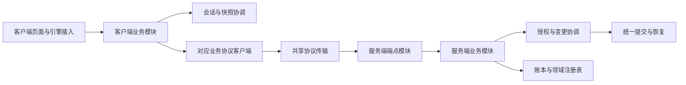

# partial 使用审计与模块拆分计划

目标是让 1.7 的业务模块拥有自己的状态和明确的依赖，逐步解除 `ClashOfRimMod` 与 `ClashOfRimNetworkServer` 的跨文件私有成员耦合。当前 `partial` 拆分主要改善了文件浏览，没有建立模块边界。优先迁移会话、快照变更边界和事件流程，再按业务域完成迁移；保留已经统一的提交、恢复、状态转换和游戏对象流转算法。

审计基线为 `ee55d0b0` 加当时工作区，包括此前未提交的改动。初次审计只增加计划；后续实施状态见文末记录。以下 P2/P3 表示结构改造优先级，不代表新复现的功能故障。1.6 冻结内容不参与改造。

## 使用范围

扫描 `Source/`、`Tools/`、`ThirdPartyCompat/Source/` 的 946 个 C# 文件，排除 `bin/`、`obj/`、冻结版本和独立的 RimTest 子仓库。发现 30 个 partial 类型：生产代码 16 个类型、102 处分片声明、100 个文件；项目测试工具 14 个类型、52 处分片声明、42 个文件。第三方兼容包自身未发现 partial 声明，但依赖主客户端兼容 API。

统计使用 Roslyn 语法树，按命名空间和外层类型识别同名嵌套类型。行数是类型声明范围，包含空行和嵌套类型；嵌套 Fixture 与外层测试类的行数不能相加。字段数包含常量和 readonly 字段，不含属性；readonly 集合的内容仍可变。跨分片引用按可解析的符号统计，是已确认的依赖，不是完整运行时调用图。[完整类型和文件清单](partial-module-inventory-2026-10-17.json)保存本次基线。

| 生产类型 | 分片 | 类型行数 | 字段 | 已确认跨分片访问的字段 | 处理方向 |
| --- | ---: | ---: | ---: | ---: | --- |
| `ClashOfRimMod` | 23 | 21,159 | 122 | 101 | 按会话、快照和业务域分配状态所有权 |
| `ClashOfRimNetworkServer` | 43 | 17,352 | 12 | 4 | 宿主装配、HTTP 端点与业务服务分离 |
| `ClashOfRimMultiplayerWindow` | 2 | 3,994 | 132 | 68 | 按页面拆视图及编辑状态 |
| `ClashOfRimModNetworkClient` | 2 | 3,043 | 86 | 3 | 共享传输层加各域协议客户端 |
| `ClashOfRimCompatibilityApi` | 6 | 2,474 | 52 | 44 | 保留公开门面，注册生命周期与各能力存储分离 |
| `BiotechCompatibility` | 10 | 1,808 | 38 | 17 | 按物品元数据、pawn、远程地图等能力组合 |
| `BankLoanRegistry` | 2 | 983 | 15 | 5 | 保留单一账务写入边界，收回同一类型文件 |
| `ServerShopRegistry` | 2 | 717 | 9 | 5 | 保留库存与幂等记录的共同发布边界 |
| `SnapshotCommitService` | 3 | 683 | 5 | 4 | 日志存储、提交编排和业务应用分离 |
| `MercenaryContractRegistry` | 2 | 579 | 10 | 4 | 保留合同写入边界，收回同一类型文件 |
| `RemoteIdeoMaterializer` | 2 | 574 | 0 | 0 | 文化包加载与目录物化分离 |
| `ItemDeliveryItemSummary` | 1 | 81 | 0 | 0 | 删除无实际分片的 partial 修饰符 |
| `ModThingReferenceDto` | 1 | 78 | 0 | 0 | 同上，保持序列化契约 |
| `ModPawnExchangeAppearanceDto` | 1 | 25 | 0 | 0 | 同上 |
| `ModCrossMapPawnReferenceDto` | 1 | 21 | 0 | 0 | 同上 |
| `ModPawnExchangeIdentityDto` | 1 | 15 | 0 | 0 | 同上 |

服务端主类的字段全部是常量或 readonly 字段，不能据此认为它低耦合：它通过 `ClashOfRimNetworkState` 获取依赖。该状态类有 39 个构造参数、40 个直接声明的属性。网络客户端的 86 个字段中有 79 个 readonly 字段，包含大量路由定义，不能将它们全部视为可变业务状态。

## 主要发现

### A1 P2 客户端会话生命周期拥有各业务模块的内部状态

`ClashOfRimMod` 有 564 个直接声明的方法。`settings` 被 22 个分片访问，`manualSyncInProgress` 被 12 个分片访问，`eventStateLock` 被 11 个分片访问。退出逻辑逐一清除银行、雇佣、商店、世界、事件和聊天字段；其中事件锁还保护玩家列表、地图标记、交易订单和商店列表。新增一个业务状态，往往必须同步修改另一个文件中的退出流程。

依据：[字段集中声明](../Source/Client/Core/ClashOfRimMod.cs#L50)、[退出与跨域清理](../Source/Client/ClientNetwork/Runtime/ClashOfRimMod.SessionRuntime.cs#L330)。这使状态所有权难以检查，也让之前修复的迟到响应和切换会话隔离容易在新增路径中遗漏。

目标：`ClientSessionRuntime` 管理身份、会话代次和连接生命周期；`ClientSnapshotCoordinator` 管理上传事务和未确认本地变更。事件、银行、交易、商店等模块各自持有状态和只读快照。模块只接收会话视图、所需命令及调度入口；不接收整个 Mod、可随意改写的 settings 或全量 ClientRuntime。

复用 `ClientSessionWork` 的取消、发布锁和主线程动作所有权。第一阶段由新会话模块托管这些能力，不为每个业务创建独立会话代次。退出仍先使旧工作失效，再清理模块状态；账户、殖民地和 Game 对象的生命周期分别处理。

### A2 P2 服务端宿主和业务服务合并在一个静态类型

43 个分片共同组成 589 个方法的静态类。`MapEndpoints` 注册路由，`Bootstrap` 装配存储和宿主，其他分片直接执行授权、恢复、业务规则、快照提交、通知及成就登记。新提取的事件读取和银行上下文也仍依赖同一类型中的私有恢复及授权方法。

依据：[路由注册](../Source/Server/ClashOfRim.Network/Server/Core/ClashOfRimNetworkServer.cs#L88)、[宿主装配](../Source/Server/ClashOfRim.Network/Server/Core/ClashOfRimNetworkServer.Bootstrap.cs#L17)、[全量状态依赖](../Source/Server/ClashOfRim.Network/Client/ClashOfRimNetworkState.cs#L9)、[事件读取上下文](../Source/Server/ClashOfRim.Network/Server/Core/ClashOfRimNetworkServer.EventReadContext.cs#L8)。

目标：宿主只装配服务；各域 `Map…Endpoints` 负责 HTTP 绑定和协议响应；业务服务使用构造参数声明所需账本、注册表、授权、提交和通知能力。`ClashOfRimNetworkState` 可暂时保留为宿主与旧测试的装配容器，但新业务模块不得把它作为全量依赖入口。

不能把当前私有方法统一改成 public static 后互相调用。每迁移一个域，旧入口只能单向转发给新服务，新服务不能直接调用旧主类完成业务。基础设施迁移所需的临时适配器单独列名并限定退役阶段，不能成为长期模块接口。

### A3 P2 恢复边界和提交流程的所有权仍跨主类与服务

`EnterRecoveredSnapshotMutation` 掌握准备前授权、锁外恢复准备、重新加锁、授权复验和嵌套锁规则，但它是服务器主类的私有方法。它随后以多项注册表和回调调用 `SnapshotCommitService.Recover`，回调又回到主类中的上传后处理和确认计划。`SnapshotCommitService` 虽然只有 683 行类型代码，却承担日志读写、待办缓存、回执、恢复准备和多种业务提交。

依据：[统一恢复边界](../Source/Server/ClashOfRim.Network/Server/Core/ClashOfRimNetworkServer.SnapshotCommits.cs#L15)、[恢复回调装配](../Source/Server/ClashOfRim.Network/Server/Core/ClashOfRimNetworkServer.SnapshotCommits.cs#L80)、[提交与恢复入口](../Source/Server/ClashOfRim.Network/Server/Services/SnapshotCommitService.cs#L103)。

先把现有变更边界提取为 `SnapshotMutationCoordinator`，保留原控制流程，再逐步让日志存储和业务应用拥有独立职责。提交协调器继续唯一持有 pending/applying 状态；日志存储不另建第二份待办缓存。业务变更优先复用现有 `TradeSnapshotMutation`、`SupportSnapshotMutation`、`PendingSnapshotOperations` 等类型。

当前日志版本 1–12、磁盘目录、恢复顺序、回执优先重放及原子提交必须保持兼容。模块迁移阶段不同时更换日志格式、不拆分全服变更锁、不新增第二套提交模板。已统一的 `PersistNewIntent` 和 `LedgerBatch` 应继续共用。

### A4 P2 网络传输与临时登录生命周期混在协议客户端中

`ClashOfRimModNetworkClient` 的 105 个方法覆盖几乎所有业务。`SetupAuthentication` 分片可直接访问 HTTP 客户端和凭据上下文，并负责创建临时会话及 finally 登出。这种行为属于会话租约的生命周期，不应由各业务客户端分别复制。

依据：[客户端主体](../Source/Client/ClientNetwork/Runtime/ClashOfRimModNetworkClient.cs#L18)、[临时认证生命周期](../Source/Client/ClientNetwork/Runtime/ClashOfRimModNetworkClient.SetupAuthentication.cs#L9)。

目标：共享 `ProtocolTransport` 继续负责实际序列化、请求头、取消、错误映射及 multipart；各域客户端只构造对应请求；`SetupAuthenticationLease` 管理临时登录和所属会话释放。现有客户端可暂时作为转发门面。只读和写入请求都要保留原先的身份、快照绑定及 `ClientSessionWork` 约束。

### A5 P2 多人窗口拥有跨页编辑状态并直接调用整个 Mod

多人窗口合计 132 个字段，管理员分片可访问其中的大量字段，并通过整个 Mod 读取配置、修改业务和控制刷新。窗口关闭、切页、会话切换及异步刷新缺少页面级的状态所有者。

依据：[窗口主体](../Source/Client/Multiplayer/Windows/ClashOfRimMultiplayerWindow.cs#L19)、[管理员页入口](../Source/Client/Multiplayer/Windows/ClashOfRimMultiplayerWindow.Admin.cs#L17)。

目标：窗口保留布局、页签选择和页面对象的生命周期；玩家、事件、交易、银行、商店、管理等页面分别持有自己的筛选、分页和编辑草稿。页面读取业务模块发布的只读状态，调用明确的业务命令。先建立业务模块，再移动页面，避免页面对象只是换个位置继续接收整个 Mod。

### A6 P2 兼容 API 的注册生命周期与各能力集合纠缠

六个分片共享 52 个字段，44 个存在跨分片访问。核心文件维护各类能力集合、优先级、顺序、注册令牌和清理动作，`ClearCompatibilityRegistrations` 明确列出所有能力集合。第三方兼容包直接调用这一公开静态 API。

依据：[注册状态和代次](../Source/Client/ThirdPartyCompatibility/Api/ClashOfRimCompatibilityApi.cs#L16)、[跨能力清理](../Source/Client/ThirdPartyCompatibility/Api/ClashOfRimCompatibilityApi.cs#L444)。

目标：保留公开 API 签名作为兼容门面；一个 `CompatibilityRegistrationScope` 拥有 generation/token/priority/order 和注销生命周期，物品、pawn、远程地图和世界能力注册表分别拥有其集合及缓存。排序和注册去重继续复用现有统一逻辑。能力注册表不能各自创建不同的全局注册代次，也不能把公开 API 改为第三方必须访问的新实现类型。

### A7 P3 DLC 分片应按能力拆分而非按 DLC 名称继续聚集

`BiotechCompatibility` 的十个分片覆盖基因物品、繁殖来源、pawn、编辑器展示、远程地图和防御点。38 个字段中 28 个是常量，另外 10 个是 readonly，主要耦合在元数据键、辅助函数和反射缓存；它与客户端主类的可变状态问题不同。

目标：物品元数据编解码与匹配、繁殖来源、pawn 交换、地图清理分别成为具体能力组件；共享元数据契约保持唯一来源。UI 编辑和展示共同使用同一个编解码器。现有独立的 Biotech 世界配置和物品流转类继续复用，不回收进新“大 DLC 服务”。文化目录物化使用独立的 `IdeoPackageLoader` 加现有物化服务，加载器继续遵守 Scribe 与 Game 线程边界。

依据：[Biotech 元数据契约](../Source/Client/DlcCompatibility/Biotech/Trading/BiotechThingReferenceCompatibility.cs#L12)、[文化包加载](../Source/Client/DlcCompatibility/Ideology/Ideos/RemoteIdeoMaterializer.PackageLoading.cs#L12)。

### A8 P3 测试本身依赖私有成员名字和跨场景状态

`GameSuite` 有 15 个分片，`DomainCommands` 有 8 个分片；测试套件和桥接共享客户端、场景结果和反射辅助函数。部分客户端回归通过字符串定位 Mod 私有方法。直接重命名迁移会使这些测试失效，即使业务行为保持一致；若只更新名字，测试也未必能约束新模块边界。

依据：[场景调度及共享状态](../Tools/ClashOfRim.GameTests/GameSuite.cs#L15)、[桥接模块注册](../Tools/ClashOfRim.RimTestBridge/DomainCommands.cs#L23)、[私有调度方法定位](../Tools/ClashOfRim.Client.Tests/MainThreadDispatchTests.cs#L13)。

目标：桥接按账户、银行、商店、远程地图等注册独立命令处理器；命令名和行为保持稳定。Mod 私有业务反射逐步替换为显式命令和只读观察入口，仍走正式产品流程。保留游戏内部反射所需的集中适配器。`GameSuite` 拆成场景对象与有明确先决条件的 fixture；共享服务器和客户端生命周期，场景产物由明确的返回值或领域 fixture 传递。

### A9 P3 部分 partial 没有对应的模块拆分需要

五个 DTO/载荷类型只有一处声明，可直接删除 partial 修饰符。银行、雇佣和商店注册表的第二分片使用同一个 gate、缓存和持久化提交，是同一聚合的操作，不宜拆成可独立改写同一数据的服务。先把同一类放回一个文件；只有可独立验证的纯计算才提取为策略。

依据：[银行待确认批次操作](../Source/Server/ClashOfRim.Network/Server/Registries/Economy/BankLoanRegistry.PendingOperations.cs#L7)。减少 partial 数量本身不能替代状态和事务边界的改进。

## 目标边界

第一轮在现有程序集内建立具体类、私有状态和显式依赖，保持当前加载及打包方式。稳定后再评估是否需要独立项目；不把每个目录都变成 DLL。新名字表示职责方向，实施时优先复用现有服务及策略。

图中是调用方向；两端宿主负责创建和连接这些对象，不参与具体业务决策。

| 模块 | 唯一负责的状态或职责 | 可依赖的能力 | 不应取得的能力 |
| --- | --- | --- | --- |
| 客户端会话 | 身份、代次、连接、退出和重新登录 | 认证客户端、设置持久化、现有会话工作机制 | 直接清空所有业务模块的私有列表 |
| 客户端快照 | 上传事务、捕获、确认失败与重试、lineage 更新 | 会话视图、上传服务、主线程调度 | 银行或商店的界面状态 |
| 客户端业务模块 | 本域运行状态、命令及只读状态发布 | 会话视图、对应协议客户端、快照协调、具体游戏适配器 | 整个 Mod、全量 settings、其他域的可变集合 |
| UI 页面 | 当前页面的显示、选择和编辑草稿 | 本域状态和命令 | 直接管理网络会话或快照提交 |
| HTTP 端点模块 | 请求绑定、响应映射、路由和恢复元数据 | 本域业务服务 | 直接改写注册表或重新实现恢复流程 |
| 服务端业务模块 | 本域业务规则和调用顺序 | 明确的授权、变更协调、账本或注册表、通知能力 | 整个 NetworkState、静态主类私有助手 |
| 服务端提交协调 | 全局变更顺序、恢复、日志与回执发布 | 日志存储、快照存储、现有业务变更对象 | HTTP 对象和客户端 UI 状态 |
| 兼容能力注册表 | 本能力集合和缓存 | 统一注册生命周期和公共契约 | 其他能力注册表的内部集合 |

跨模块调用优先使用已有数据类型和少量明确端口。只有需要替换实现、隔离引擎或跨生命周期时引入接口；纯计算保留普通函数。跨域流程由用例或协调器发起，避免领域模块双向引用。禁止通过 `IServiceProvider`、`Func<ClashOfRimMod>` 或“包含所有服务的 Context”重新引入隐式依赖。

## 分阶段实施顺序

每个表项是一个阶段，可包含多个小提交。多业务阶段必须按列出的业务逐个完成，不能合成一次大搬迁。每个提交迁移实际实现和状态，补齐受影响的边界测试，测试通过后提交；新旧实现不并存执行。

| 阶段 | 拆分内容 | 依赖和完成条件 | 主要验证 |
| --- | --- | --- | --- |
| M0 | 固定协议、存档、路由、锁顺序及测试入口；建立迁移清单和边界约束 | 本次清单已完成；实施前加入只约束已迁移目录的依赖检查 | 实际 JSON 契约、注册路由和恢复元数据、冻结校验 |
| M1 | 服务端授权服务与 `SnapshotMutationCoordinator`，分别提交 | 直接迁移现有实现；协调器依赖明确的恢复端口，旧恢复逻辑仅允许由指定临时适配器接入 | MutationAuthentication、SnapshotJournalRecoveryPreparation、HttpSnapshotRecovery、SessionConnection |
| M2 | 服务端 `EventDeliveryService` 与事件读取端点模块 | 依赖 M1；登录复用队列读取端口，长轮询等待在锁外；投递继续单一 LedgerBatch | EventReadHttp、EventDeliveryBatch、DeferredEventDelivery、完整 NetworkSmoke |
| M3 | 客户端会话、快照事务、协议传输和临时认证租约，分别提交 | 统一所有权先于业务迁移；原 Mod/网络客户端只转发已迁移入口；保留一个会话代次与上传协调机制 | SessionPublication、MainThreadDispatch、重连测试、WorldSetupTransport、AdministratorSetupTransport |
| M4 | 客户端事件收取、事件状态和信件执行模块 | 依赖 M3；复用 ClientEventLetterPolicy、载荷读取器和确认流程；不再访问 Mod 的事件字段 | EventLetterPolicy、RaidSettlementPayload、延后选择、重复投递和会话替换 |
| M5 | 银行业务服务与客户端银行模块，服务端/客户端分开提交 | 依赖 M1/M3；银行读取、借款、偿还与债务边界明确，继续调用统一提交协调 | 银行上下文恢复、借款条款变化、经济幂等、快照中断、RimTest 银行矩阵 |
| M6 | 礼物、交易、商店，按域分别迁移两端 | 依赖事件/快照基础；快照、物品流转和拒收退回不复制算法 | GiftRejectionAtomicity、交易恢复/退款、复杂物品、商店全物品及压力场景 |
| M7 | 雇佣、支援、袭击、远程地图，逐域迁移 | 保留统一 pawn 流转和游戏地图加载器；领域模块不得相互持有可变状态 | 提交/证据/结算恢复、超时、支援死亡与归还、远程地图和飞船场景 |
| M8 | 账户、世界准备/同步、殖民地生命周期、管理、聊天、成就，逐域迁移 | 复用会话能力；世界生成、上传和进入游戏的主线程边界独立；路由装配从服务器主类退出 | 账户重建、世界覆盖率/难度/文化、权限、排行榜和成就实机场景 |
| M9 | 拆分 SnapshotCommitService 内的日志存储、回执及业务应用职责 | 业务模块已通过稳定提交入口接入；保留 pending/applying 的唯一所有者、日志 1–12 和现有 Apply 顺序 | 完整 Save 故障矩阵、历史日志恢复、重复恢复、回执优先、持久化重启 |
| M10 | 兼容 API 内部能力注册表、Biotech 组件、文化包加载器 | 外部 API 签名、令牌和顺序不变；旧门面仅转发 | 注册/注销/优先级、DLC 开关、复杂物品与 pawn、多语言文化、第三方兼容包构建 |
| M11 | 多人窗口拆页面；清理 Mod、网络客户端和服务器过渡门面 | 所需业务模块已就位；UI 不再接收整个 Mod，宿主只负责装配和引擎接入 | 页面刷新、编辑状态、切页、退出、重连及代表性 RimTest 功能流程 |
| M12 | 按域拆桥接和场景 fixture；合并内聚注册表；移除单声明 partial | 桥接适配随 M1–M11 同步更新，此步收尾清理；不另造一套业务实现给测试使用 | 全套回归、测试命令清单、第三方构建、1.6 冻结和模块依赖检查 |

M1 不一次迁移全部恢复业务。协调器只提取加锁、锁外准备、重入和复验控制流程；世界通知、管理员基线、殖民地删除和快照后处理暂由一个 `LegacySnapshotRecoveryAdapter` 实现明确的恢复端口。只有该具名适配器可转接旧主类恢复逻辑，业务模块不得依赖它或传入任意恢复回调。M5–M8 随对应业务迁移替换其协作对象，M9 结束前删除适配器及旧恢复入口。这样可以逐步迁移现有恢复链，避免把 M1 扩成全服业务重写。M3 不允许把原 Mod 作为 RuntimeContext 传给新模块。

## 每步验收标准

1. 新模块能在不构造完整 Mod/NetworkState 的情况下测试主要用例；构造参数只声明实际依赖。已有领域注册表继续拥有其缓存、锁和持久化。
2. 迁移的方法、字段和算法从旧 partial 中删除。必要的兼容门面仅转发，保留原因和删除条件，不再包含分支、重试、状态写入或领域规则。临时恢复适配器只保留尚未迁移的恢复职责，并在清单中逐项减少；不能将其算作完成了相应业务拆分。
3. 已迁移客户端目录不引用 `ClashOfRimMod.Instance`，服务端业务目录不引用 `ClashOfRimNetworkServer` 或全量 `ClashOfRimNetworkState`。装配、兼容门面和引擎补丁采用显式限定的例外，逐步缩减；不依靠通用服务定位器绕过约束。
4. 保持会话发布锁与缓存锁的顺序、全服变更锁及领域锁的顺序、恢复前后授权复验、重放优先、通知与成就的幂等，以及等待前释放变更锁。跨模块不传递可任意释放的锁对象。
5. 保持 HTTP 路由、JSON 字段与枚举值、存档字段、日志格式、第三方公开 API、Harmony 接入点和 RimTest 命令语义。测试从私有实现名字转向业务结果；引擎专属反射仍集中在适配层。
6. 执行本步定向测试及受影响的集成测试后提交；阶段收尾执行完整回归、第三方兼容包构建及冻结校验。涉及引擎生命周期的步骤追加 RimTest，不用编译成功代替游戏行为验证。

总体目标是生产业务类型不再使用 partial；职责内聚的单一类型归并到一个文件。测试中的 partial 逐步以场景和 fixture 组合替代，确有必要的生成代码才允许保留例外。完成度以状态归属、依赖方向和回归结果衡量，不以文件数或类名变化衡量。

## 验证基线与执行入口

最近一次运行时验证来自[事件协议修复](event-protocol-audit-2026-10-17.md)：Events 52 项、Save 136 组、Client.Core 8 组、客户端 42 项、完整 NetworkSmoke 和 77 个冻结文件通过。本轮是静态结构审计，没有将该结果作为模块迁移已验证的证据。

后续实施使用 `Tools/Test-Regression.ps1 -IncludeClient -RimWorldManagedDir E:/SteamLibrary/steamapps/common/RimWorld` 作为完整回归入口；客户端测试需要真实 1.7 游戏程序集。定向组沿用现有控制台测试程序，不能以 `dotnet test` 的空执行替代。RimTest 使用项目维护的 GameTests/Bridge 场景，保持主仓库之外的 RimTest 子仓库边界。

本计划承接[架构修复记录](architecture-remediation.md)第 5 项和[事件协议审计](event-protocol-audit-2026-10-17.md)的统一逻辑成果。实施从 M0 的剩余约束与 M1 开始；不重新实现已经修复的恢复、提交和账本算法。

## 实施记录

### M0 迁移契约与依赖检查

已固定 81 个实际 HTTP 协议端点的路径、方法和恢复所有权，其中 51 个端点显式拥有恢复。`ServerNotification` 是下行通知契约，不当作入站 HTTP 端点注册。`ModuleBoundaryTests` 从实际 ASP.NET 端点读取元数据，与迁移前契约比较；随完整 NetworkSmoke 自动执行，也支持 `--module-boundaries-only`。

`ModuleDependencyGuard` 检查新服务端 `Network.Modules.*` 类型的编译后成员、泛型参数、方法体调用和异步状态机，禁止依赖旧服务器主类、全量 NetworkState 或 IServiceProvider。签名、泛型和方法体违规样本验证检查器确实能拒绝越界依赖。当前尚无迁移模块，零类型结果仅表示约束已经接入；客户端模块加入时接入同一检查器。

验证：新约束及 81 个端点契约通过，Client.Core 8 组通过，1.6 冻结 77 个文件通过。日志：`LocalOnly/module-migration/m0.log`。尚未改动产品逻辑，下一步 M1 提取殖民地访问授权。

### M1a 殖民地访问授权

`ColonyAccessAuthorization` 已接管所有权、会话刷新、侦察/盟友观察、PvP 目标、袭击准备和袭击事件授权。构造依赖只包含令牌、会话、外交、准备记录、账本及当前 PvP 开关；旧服务器主类删除了这些决策实现，仅保留转发入口。盟友判定由现有外交注册表统一提供，事件参与方可见性提取为共享 `EventVisibility`，避免后续模块重新复制判定。

独立测试不构造 NetworkState，覆盖旧会话被替换、退出与过期、跨用户/殖民地拒绝、实时 PvP 配置、未结算袭击、观察者盟友范围、非玩家袭击和过期准备凭据。模块依赖检查现已实际检查 1 个产品类型，81 个 HTTP 端点契约保持一致。

验证：上述独立测试、完整 NetworkSmoke 及 Save 全部用例通过（日志 `LocalOnly/module-migration/m1a-direct.log`、`m1a-network.log`、`m1a-save.log`）。快照恢复协调器仍为下一项；M1a 不改变各端点的恢复归属。

### M1b 快照恢复协调

`SnapshotMutationCoordinator` 接管唯一的恢复循环：共享变更锁、恢复前后授权、锁外准备、嵌套调用、准备版本竞争和异常释放。`SnapshotMutationScope` 的 Monitor 重入与指标逻辑保持复用；`SnapshotCommitService.RecoveryPreparation` 直接实现准备端口，未增加第二套压缩或日志算法。旧 partial 只转发协调入口，原循环与嵌套结果类型已删除。NetworkState 只负责装配，未被新协调器引用。

过渡职责集中于 `LegacySnapshotRecoveryAdapter`：前置世界通知、管理员基线、殖民地删除，以及提交日志重放、快照后处理和雇佣事故恢复仍由旧领域实现执行。该适配器只转接具名恢复端口，新模块禁止直接引用它；这些业务尚未完成拆分，须随 M5–M8 缩减并在 M9 前删除适配器。现有调用继续共用同一把变更锁。

独立协调器测试覆盖三次授权边界、无需准备、锁外准备期间另一线程进入、嵌套锁归属、准备失效/失效异常/安装竞争后的重新捕获，以及授权、前置恢复、捕获、准备、安装和重放六处异常后的释放与重试。依赖检查覆盖 6 个产品及编译生成类型，81 个端点恢复契约不变。

验证：完整 NetworkSmoke、Save 136 组、Events 52 项、Client.Core 8 组、真实 1.7 程序集客户端 42 项、第三方兼容包构建及 1.6 冻结 77 个文件全部通过。日志：`LocalOnly/module-migration/m1b-network.log`、`m1b-save.log`、`m1-events.log`、`m1-core.log`、`m1-client.log`、`m1-third-party.log`。M1 完成，下一项为 M2 服务端事件投递与读取端点。

### M2 服务端事件投递与读取端点

`EventDeliveryService` 接管队列读取、长轮询、详情批次投递、投递租约到期和已删除来源的失败支援事件清理。它只接收授权、变更协调、快照、账本、通知、在线状态和玩家记录；`EventReadEndpoints` 只负责三个请求的绑定与响应映射，并保留对应恢复元数据。登录复用服务的租约维护与队列投影，不再自行构造队列。旧 `EventReadContext` partial 已删除，原主类/SessionWorld/RaidsDiplomacySupport 中对应实现也已删除。

完整批次仍先检查事件可见性，再维护和构造详情，最后通过一个 `LedgerBatch` 发布投递、接收与终态消费。长轮询在等待前释放变更锁，醒来后通过 M1 协调器复验会话与快照。共享 `EventVisibility` 提供唯一的参与方可见性规则，端点不复制授权或账本算法。

独立测试直接构造服务及其明确依赖，覆盖跨殖民地隔离、历史账户级事件、混合非法批次无副作用、重复下载、过期租约、恢复撤销会话，以及长轮询期间会话替换、快照更新、取消和正常唤醒。原延后投递回归改为调用服务，移除了对旧私有端点方法名的反射。模块依赖检查覆盖 16 个产品及编译生成类型，81 个端点契约保持一致。

验证：独立模块测试、完整 NetworkSmoke 和 Save 136 组全部通过。日志：`LocalOnly/module-migration/m2-network.log`（独立模块、完整 HTTP/WebSocket、持久化重启与事件回归）和 `m2-save.log`（完整恢复矩阵）。本阶段未改动游戏端生命周期；M1 的客户端、第三方构建及冻结验证仍对应相同客户端代码。下一项为 M3 客户端会话与快照基础边界。

### M3a1 客户端连接生命周期

`ClientSessionConnection` 已接管 WebSocket 连接的取消源、运行状态、替换、消息发布、连接丢失和资源收尾。原 Mod 删除 `presenceCancellation`、`presenceInProgress` 和异步连接循环，入口只转发连接请求；主菜单重置、退出、废弃和会话失效统一停止该连接。`ClientSessionStreamTransport` 只适配现有协议客户端，模块依赖窄流式接口，不接收 Mod、完整 settings 或全量协议客户端。Mod 保留界面文本映射和尚未迁移的事件/重连业务回调。

连接继续使用唯一的 `ClientSessionWork` 代次与发布锁。每条流同时校验会话代次和连接归属，拒绝旧流的迟到消息、失败状态和断线通知；收尾只释放自己的连接，覆盖会话在后台委托启动前失效的情况。取消和完成之间的资源竞争由连接自身管理，保留先取消旧流再开启新流的顺序。

客户端复用 M0 的编译依赖检查器，禁止 `Modules.*` 引用 Mod、完整 settings、全量协议客户端或 IServiceProvider，当前覆盖 14 个产品及生成类型。独立测试不构造 Mod 或 Game，包含有效性、恢复版本、同代次/跨代次替换、迟到事件与状态、正常关闭/取消/失败/异常/主动停止/退出、40 次停止与完成竞争，以及 64 次调度期间的会话替换。

验证：客户端 44 项、Client.Core 8 组、第三方兼容包构建和 1.6 冻结 77 个文件通过。实机先通过 core-features 42/42，随后复核并保留旧流取消先于新流打开的顺序，最终产物通过英语/法语 coverage50-french 14/14（含重载与会话重连），未执行项均为 0。最终包与实机输入记录的 DLL SHA256 均为 `5D8B182464DBDC2B01A0C09037B6C4979B27614BD9840443326B45AF744CF3F7`。日志位于 `LocalOnly/module-migration/m3a-client.log`、`m3a-core.log`、`m3a-third-party.log`；实机证据分别为 `G:/RimTestRuns/ClashOfRim-module-migration/20261017-020312-464b5314` 与 `20261017-020755-ab177dde`。

首次实机批次在开局前因测试助手误选原版 Steam 缺失提示的 Quit 按钮而退出，未计为连接验证。该测试问题已单独修复并保留失败证据，详见 [RimTest 断言原则](rimtest.md#断言原则)。

本步仅完成连接职责；登录身份、退出清理、原地重连用例、快照协调、协议传输和临时认证租约仍属于 M3 后续工作，不将剩余 SessionRuntime partial 视为已拆分完成。

### M3a2 客户端身份发布、过期与退出

`ClientSessionLifecycle` 接管当前会话标识、过期处理状态、登录身份规范化、凭据发布和明确退出。五个登录入口（手工登录、地图会话、存档恢复、观察入口、原地重连）统一调用身份发布；Mod 删除对应字段写入及重复算法，只保留供尚未迁移领域读取的会话标识门面。设置读写和 Logout 分别通过窄端口适配，模块不接收完整 settings、Mod 或协议客户端；身份变更通知统一更新兼容清单与管理员状态。

失效采用同一 `ClientSessionWork` 发布边界，并为已排入主线程的过期处理保留具体归属。新登录、退出或代次切换后，旧清理不能再清空凭据或弹出过期窗口；并发失效只取得一次处理权。身份替换停止旧连接，退出先取消旧代次、脱离连接和身份，再通知业务状态清理，最后写回空凭据。Logout 使用捕获的旧身份和令牌，完成或失败均不改写新会话。

独立测试不构造 Mod/Game，覆盖身份规范化与历史缺省字段、精确令牌/会话匹配、同代次与跨代次迟到清理、32 次并发失效、未建立流时的持久化凭据过期、身份替换/清空/退出停止连接、清理与持久化顺序，以及旧 Logout 的认证上下文、失败和迟到完成。客户端依赖检查覆盖 21 个产品及生成类型。客户端 45 项、Client.Core 8 组、第三方构建和 1.6 冻结 77 个文件全部通过。最终产物实机 core-features 42/42、account-core 22/22，未执行项均为 0；包含踢出/封禁后重连、远程观察、袭击、存档重载，以及两名玩家各自废弃和重建、旧债务隔离、新殖民地成就、全局商店与账户管理员角色保留。日志为 `LocalOnly/module-migration/m3a2-client.log`、`m3a2-core.log`、`m3a2-third-party.log`、`m3a2-rimtest.log`；实机证据目录为 `G:/RimTestRuns/ClashOfRim-module-migration/20261017-021631-d14cf64b`。最终包与两组实机输入记录的 DLL SHA256 一致：`DA9D040D87F5557EFA899681073C1FD2D8D10E64E1FE9412B4D538F752CEBC3A`。

本步没有把原地重连的准备、两次快照复验和临时登录清理宣称为已迁移；该用例、快照协调、协议传输和临时认证租约仍为 M3 后续工作。各领域退出清理目前由宿主订阅会话结束通知，随 M4–M8 各自迁移。

### M3a3 客户端原地重连用例

`ClientSessionReconnect` 接管重连准入、请求顺序、登录前后权威快照复验、返回身份校验，以及尚未接纳登录的所有权。旧 Mod 删除 `sessionReconnectInProgress` 与相应网络/业务分支。模块只依赖窄重连传输端口和 M3a2 会话生命周期；继续复用 `SessionReconnectSafetyPolicy`，不复制判定规则。宿主目前保留原同步门接入、主线程调度、界面呈现及尚未迁移领域的刷新接入；同步门在 M3 后续统一，领域刷新和界面随 M4–M11 迁移。

成功的网络准备不会立即发布身份或释放重连准入。主线程确认原 Game 仍存在、未出现本地原子变更、用户/殖民地/服务器/当前快照仍一致后，才通过会话生命周期接纳登录。等待主线程期间保留原手工同步占用；完成、取消和丢弃分支只释放自己的占用一次。新代次或同代次身份替换使旧准备失效，旧收尾通过具体尝试归属判断，不能清除新尝试。

尚未接纳的登录在身份不符、快照变化、异常、退出、主线程动作被丢弃时统一释放；迟到的成功登录先取得清理所有权，再检查当前归属，避免取消时丢失已创建的服务端会话。清理复用生命周期的释放及诊断入口。底层 `LogoutDetachedAsync` 与普通 Logout 共用同一请求实现，管理员初始配置清理也改用该入口；它使用独立且有时限的取消源，不再被已退出代次取消。公开 Logout 签名、路由和“用户/殖民地/会话 ID”连接凭据保持不变；身份不匹配时使用服务端返回的用户及会话，而非登录前的请求用户。

独立模块测试覆盖准入与延后接纳、16 种准备/登录/元数据失败、9 种主线程前状态变化、三个请求阶段的代次替换、清理期间的新身份/新尝试、丢弃与清理失败、重复完成和重复释放。实际 HTTP 客户端回归验证旧代次取消后仍能发出具有独立超时的 Logout，并检查实际路由及请求身份。客户端模块依赖检查覆盖 31 个产品及生成类型。客户端 46 项、Client.Core 8 组、第三方构建与 1.6 冻结 77 个文件全部通过。最终产物实机 core-features 42/42、英语/法语 coverage50-french 14/14，未执行项均为 0，涵盖踢出和封禁后重连、拒绝登录、远程观察、袭击结算、存档重载和跨文化世界设置。日志为 `LocalOnly/module-migration/m3a3-client.log`、`m3a3-core.log`、`m3a3-third-party.log`、`m3a3-rimtest.log`；实机证据位于 `G:/RimTestRuns/ClashOfRim-module-migration/20261017-023612-a12ab047`。最终包与两组实机输入记录的 DLL SHA256 一致：`60A0D491458586E833F08FEE7699A77113A1F28BDD32959EB0C0981300EE2066`。

M3 尚未结束：下一项为客户端快照与手工同步协调，之后迁移协议传输和初始配置等临时认证租约。此次只迁移重连用例，不将其余 SessionRuntime 业务视为已完成拆分。

### M3b1 同步协调与快照事务归属

`ClientSynchronizationCoordinator` 接管手工同步与快照上传的唯一准入状态、锁、事务序号和诊断。Mod 删除原始状态字段、同步锁及开始/结束算法，仅保留转发入口与游戏消息呈现。协调器继续使用现有 `ClientSessionWork` 代次与发布边界，锁顺序为会话发布、协调状态；模块不依赖 Mod、settings 或游戏对象。原地重连直接取得协调器的手工操作凭据，准备到主线程接纳期间保留占用，完成或丢弃后统一释放，宿主删除重复的释放函数。

所有快照事务入口返回具体 `Lease`，正常收尾只释放所捕获的事务。袭击开始、袭击结算和搬家上传到确认的交接不再传递“已开始”布尔值，改为传递实际凭据；搬家主线程动作被丢弃时也有明确的释放入口。重复释放、同代次重置后的迟到释放及旧会话回调均不能清除新事务。明确退出与权威袭击清理继续使用显式重置，普通请求不得全局结束上传。

手工流程尚未全部取得独立凭据：原有写入暂时通过具名 `SetLegacyManualInProgress` 转发，后续 M3b2 必须逐个迁移并删除该入口。该过渡端口不能清除已有快照或重连持有的手工操作；允许旧手工流程升级快照的参数，也不能接管拥有独立凭据的手工操作。只有显式传入其凭据才允许升级。未将这一过渡层计为手工同步拆分完成。

独立测试不构造 Mod/Game，覆盖手工与快照互斥、显式升级、旧手工兼容端口边界、跨协调器/失效凭据拒绝、同一凭据接续只开始一次、重复完成、同代次重置、跨代次回调和 32 轮各 16 个并发请求。重连测试改为实际占用协调器并检查释放；运输舱实机夹具改为取得真实准入，不再反射写入已删除的忙碌字段。模块依赖检查覆盖 37 个产品及生成类型。客户端 47 项、Client.Core 8 组、Events 52 项、第三方兼容包构建和 1.6 冻结 77 个文件通过。

最终产物实机 core-features 42/42、stability-transfers-core 22/22、relocation-core 16/16 全部通过，未执行项均为 0。覆盖重连、银行/商店/交易提交、重复远程观察、支援提前归还/拒绝/到期、袭击损失后重载结算，以及商队搬家和任务地点搬家后存档重载。实机证据为 `G:/RimTestRuns/ClashOfRim-module-migration/20261017-025437-64471fa3`；三组输入记录与最终包的 DLL SHA256 均为 `706CCBB8A3F672C7453FEE98CD4A5C3E96FC77DDC002256C1508F5CEAADFF531`。日志为 `LocalOnly/module-migration/m3b1-client.log`、`m3b1-core.log`、`m3b1-events.log`、`m3b1-third-party.log`、`m3b1-frozen.log` 和 `m3b1-rimtest.log`。运输舱夹具本次完成编译适配，其独立合成到达场景不在这三组矩阵中，不另计实机通过。

剩余手工入口、快照上传服务边界、协议传输和临时认证租约仍属于 M3 后续工作，尚未进入 M4。

### M3b2a 手工请求、银行准备与主线程交接

手工登录、事件读取/等待、外交、拒收和交易接单，以及银行借还款、欠款与雇佣准备，均改为通过协调器取得具体操作凭据。对应六个 partial 删除了全部 50 处手工同步布尔写入；银行和雇佣的五个快照提交入口也删除了宽泛的 `allowExistingManualSync` 接管。同步准备、异步报价、主线程执行和快照提交通过明确凭据衔接，异常或提前返回统一在 `finally` 释放；已升级到快照的旧准备凭据不再清理后续操作的忙碌状态。

协调器新增手工所有权转移和队列交接，先把占用交给后续动作，再调用宿主提供的排队端口。后台收尾不再释放等待主线程的雇佣/商队交易；队列丢弃、排队失败、动作异常、重复执行、同代次恢复与退出换代都由同一所有权检查处理。`Complete` 仅在仍拥有操作时执行对应收尾，银行/雇佣的状态清理不再脱离事务归属。普通只读请求和消息呈现保持原完成边界，不因排队显示一条消息而延长整个同步占用。

独立测试增加连续两次交接、同步准备接续、交接后升级快照、生产者/队列/快照各自完成、队列拒绝与动作/完成回调异常、重复丢弃和新会话的覆盖。模块依赖检查覆盖 38 个产品及生成类型；客户端 47 项、Client.Core 8 组、Events 52 项、第三方构建及冻结 1.6 的 77 个文件通过。复用五种现有语言的通用忙碌文案并建立语义对应的同步键。

实机矩阵新增商队现场交易与守卫购买，复用原交易编辑、真实远行队、菜单确认及银行现金夹具，不新增产品测试旁路。最终产品构建通过 core-features 43/43、bank-core 18/18，未执行项均为 0；包括商队货物与双方库存守恒、贷款逾期偿还、雇佣死亡欠款、守卫购买/重复购买、支援归还、袭击结算、存档重载与重连。

银行通过证据为 `G:/RimTestRuns/ClashOfRim-module-migration/20261017-031832-10c6438f/bank-core/20261017-032314-c6a526a2`，核心通过证据为 `G:/RimTestRuns/ClashOfRim-module-migration/20261017-033050-6a9b4a95/core-features/20261017-033056-178666f5`。两场输入记录与最终包的 DLL SHA256 均为 `FCD18BF4D25B923F8B7FE86042D5A96A1A66C55C57D0BB6D1EA0C9CF470BB956`；测试驱动在银行批次后修正了下述两处夹具问题，因此这些结果来自两个批次，不称作一次完整矩阵全绿。日志为 `LocalOnly/module-migration/m3b2-client.log`、`m3b2-core.log`、`m3b2-events.log`、`m3b2-third-party.log`、`m3b2-frozen.log`、`m3b2-rimtest.log`、`m3b2-core-rerun.log` 和 `m3b2-core-final.log`。

两个中间核心批次保留为失败证据：`20261017-031832-10c6438f` 的联盟用例读到了旧玩家列表，未等待本次刷新结束就发送请求，因同步占用被拒绝；`20261017-032716-d3ccb581` 已通过联盟与观察，但新增商队用例把对象句柄字符串直接传给要求引用对象的桥接入口，绑定阶段失败。分别补齐刷新完成等待与 `{ handle }` 参数包装后重跑，产品代码及业务断言未因这两次失败而改变；失败和未执行项不计入通过数。

M3b2 尚未结束：主菜单进入/恢复、世界准备与远程地图仍有 24 处手工布尔写入（含回调中的写入），随后还需移除过渡端口。银行在快照构建失败后的三个重建入口仍使用原 `CanRunManualSync` 资格检查；静态检查显示它可能拒绝自己保留的本地原子变更，需在 M3 后续统一本地准入时补复现，不能以正常借还款通过证明重建重试可用。快照上传边界、协议传输与临时认证租约仍待完成。

### M3b2b 主菜单与世界准备的操作交接

主菜单进入、世界底图下载、既有殖民地恢复及初始世界配置提交删除了全部 14 处手工同步写入。协调器新增异步交接入口，先转移占用，再通过现有 `ClientSessionWork` 启动后续请求；当前阶段只在仍拥有凭据时执行，完成或异常只释放自己的占用。下载到主线程、主线程到下一次下载，以及语言兼容提示的继续/取消都复用同一交接机制，删除了 `continuingAsyncFlow` 和两处重复 `finally` 清理。

语言提示等待期间仍占用当前操作；旧窗口重复继续或迟到关闭不能释放新操作。宿主在不显示窗口、已存在窗口或排队动作被丢弃时调用取消入口，窗口本身继续复用原来的关闭回调。初始世界配置无法取得准入时保留待提交标志，不再覆盖其他操作的同步状态。恢复存档的占用延续至快照验证和提交给现有内存加载器；引擎加载器及其完成回调的服务边界尚未在本步迁移。

独立测试覆盖异步请求到主线程交接、连续异步阶段、同步抛错、await 后失败、取消后的迟到完成，以及提示窗口取消/重复回调/新操作隔离。模块依赖检查覆盖 41 个产品及生成类型；客户端 47 项、Client.Core 8 组、第三方兼容包构建和 1.6 冻结 77 个文件通过。

最终产品构建通过 core-features 43/43 与 coverage50-french 14/14，未执行项均为 0。覆盖两个玩家首次建档、世界底图进入、错误密码与封禁/解除、存档恢复、重连，以及英语/法语兼容提示、50% 世界参数与区域格式。证据目录为 `G:/RimTestRuns/ClashOfRim-module-migration/20261017-034140-783e6a9a`；两场输入与最终包的 DLL SHA256 均为 `22A51FE9DA8E92A6712E87D16A1FC9D8FBA2E2D1B576B54500BBE5F04854CAFE`。日志为 `LocalOnly/module-migration/m3b2b-client.log`、`m3b2b-core.log`、`m3b2b-third-party.log`、`m3b2b-frozen.log` 和 `m3b2b-rimtest.log`。

本批核心场景有一次 `/world/colony-sites` HTTP 400：trace 中 B 返回主菜单为 `03:45:48.6557892 UTC`，服务器日志记录拒绝为 `03:45:48.6647051 UTC`。最终 SQLite 的 `world-configuration/player-colony-sites` 仍有 A、B 两条正确记录，客户端运行时门禁通过；现有日志没有请求拒绝的具体原因，不能据此断言只是正常取消。M8 世界登记迁移需补充退出期间在途登记的取消复现与诊断，当前不将该分支算作已验证。

M3b2 剩余远程地图的 10 处旧手工写入，以及相关快照入口的宽泛接管参数；完成这些迁移后才能删除协调器的过渡端口。M3 的本地原子变更准入与银行重建重试、快照服务边界、协议传输和临时认证租约继续保留在后续清单中。

### M3b2c 远程地图交接与旧同步入口退役

观察和袭击准备复用同步协调器的异步、主线程和引擎长事件交接。下载完成后仍保留操作占用，直到地图打开完成；袭击准备只凭当前操作的凭据升级到快照提交。删除了表示已转交主线程的布尔标志和重复收尾，以及结算失败、支援损失失败和超时分支对其他手工操作的清理。用于判断本地 pawn 变更是否需要收尾的状态仍保留，它与同步占用不是同一职责。

远程地图的最后 10 处手工同步写入已移除。`manualSyncInProgress` 只保留只读门面；协调器删除 `SetLegacyManualInProgress`、旧操作标记和 `allowExistingManualSync` 参数。袭击结算和搬家不能接管不属于自己的手工操作，普通请求也不能全局解除同步占用。退出和权威恢复继续通过具名重置入口清理。

模块测试覆盖下载、主线程、引擎队列和快照升级之间没有准入空隙，以及下载失败、排队失败、地图打开异常、丢弃、同代次重置、会话换代与重复回调。原 Events 测试通过源码字符串寻找旧私有方法和 `manualSyncInProgress = false`，此次先运行确认其已因 M3b2b 迁移失效，再移除该实现检查；客户端行为测试验证队列完成后首个自动快照能进入，迟到清理不会释放它，真实开局则由 RimTest 覆盖。Events 总数因此由 52 项变为 51 项，不将删除的检查计作通过。

首次实机矩阵 `G:/RimTestRuns/ClashOfRim-module-migration/20261017-035636-390d6a31` 的核心 43 项和搬家 16 项通过，但全 DLC 流转在 `support-state-early-return` 失败，后续六项未执行。独立状态观察确认唯一差异为已故恋人引用的 `dead` 从 true 变成 false：共用 pawn 恢复器收到 `OtherPawnDead` 后没有应用到关系占位对象。修复限定于占位 pawn，保留死亡状态并同步活跃/休眠世界 pawn 索引，不对真实本地 pawn 应用远端死亡声明，也不把较旧的存活声明当作复活命令。独立测试验证索引、重复应用、保留标记和不生成尸体；礼物与支援继续共用恢复器。

复核夹具还发现，设置复杂状态和商队出发分别取不同查询的第一名 pawn，不能保证测试对象一致。流转场景现在把夹具对象显式传入原商队流程，并固定增加已故关系引用，避免依赖随机开局人物。中间批次 `20261017-040646-01c40f8f` 因新增夹具缺少命名空间引用而构建失败，没有执行游戏用例；补齐引用后再运行，未放宽业务断言。

修复死亡状态恢复后的中间构建通过 core-features 43/43、stability-transfers-core 22/22、stability-transfers-dlc 22/22、relocation-core 16/16，未执行项均为 0。证据目录为 `G:/RimTestRuns/ClashOfRim-module-migration/20261017-040758-ead4a644`，四场输入记录的 DLL SHA256 均为 `BF096DC27FE610A642295753B7D44FEF313B1383CF69896390B84AC2C79CD141`。该构建尚未包含随后补齐的已有占位 pawn 活跃/休眠索引迁移，不能把本批 103 项称作最终构建全矩阵通过。

世界配置请求的退出竞态仍需追踪。首次核心批次 B 返回主菜单为 `04:00:42.2480588 UTC`，`/world/configuration/current` HTTP 400 为 `04:00:42.2695678 UTC`；中间全 DLC 批次及最终原版流转批次也记录了同一路径的 HTTP 400，后者时间为 `04:20:28.4725665 UTC`。客户端运行时门禁通过，但现有请求诊断没有拒绝原因，不证明它们一定是正常取消。与 M3b2b 的世界登记请求一起，在 M3 协议传输与 M8 世界生命周期迁移时补齐取消原因及响应诊断。

补齐世界 pawn 索引后的最终构建通过 stability-transfers-core 22/22 和 stability-transfers-dlc 22/22，未执行项均为 0。证据目录为 `G:/RimTestRuns/ClashOfRim-module-migration/20261017-041845-2a290ea1`，两场输入记录与兼容包构建后的产品 DLL SHA256 一致，均为 `9C3D6EC2921422C33B77DFD8F19C8A85F274889F6632F7703C60549BF68CAD14`。这两组覆盖固定的复杂 pawn 状态、死亡关系、三种支援归还、重复观察、袭击损失结算重载、存档恢复和重连；核心及搬家验证仍对应上一段明确列出的中间构建，不混算为最终构建的全量验证。

客户端 47 项、Client.Core 8 组、Events 51 项、第三方兼容包构建、模块依赖检查的 41 个类型和冻结 1.6 的 77 个文件均通过。日志为 `LocalOnly/module-migration/m3b2c-client-final.log`、`m3b2c-core.log`、`m3b2c-events.log`、`m3b2c-third-party-final.log`、`m3b2c-frozen-final.log`、`m3b2c-rimtest-verified.log` 和 `m3b2c-rimtest-final-transfer.log`。失效源码检查替换单独提交为 `8fc4c450`；死亡关系修复与确定性夹具单独提交为 `d2c631c9`，其余改动为本步同步归属迁移。

M3b2 完成，M3 整体尚未结束。下一项为本地原子变更状态与准入、银行重建重试，之后处理快照服务边界、协议传输及临时认证租约。通用事件确认入口也存在先允许当前原子操作、随后调用 `CanRunManualSync` 的相同模式，需与银行重建一并复现。远程地图的业务实现仍归 M7 迁移，本步只完成它对统一同步协调器的接入。

### M3b3 未确认本地变更与恢复准入

`ClientLocalMutationCoordinator` 接管未确认变更、状态快照、继续确认的准入，以及失败后的重试/退出决定。Mod 删除原先的三个变更字段和三个失败窗口字段；配置、待确认操作、权威快照的检查统一到一个模块方法，原来的两份额外准入算法删除。模块只接收配置及快照是否存在的值，复用 `ClientSessionWork` 发布边界，不依赖 Mod、完整 settings、游戏 UI 或全量协议客户端。会话退出由装配处订阅统一重置。

原来用翻译后的操作名称判断能否继续确认，现改为内部 `LocalMutationKind`，显示文本由 `ClientLocalMutationPresentation` 统一映射原语言键。礼物发送与落地、支援发送/到达/归还、袭击准备/恢复/结束等原有类别继续区分。该标识不写入 HTTP、存档或账本，不改变协议枚举。状态文字变化不会改变准入身份。

先保留失败复现，再修复银行借款、贷款偿还、欠款偿还三个重建入口，以及单事件确认的矛盾检查：先认可当前操作，随后调用普通同步检查又拒绝它。现在这些入口与批量事件确认、雇佣继续流程使用相同准入方法，并显式传入当前操作类别。银行失败窗口原本默认不开放重试按钮，本次没有扩大可重试错误范围，也没有将该内部重建缺陷表述为所有银行用户都能触发的 UI 故障。复现代码及失败日志分别保存在 `LocalOnly/module-migration/m3b3-reproduction.cs`、`m3b3-before.log`。

失败窗口绑定具体失败记录，排入主线程后再确认记录仍有效；重试或退出只能消费一次。重新开始、报告另一条失败、清理或会话换代会使旧决定失效，包括同类操作的替换。回调执行前先消费决定，回调里产生的新失败不会被旧收尾清空。窗口只显示当前记录并转发操作，不再读取全局可变的重试委托。

新增独立模块测试覆盖所有操作类别、配置/快照前置条件、状态文本变化、只读快照、禁止重试、重复与并发决定、同类替换、重置、回调异常及旧会话迟到工作。另有五条现存调用方集成路径，覆盖三个银行重建和单个/批量事件确认：只替换引擎序列化与语言显示，实际执行准入、恢复回调及同步占用，确认能进入构建，构建失败后仍阻止其他变更且不泄漏同步占用。这组桥接仍反射尚未迁移的 Mod 私有入口，随 M4/M5 转为领域模块调用；它不等同于完整网络断线重试的实机验证。运输舱测试夹具改用模块操作代替直接写私有布尔字段，其独立合成到达场景仍未计入本次实机覆盖。

本步完成本地状态及准入算法的归属迁移，尚未完成全部快照编排。继续准入仍沿用原有的操作类别语义；各业务完成/撤销的调用仍由旧领域流程发起，不能据此宣称每笔业务已经持有独立的原子变更凭据。下一步 M3 迁移快照捕获、上传及结果发布边界，随后处理协议传输和临时认证租约；M4–M8 再逐域移出确认及业务执行流程。

验证：客户端 49 项、Client.Core 8 组、Events 51 项、第三方兼容包构建和冻结 1.6 的 77 个文件均通过；客户端模块依赖检查覆盖 47 个产品及生成类型。日志为 `LocalOnly/module-migration/m3b3-client.log`、`m3b3-core.log`、`m3b3-events.log`、`m3b3-third-party.log`、`m3b3-frozen.log`。初次编译发现遗漏的支援到达及商店操作参数，集成夹具首次运行又发现引擎序列化方法存在重载；补齐类型迁移并明确测试重载后重跑通过，未放宽行为断言。

同一最终构建通过 core-features 43/43、stability-transfers-dlc 22/22、bank-core 18/18、relocation-core 16/16，共 99 项，未执行项均为 0。覆盖核心经济交互、全 DLC 复杂状态流转、三类支援归还、袭击损失重载结算、银行连续逾期惩罚/罚息及死亡欠款、余额不足/重复偿还保护、商队/任务地点搬家，以及各场重载和重连。证据目录为 `G:/RimTestRuns/ClashOfRim-module-migration/20261017-043912-a0574196`，四场输入记录与最终包的 DLL SHA256 均为 `7718D26D85FBC8628A6D22C4DD775BF4BB20D7747757D04CBC921993D9814B8E`；执行日志为 `LocalOnly/module-migration/m3b3-rimtest.log`。

核心批次再次记录 `/world/configuration/current` HTTP 400，现有诊断仍不包含请求被拒绝的具体原因。实机矩阵通过只证明已列出的业务断言及客户端运行时门禁通过，不关闭此前 M3/M8 的退出在途请求诊断追踪项。M3b3 完成，M3 整体仍未结束。

### M3b4a 普通快照上传编排与游戏发布

`ClientSnapshotUploader` 接管普通上传的身份捕获、游戏快照捕获调度、成就候选合并、打包、网络上传及接受结果发布。只依赖快照状态存储、绑定 Game 的捕获/发布端口、单一上传传输端口及既有同步协调器。游戏引擎、设置读写和 HTTP 客户端均留在具名适配器中；打包和存档清理继续复用原实现。公开 `ModSnapshotUploadService` 的构造函数和两种上传签名保留为装配、转发和显示结果转换门面，原编排实现删除。八处内部调用传入自己已取得的快照占用。

上传服务原来的静态 `SemaphoreSlim` 已删除。公开调用等待既有 `ClientSynchronizationCoordinator` 的同一准入，内部调用延续已有占用；一个占用同时只能执行一次上传。等待信号在检查准入前捕获，释放及重置唤醒等待者；取消等待不释放别人的操作。游戏 Mod 与公开兼容入口由 `ClientSnapshotComposition` 使用同一个协调器，模块测试则显式构造独立协调器，不通过全局设置或 Mod 实例寻找依赖。

每次上传绑定发起时的 Game，并保留具体会话代次与身份。排队后的合法上传读取前一笔已接受的快照谱系；等待中换账号、处理过程中换凭据/谱系、会话换代或占用失效则取消。旧 HTTP 成功或失败都不能作为新身份的结果发布。直接传入的成就候选在开始时复制，队列候选与游戏存档在同一主线程动作中捕获，继续保留原去重顺序及待办清理规则。

接受响应后的设置谱系、游戏谱系、已提交成就和设置持久化统一排入绑定 Game 的主线程动作。上传任务等待该动作完成后才返回成功，期间持续保有同步占用；替换 Game、丢弃或取消时不把成功状态发布到新游戏。此前是先在后台更新设置、排入游戏动作后立即返回成功，本步消除了这段结果已返回而游戏尚未同步的间隙。发生引擎或持久化异常时沿用失败传播，不把已发生的服务器提交描述为已回滚。

新增独立上传测试覆盖真实打包内容、身份与谱系、成就去重与捕获、缺省响应、配置/存档/网络/拒绝分支、等待和借用占用、同凭据并发调用、主线程延迟与丢弃、Game/身份/谱系/会话替换、各阶段取消及发布异常。模块依赖检查进一步禁止直接访问游戏组件、语言显示以及 Verse/RimWorld/UnityEngine 类型。公开兼容入口也验证等待同一手工操作且取消不影响它。

本步只完成普通上传服务边界。Mod 内的同步 `TryBuildCurrentGameSnapshotPackage` 和专用事件/经济确认编排仍需继续移出，不能将普通上传服务迁移计作全部确认事务已经模块化。M3 仍需收尾这些快照基础入口、协议传输及临时认证租约；领域确认回调随 M4–M8 逐域迁移。

客户端最终 50 项、Client.Core 8 组、Events 51 项、第三方兼容包构建和冻结 1.6 的 77 个文件通过；模块依赖检查覆盖 64 个产品及生成类型。64 个并发等待者验证串行执行、全部完成及无漏唤醒，重置后旧收尾不会释放被唤醒的新上传。日志分别为 `LocalOnly/module-migration/m3b4-client-final.log`、`m3b4-core.log`、`m3b4-events.log`、`m3b4-third-party-final.log`、`m3b4-frozen-final.log`。

扩展实机批次 `G:/RimTestRuns/ClashOfRim-module-migration/20261017-045903-bef182fa` 通过 core-features 43/43、stability-transfers-dlc 22/22、bank-core 18/18、relocation-core 16/16 和 gravship-all-dlc 16/16，共 115 项，未执行项均为 0。五场输入记录的产品 DLL SHA256 均为 `F829D0FD10DBDA6536084738FC83D7BA13EDE00108A722313378A5802FC62E0D`，日志为 `LocalOnly/module-migration/m3b4-rimtest.log`。除原有核心、银行和流转检查，还验证全 DLC 飞船飞往新地图/任务地点、原 pawn 与货物保留、贷款保留及着陆后偿还、重载和重连。

复核发现公开上传的等待循环使用会记录拒绝诊断的尝试入口，虽然最终会正常取得占用，等待却被误记为失败。修订为在发布边界内确认空闲后才进入已有取得流程，并通过竞争测试断言普通等待不产生拒绝通知。上段 115 项对应修订该诊断之前的中间构建，不称为最终产物全矩阵验证。全 DLC 飞船批次仍出现 `/world/configuration/current` HTTP 400；其拒绝原因仍需在 M3 协议传输/M8 世界生命周期阶段验证。

最终产物另行通过 core-features 43/43，未执行项为 0。证据目录为 `G:/RimTestRuns/ClashOfRim-module-migration/20261017-051100-3904204d`，实机输入与最终包的 DLL SHA256 均为 `4E099C6F73A893E2A080CAE002E10B66A54AA546FA5FF5F88B1AF0868C7F9866`，日志为 `LocalOnly/module-migration/m3b4-rimtest-final.log`。该批再次出现上述世界配置 HTTP 400，未关闭诊断追踪项。M3b4a 完成，M3 整体未完成；同步捕获入口迁移时还需验证无 Game 的公开调用能否及时结束，当前端口测试的无 Game 分支不能代替实际游戏队列的验证。

### M3b4b 共享捕获、打包与接受结果发布

`ClientSnapshotPreparation` 接管同步捕获与打包，只依赖绑定 Game 的快照端口；`ClientSnapshotPublication` 接管设置谱系、游戏谱系、提交成就和持久化的共同顺序，只依赖快照存储及游戏端口。普通上传也调用这两个模块，捕获仍在主线程，普通上传的压缩打包仍可在捕获后执行。原始存档序列化、打包、成就队列清理和游戏谱系写入均复用现有实现，没有新增并行算法、缓存或准入机制。

Mod 中 `TryBuildCurrentGameSnapshotPackage`、`PersistAcceptedSnapshotLineage` 的实现与声明删除，17 处准备入口和 14 处发布入口直接使用装配好的具体模块。覆盖银行/雇佣、单个及批量事件确认、交易、商店、支援和袭击归还。业务仍负责自己的主线程确认回调、占用和失败恢复；模块不接收整个 Mod，不把尚未迁移的业务回调计为完成了 M4–M8。领域确认保留存档内待提交成就，普通上传只清除本次随请求提交的队列；取消捕获继续传播取消，不转换成可重试的存档失败。空或空白返回令牌统一视为缺省，保留既有令牌；普通上传缺少接受快照 ID 时沿用本次包 ID，避免返回成功却跳过发布。

实际公开上传入口复现了无 Game 时滞留的问题：设置已配置、程序停在主菜单，上传把验证动作排入游戏组件队列；只泵送实际入口队列时任务没有结束，同步占用持续保留。修复前失败日志为 `LocalOnly/module-migration/m3b4b-before.log`。现于取得上传占用和入队前检查已绑定的 Game，无 Game 直接返回 `UntrackedSaveFile` / `NoRunningGame`。回归使用真实公开门面、真实游戏适配器和入口队列，仅替换本地化，覆盖两种公开重载及有/无旧快照，不靠取消或创建新游戏完成请求。

独立模块测试增加领域打包的真实压缩内容、元数据、待办保留、捕获失败/异常/取消和非法 XML，以及发布顺序、空快照无写入、缺省令牌和不消费成就。银行重建集成测试改为通过模块装配入口，继续只替换序列化与显示，不替换产品的重试和准入流程。客户端 50 项、Client.Core 8 组、Events 51 项、第三方兼容包构建、冻结 1.6 的 77 个文件通过；模块依赖检查覆盖 66 个产品及生成类型。日志前缀为 `LocalOnly/module-migration/m3b4b-`。

实机批次 `G:/RimTestRuns/ClashOfRim-module-migration/20261017-052246-0d1ea017` 的核心 43/43、全 DLC 流转 22/22、搬家 16/16 通过，三场均无未执行项。银行场景则通过 13 项，在 `bank-mercenary-debt` 失败，后续 4 项未执行，因此整个首轮矩阵失败，不能记为 99 项全通过。失败发生在雇佣死亡欠款的首次逾期处罚：本地任务的处罚次数和下一期限已更新，但机械族 pawn 数量仍为 0，客户端显示 `OverdueRaidFailed`；没有捕获或发布失败记录。

为保留后续定位证据，提交 `8316a47e` 给测试桥接增加 `BankRaidObservation`，只观察原袭击执行器、步行入口选择和实际 pawn 数量，不替换返回值、不改变随机数或放宽断言。诊断复测 `G:/RimTestRuns/ClashOfRim-module-migration/20261017-053505-e98912bc` 的银行 18/18 通过且无未执行项，原 4 个未执行用例也完成；两次贷款处罚分别生成 1 个机械族 pawn，欠款处罚生成 4 个，入口选择均成功。两批所有实机输入与最终产品 DLL SHA256 均为 `7ED17FCB8F8AAACC419CAB26A9C9A0604B33BF67F95BFAEB126C788628CBB952`；第二批只更新测试桥接和失败诊断，产品代码未再修改。执行日志为 `m3b4b-rimtest.log`、`m3b4b-bank-diagnostics.log`。

复测成功不等于解释或修复了首轮袭击生成失败。该问题仍开放，留到 M5 银行模块阶段继续复现并区分派系解析、入口选择与 pawn 生成分支，不能据此认定与本次重构相关或无关。静态检查的是本地 1.7 `Assembly-CSharp.dll`（SHA256 `eff7d97949f919fb2b151ebfb906e9be749b63410b7dbda78eeebb7972b245c3`）：REA 记录 `ev_6fc529c145774af2271351edd8953f176ef7f659cff6b896f9185ac078a41332` 因元数据表示预算而仅有部分覆盖，后续分支检查使用现有 ILSpy，本地证据保存在 `LocalOnly/module-migration/m3b4b-*.cs`。这些静态分支不能替代失败当时的执行轨迹。

M3 仍需迁移共享协议传输和临时认证租约。既有公开打包器仍自行生成部分本地化失败消息，本步保持其契约；后续要将打包错误数据与显示转换分离，当前依赖检查只证明模块没有直接使用引擎类型，不证明下游基础设施全部独立于引擎。服务端存档下载/装载的谱系设置属于账户与世界进入流程；袭击结算对已捕获存档的业务变换属于远程地图流程，分别留待 M8、M7，不能混同于本步移出的当前游戏捕获入口。既有世界配置 HTTP 400 拒绝原因仍需在协议传输和世界生命周期阶段追踪。

本轮全 DLC 流转场景再次记录世界配置 HTTP 400，仍不关闭诊断追踪项。M3b4b 的模块迁移完成；M3 整体未完成，银行首次失败及后续成功证据均保留。

### M3c1 共享 HTTP 传输与 JSON 编解码

`ClientProtocolTransport` 接管 JSON GET/POST、二进制下载和 multipart 上传，共用一条发送、错误映射和资源释放流程。构造参数仅有调用方拥有的 `HttpClient`、不可变连接身份上下文，以及读取语言和报告诊断的窄环境端口。传输层不拥有账号设置或业务状态，不创建第二个会话代次，也不释放调用方的 HttpClient。原网络客户端的四个私有发送实现删除，现有业务入口只在构造请求后调用传输模块；各域请求构造仍留待业务模块阶段迁移。

`ClientProtocolJson` 保留 DataContract JSON、字段名及简单字典格式。引擎语言读取、本地化解码失败消息、会话过期通知接线和 multipart 释放警告移入 `ClientProtocolEnvironment`，模块不直接访问 Verse 或完整网络客户端。JSON 命令继续由 DTO 携带认证，二进制下载及 multipart 继续携带既有认证头；相对路由保留基地址的路径前缀。每次调用读取当前语言，并使用已有语言头编码算法。现有 WebSocket 消息读取使用同一 JSON 解码器和环境适配器，但其收发/心跳/关闭循环尚未迁移，不能计作流传输已完成。

传输边界测试先复现了快照下载取消遗漏：收到响应头后，成功响应的字节读取和失败响应的文本读取都未传入请求取消令牌，取消后任务仍等待正文。修复前日志为 `LocalOnly/module-migration/m3c1-before.log`。现在发送、成功正文及错误正文读取使用同一个调用方/会话联合令牌，忽略取消的迟到响应也不能继续作为成功返回。独立登出仍显式脱离会话取消，只服从自己的清理超时；没有将该例外推广到普通请求。

公共传输失败继续使用既有异常名和 HTTP 状态/原因/正文格式，业务 `Accepted=false` 仍由调用方解释；JSON 请求的 I/O 异常现在与二进制及 multipart 一样返回明确失败，而非漏出这类异常。请求及响应资源各自释放，原 multipart 的 NullReferenceException 释放容错保留且可观察，不推广成吞掉其他异常的通用保护。会话过期的中英文文本识别保持现有回退行为；它不是新的强类型协议，后续仍需以服务端明确的错误码替代，不能将单纯搬迁视为语义缺陷已修复。

客户端 51 项、Client.Core 8 组、完整 NetworkSmoke（HTTP、WebSocket、持久化重启、快照和事件流程）、第三方兼容包构建及冻结 1.6 的 77 个文件通过。独立模块测试覆盖四类实际请求内容、Unicode/字典字段、认证及语言头、HTTP/协议/解析/I/O 失败、原凭据归属、成功文本不误报过期、调用方与会话取消、独立清理、资源释放及 caller-owned HttpClient 的复用；模块依赖检查覆盖 76 个产品及生成类型。NetworkSmoke 首次从仓库根目录执行因缺少 `Localization` 目录而在启动前失败，改在 `Tools/ClashOfRim.NetworkServer` 执行后通过，未修改产品来规避环境要求。对应日志为 `LocalOnly/module-migration/m3c1-client.log`、`m3c1-core.log`、`m3c1-network-final.log`、`m3c1-third-party.log` 和 `m3c1-frozen.log`。

实机批次 `G:/RimTestRuns/ClashOfRim-module-migration/20261017-054736-5868e355` 通过 core-features 43/43、coverage50-french 14/14，共 57 项，未执行项均为 0。覆盖核心经济、物品/pawn 流转及袭击结算，另验证法语显示、fr-FR 文化、50% 世界覆盖率、世界/难度参数、存档重载和重连。两场输入记录与最终包的 DLL SHA256 均为 `7281CCA52B779EE1686E45A9FEA609D76BA1237B2B649A26CE5FEC550C220BD6`；日志为 `LocalOnly/module-migration/m3c1-rimtest.log`。

本批没有世界配置 HTTP 400 记录，但不据此关闭此前追踪项。源码进一步确认 `GetWorldConfiguration` 业务处理函数的显式返回均使用 `Results.Ok`，所以既往 400 不能直接解释为这些业务分支的拒绝；仍需请求绑定、取消和中间件层的实际证据。M3c1 完成。下一步继续移出 WebSocket 收发及关闭生命周期，再处理临时认证租约和打包错误/显示分离；M3 整体及后续 M4–M12 仍未完成，银行袭击生成的首轮失败也仍开放。

### M3c2 WebSocket 流传输与关闭生命周期

`ClientSessionWebSocketTransport` 接管 URI/查询参数、心跳、分片接收、JSON 解码、事件发布和连接关闭。它直接实现既有 `IClientSessionStreamTransport`；Mod 装配会话协调器和具体流模块，删除原先创建 HttpClient 再回调完整网络客户端的 `ClientSessionStreamTransport`。公开 `StreamSessionAsync` 保留签名和未配置结果，只转发到同一模块。原循环、URI 和收发助手从旧 partial 删除，没有保留两套实现。

新模块只依赖 WebSocket 创建端口、语言/解码提示元数据和现有会话工作机制。引擎语言读取仍位于适配层；HTTP 与流传输复用 `ClientProtocolMetadata`、已有语言头编码和 `ClientProtocolJson`。路由仍来自协议清单，查询中的用户、殖民地、快照、会话及版本字段保持原有语义；版本号使用 invariant 格式。没有新增认证字段或另建会话代次。事件同步发布使用既有会话发布边界，取消或会话替换后的迟到读不能调用订阅者。

先把原循环机械移到可控 WebSocket 端口，再运行故障测试，复现了心跳任务失败后接收仍等待、调用方取消后清理进入无期限 CloseAsync 两条控制流，日志 `LocalOnly/module-migration/m3c2-before.log`。这是依赖边界下的故障注入证据，不代表两条路径均已在实机 ClientWebSocket 中复现。现在任一方向结束都会收束并等待另一方向，保留首个失败并观察清理中的次要失败。取消直接中止连接；正常收到对端 Close 后只发送 CloseOutput 回复，默认五秒截止；超时返回明确失败并释放资源。空/非法 JSON 仍按共享解码器分类，二进制帧明确拒绝；原有 pong/keepalive 过滤和未知业务事件转发保持不变。

新增模块测试覆盖 URI 转义、基础路径、ws/wss、语言头、可选字段、文化变化下的版本号、UTF-8 字节内分片、事件顺序、心跳报文、接收/发送/连接失败及同时失败、正常关闭、阻塞发送取消、关闭超时、调用方取消、会话重置、迟到连接/消息、订阅者异常和连接协调器收到失败后的失联通知。失败测试中的套接字状态和截止时间可控，正常清理后验证没有未完成的收发。客户端 52 项、Client.Core 8 组、完整 NetworkSmoke、第三方兼容包构建及冻结 1.6 的 77 个文件通过；模块依赖检查覆盖 86 个产品及生成类型。日志为 `LocalOnly/module-migration/m3c2-client.log`、`m3c2-core.log`、`m3c2-network.log`、`m3c2-third-party.log` 和 `m3c2-frozen.log`。

实机批次 `G:/RimTestRuns/ClashOfRim-module-migration/20261017-060618-56583a5f` 通过 core-features 43/43、coverage50-french 14/14，共 57 项，未执行项为 0。覆盖管理员踢出重连、封禁/解封、普通重连、存档重载和法语/fr-FR 下的世界、难度、文化同步；两场输入与最终包的 DLL SHA256 均为 `C4D96689A6EA302DBCF6D8E1C629CFF955A04AC03C7DF08C286877F3FA302216`，日志 `LocalOnly/module-migration/m3c2-rimtest.log`。核心场景记录一次 `/world/configuration/current` HTTP 400，法语场景未记录；具体拒绝原因仍未知，继续跟踪 M3/M8 的在途世界请求问题。此前银行袭击生成的首次失败也仍开放。

M3c2 完成，M3 整体未完成。下一步移出临时认证租约，统一世界基底上传与管理员准备的登录/释放顺序，保留独立登出的会话归属与清理超时；随后处理打包错误与显示分离。M4–M12 的事件、经济、pawn/地图、世界账户、提交日志、兼容能力、页面和测试场景仍须逐域实施，当前不能把主类改为普通 class 即宣称模块拆分完成。
